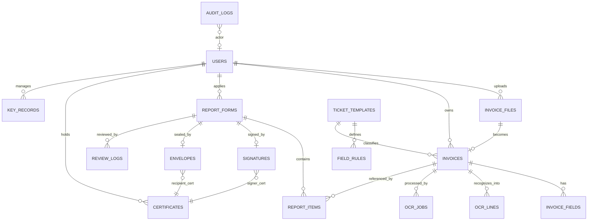
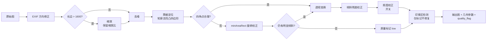
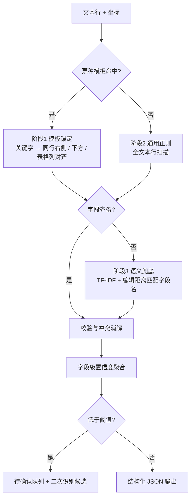
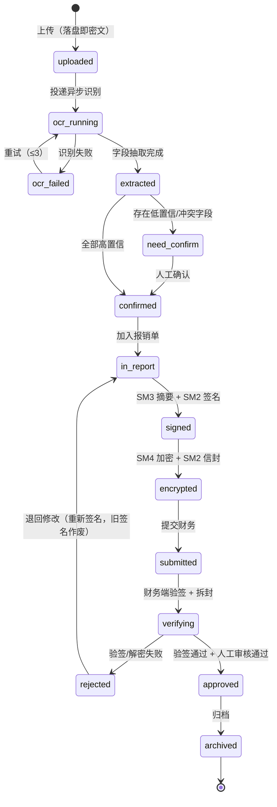

# 基于 OCR 的高校报销票据识别与加密系统
## 毕业设计完整方案（融合票据 OCR / 关键要素抽取 / 国密数字信封与签名的 Web 应用）

| 项目 | 内容 |
|---|---|
| 选题名称 | 基于 OCR 的高校报销票据识别与加密系统设计与实现 |
| 学生 | 计算机科学与技术 2023 级 许紫煜（2023317220429） |
| 指导教师 | 郭曦（副教授） |
| 目标用户 | 报销人（学生/教职工）、财务审核人员、系统管理员 |
| 文档用途 | 开题后方案细化、技术选型、开发排期、论文与答辩规划 |
| 版本 | v1.0（2026-11-18） |
| 与开题报告的关系 | 开题报告定"做什么"，本文档定"怎么做"。技术选型相对开题有 3 处调整，理由见 [4.3.2](#432-与开题报告的-3-处选型调整必须写进论文) |

> 阅读顺序建议：**第 0 章（一页速览）→ 第 2 章（范围边界）→ 第 4 章（架构与选型）→ 第 8 章（开发计划）→ 其余按需**。
> 时间紧的时候，只要第 0、2、8 章就能开工。

---

## 0. 一页速览（TL;DR）

**一句话定位**：以票据图片/PDF 为输入，用 OCR 把"看得见的票面"变成"可校验的结构化字段"，再用国密算法把"传得走的数据"变成"只有该看的人能看、且事后赖不掉"的密文与签名，最终形成一条**可运行、可评测、可解释**的报销票据处理链路。

**核心能力（6 条）**

1. **票据影像预处理**：EXIF 方向修正、去噪、四角点检测 + 透视校正、倾斜校正、照度校正、印章区定位。目的只有一个——把"手机随手一拍"变成检测识别模型能吃的图。
2. **版面分析与文本检测识别**：先判票种，再按"标题区/表头区/明细区/合计区/印章区"分块；检测用 DBNet 输出带四点坐标的文本行，识别用 SVTR 输出字符序列与置信度，**坐标与置信度必须一路保留到字段层**。
3. **多版式关键要素抽取**：以"关键字锚定 + 相对位置 + 正则规则"为主，"语义相似度匹配"兜底，把文本行变成发票代码、发票号码、开票日期、金额、税额、校验码等字段，并做金额大小写、日期合法性、代码位数、税号校验位的交叉校验。
4. **人机协同确认**：字段级置信度分级 + 低置信字段局部二次识别（裁剪放大重识别）+ 界面并排核对 + 修正留痕。**不追求全自动，追求"错得可被发现"**。
5. **国密数字信封与数字签名**：SM3 摘要 + SM2 签名保证完整性与不可否认；SM4 对称加密 + SM2 包裹会话密钥保证机密性；私钥口令保护、角色分离、证书绑定。
6. **审核留痕与审计链**：验签结果、操作人、时间入审计日志，日志按哈希链串起来，任何一条被改都会断链；同时做重复报销检测（代码+号码唯一、影像 sha256）。

**技术栈一行版**
`Python 3.11 + FastAPI + SQLAlchemy 2.0 + Alembic` ｜ `PostgreSQL 16 + Redis 7 + ARQ + MinIO` ｜ `OpenCV + NumPy + Pillow + PaddleOCR 2.7.3(PP-OCRv4, DBNet + SVTR_LCNet, CPU)` ｜ `gmssl(纯 Python 国密) + cryptography(AES-GCM / RSA-OAEP+PSS / X.509 / PBKDF2) + OpenSSL 3.x(生成 SM2 密钥与证书)` ｜ `Vue 3 + TS + Element Plus` ｜ `pytest + Docker Compose + Nginx`

**开发总原则（复用优先，但本课题的"核心"必须自己写）**

- **通用能力一律复用**：图像预处理用 OpenCV、检测识别用 PaddleOCR 预训练模型、密码运算用 gmssl / cryptography、Web 用 FastAPI、证书用 OpenSSL。**绝不自己实现卷积网络、椭圆曲线运算、填充模式**。
- **但"业务逻辑"必须自己写**，因为这就是论文：预处理策略与失败兜底、版面分块、字段锚定与校验规则、置信度聚合与二次识别触发、签名规范化、信封封装格式、审计链、评测脚本。
- 一句话：**模型不自研，算法不手搓，链路自己搭，评测自己做。**

**MVP 边界（必须做完，也是论文主体）**
上传票据 → 预处理 → 检测识别 → 字段抽取 → 人工确认 → 生成报销单 → SM3 摘要 + SM2 签名 → SM4 加密 + SM2 信封 → 财务端验签 + 解密 → 审核通过/驳回 → 审计留痕。

**进阶（有能力再上，加分项）**
批量上传与批处理、票种微调（自建票据数据微调 DBNet/SVTR）、浏览器端签名（真正端到端）、PDF 版式票据的文本层优先解析、多票据合并报销、报销规则引擎（超标预警）。

**周期与里程碑**：26 周 / 7 个里程碑（M0 可行性验证 → M6 论文答辩）。当前时点（2026-11）处于 M0 起点。

**论文创新点（3 条，小而实）**
1. 面向多版式票据的"检测识别 → 关键字锚定 → 规则校验"三阶段字段抽取方法，以**字段级准确率与整单正确率**量化其对固定模板方案的改善。
2. 面向票据影像的**国密数字信封 + 数字签名一体化方案**，明确"先签名后加密"的顺序论证、规范化摘要规则、Encrypt-then-MAC 的对称层构造与密钥/证书体系。
3. **置信度驱动的人机协同确认 + 哈希链审计**：把 OCR 的不确定性显式化，并用可验证的审计链把"谁在什么时候确认了什么"固化下来。

**预算量级**：0 元。全部开源库 + 本机 CPU 推理；不调用付费 API，不需要 GPU（CPU 单张票据 2–4s，满足毕设需求）。可选：云服务器 4C8G ≈ 60–150 元/月（仅演示期）。

**差异化**：多数同类毕设要么只做识别、要么只做加密。本课题把两条链**真正接在一起**——识别结果直接进入签名域，中间不落明文；并且给出可复现的评测（识别指标 + 密码性能 + 安全测试），而不是几张截图。

---

## 1. 选题背景与定位

### 1.1 开题与导师意见的提炼

开题报告与答辩 PPT 已经把范围说清楚了，这里把"纸面表述"固化成可执行的设计决策：

| 开题/答辩中的原话要点 | 本文档中的落地方式 |
|---|---|
| "会计人员需逐张核对并手工录入十余个字段" | 字段清单固定为 12 个核心字段（见 3.2 节 C 组），抽取器按"票种模板 + 字段规格"驱动，不做无限扩张 |
| "自动完成版面分析、文字识别和关键要素抽取" | 三阶段流水线：预处理 → 检测识别（带坐标） → 字段抽取（带校验），每一阶段都有独立评测指标 |
| "把 OCR 识别与非对称密码技术放在同一系统中考虑" | 两个子系统共用一个领域模型（票据/报销单），识别结果直接进入签名域，**中间不落明文文件** |
| "数字信封方式：AES 加密票据原文，RSA 公钥加密会话密钥" | 对称层与密钥层分离；主方案升级为**国密 SM4 + SM2**，AES + RSA 作为对照实现（第 9 章对比实验的素材） |
| "用私钥签名、公钥验证……规范表述是数字签名" | 论文里严格区分"公钥加密/私钥解密（保密）"与"私钥签名/公钥验签（认证）"，这是答辩必问点（见 7.2） |
| "密钥对生成、存储与分发；公钥以证书形式发布" | 三套角色密钥（提交人/审核人/财务服务器）+ 自建 CA + 私钥口令保护，证书验证范围明确限定（见 7.3） |
| "对识别置信度较低的字段给出提示，由人工确认后再提交" | 置信度阈值 + 待确认队列 + 界面并排核对 + 修正留痕，是**业务流程的一等公民**，不是附属功能 |
| "版式泛化能力不足、模板维护成本高" | 不追求"全票种通吃"：先做 4 类票种（增值税电子普通发票、铁路电子客票、航空行程单、出租车票），未知票种走"通用兜底抽取"并标记低置信 |
| PPT 技术选型：Flask + MySQL + gmssl | 调整为 FastAPI + PostgreSQL + gmssl，理由与答辩话术见 4.3.2 |

### 1.2 真实痛点

- **录入是纯体力活**：一张增值税发票要抄代码、号码、日期、购销方、金额、税额、校验码，十几处，抄错一处整单退回。
- **高峰期过不去**：月末、学期末集中报销，一人一天上百张，只能靠加班。
- **错得悄无声息**：手工录入的错不会当场暴露，等到对账才发现，追溯要翻纸质凭证。
- **票据是敏感数据**：票面同时有姓名、身份证号（火车票）、银行账号、消费时间地点，多张组合能还原个人出行与消费轨迹，受《个人信息保护法》《数据安全法》约束。
- **"电子发票"不等于"可自动处理"**：全电发票普及了，但交付形态仍是 PDF/图片，审核端照样要人眼读。
- **只识别不保护等于裸奔**：影像文件一旦明文存在服务器或对象存储，一次越权就是一批人的隐私泄露。

### 1.3 同类产品调研与差异化

| 产品/方案 | 形态 | 借鉴点 | 本项目的差异 |
|---|---|---|---|
| 财务共享平台的票据 OCR 模块（如用友、金蝶） | 商业闭源，捆绑 ERP | 字段字典与校验规则的设计思路 | 黑盒、按席位收费；本项目**全链路自主实现、规则可解释、可评测** |
| 专用票据 OCR 云 API（百度/腾讯/阿里票据识别） | 按次计费 API | 票种分类 + 字段结构化输出范式 | 数据必须出网（恰是本课题要避免的）；且论文无法体现工作量 |
| PaddleOCR 官方票据 demo | 开源模型 + 示例脚本 | 检测识别模型与坐标输出 | 只到"识别出文字"，**不做字段抽取、不做校验、不做加密** |
| SROIE / CORD 竞赛方案 | 学术研究 | 字段级评测方法 | 英文/收据场景，中文增值税发票与行程单不适用 |
| 通用文档加密工具（压缩包加密、网盘加密） | 存储层加密 | 密钥管理思路 | 无业务语义，无身份绑定，无签名与不可否认 |

**差异化一句话**：**"识别结果直接进签名域"的票据处理链路 + 可复现的识别/密码双维度评测**，而不是又一个调 API 的票据识别 demo。

### 1.4 选题意义

- **工程价值**：完整走一遍"图像预处理 → 深度学习推理 → 规则与结构化 → 密码学工程 → 业务闭环 → 评测调优 → 部署"的链路。这是"AI 应用"与"信息安全"两个方向的交叉点，比单一方向的工作量更扎实。
- **实际价值**：高校财务报销是真实高频场景，痛点明确、验收标准明确（能不能少抄几行、能不能发现录入错误）。
- **可推广性**：把"票种模板 + 字段规格"换成别的单据（医保票据、银行回单、企业费用单），链路不动。密码模块与业务无关，可直接复用。
- **论文可辩护性**：识别有客观指标（Hmean、字符准确率、字段准确率），密码有客观指标（单次运算耗时、防篡改检测率、验签拒绝率），**都能给出实测数字**，不靠讲故事。

> 论文里的表述要克制：不写"识别准确率 99%"这种没有测试集支撑的数字；写"在自建 N 张测试集上，检测 Hmean 为 X，字段级准确率为 Y，整单正确率为 Z，其中印章遮挡子集明显下降"。**如实报告短板反而加分。**

---

## 2. 目标与范围

### 2.1 建设目标（可验证）

1. 搭建一个可在局域网访问的 B/S 系统，支持报销人上传票据图片/PDF 并看到识别结果。
2. 对 4 类常见票据完成字段抽取，**12 个核心字段的字段级准确率达到可接受水平**（目标见 11.2），整单正确率单独统计。
3. 识别结果支持人工修正与确认，修正过程留痕（谁改的、改前改后、什么时间）。
4. 报销单提交时自动完成 **SM3 摘要 → SM2 签名 → SM4 加密 → SM2 数字信封**，财务端能完成**验签 → 解密 → 审核**。
5. 任何字段被篡改、任何环节用错密钥，验签或解密必须失败，并留下失败记录（**安全测试要能证明这一点**）。
6. 重复报销检测可用：同一张发票（代码+号码）不能被重复提交，影像哈希一致的文件要拦截。
7. 建成一套可复现的评测脚本：一条命令跑出识别指标表、密码性能表、安全测试结论。

### 2.2 用户角色

| 角色 | 说明 | 核心诉求 | 权限要点 |
|---|---|---|---|
| 报销人 `submitter` | 学生/教职工 | 拍票据、改字段、提交报销单、看进度 | 只能看/改自己的票据与报销单 |
| 财务审核人 `reviewer` | 财务处工作人员 | 看待审队列、验签、解密、通过/驳回、写审核意见 | 可看全部待审单，但**看不到他人私钥**；解密走财务服务器私钥 |
| 系统管理员 `admin` | 自己（演示时） | 票种模板与规则维护、证书签发与吊销、审计日志查看、评测跑批 | 不能代替提交人签名（**职责分离**） |

> 权限模型保持简单：`users.role` 单字段枚举 + 行级过滤（`uploader_id = current_user.id`），不做复杂组织架构。但"行级过滤必须写进每一条查询"这条约束要坚持——它是安全测试的考点之一。

### 2.3 范围边界

**做（In Scope）**

- 4 类票种：增值税电子普通发票、铁路电子客票（火车票）、航空运输电子客票行程单、出租车票（定额发票作扩展）。
- 单张票据的完整链路（不做到"一叠票据自动切分"）。
- 图片（JPG/PNG，手机拍摄 + 扫描件）与 PDF（先按页转图再走同一链路）。
- 国密主链路（SM2/SM3/SM4）+ 国际算法对照实现（AES-GCM / RSA-OAEP / RSA-PSS），后者只用于对比实验。
- 局域网部署，单人/小团队使用，并发要求低（详见 3.3）。

**不做（Out of Scope，论文里要写进"范围限定"）**

- **不训练检测/识别模型**：使用 PaddleOCR 预训练模型，微调仅作为"可选加分项"，不作为主线。
- **不做浏览器端完整 E2E**：私钥不在浏览器生成与保管（需要 JS 国密库 + 本地密钥存储，工期不允许），主链路密码服务在服务端完成。这条要在论文里**明确写成局限**，并说明"若做端到端，应如何改"（见 7.6）。
- **不做完整 PKI**：不实现证书链校验、CRL/OCSP、时间戳服务。证书只做"公钥—身份绑定 + 指纹校验 + 有效期校验"，理由见 7.3。
- **不做 OCR 全票种通吃**：未知票种走通用兜底并标低置信，人工处理。
- **不做与学校真实财务系统的对接**：没有接口权限，用模拟的审核流程替代。
- **不做移动端 App**：响应式 Web 足够，拍照上传用手机浏览器即可。
- **不使用真实师生票据作为训练/公开数据**：样本必须脱敏或合成为主（见附录 D），这是合规红线。

### 2.4 需求分级（P0 / P1 / P2）

| 优先级 | 模块 | 说明 |
|---|---|---|
| **P0** | 用户与登录、票据上传、异步任务与状态 | 地基，做不完其他都别谈 |
| **P0** | 预处理 + 检测识别（带坐标与置信度） | 论文核心之一 |
| **P0** | 字段抽取 + 校验 + 人工确认 | 论文核心之二 |
| **P0** | SM3 摘要 + SM2 签名验签 | 论文核心之三，**本课题重点** |
| **P0** | SM4 + SM2 数字信封、财务端解密 | 与签名配套，缺一不可 |
| **P1** | 密钥与证书体系（角色分离、私钥口令保护） | 支撑签名与信封 |
| **P1** | 审计日志哈希链 | 答辩亮点，工作量小、说服力强 |
| **P1** | 重复报销检测 | 业务闭环的必需环节 |
| **P2** | 字段级语义匹配兜底（TF-IDF/编辑距离） | 加分，规则覆盖不住时再用 |
| **P2** | 票种微调、批量上传、规则引擎（超标预警）、浏览器端签名 | 有余力再说 |

---

## 3. 需求分析

### 3.1 主要用例

| 编号 | 用例 | 参与者 | 简述 |
|---|---|---|---|
| UC-01 | 上传票据 | 报销人 | 上传图片/PDF，系统落盘前即加密存储，投递异步识别任务 |
| UC-02 | 查看识别结果 | 报销人 | 左边票面（带字段框高亮），右边结构化字段，低置信字段标红 |
| UC-03 | 修正字段 | 报销人 | 手工改值/重新识别单字段，记入修正留痕 |
| UC-04 | 创建报销单 | 报销人 | 选票据、填事由与金额，系统校验金额一致性 |
| UC-05 | 签名并加密提交 | 系统 | 规范化 → SM3 → SM2 签名 → SM4 加密 → SM2 信封 → 提交 |
| UC-06 | 财务验签解密 | 审核人 | 先验 MAC、再解密影像，再验签名，三步任一失败即拒绝受理 |
| UC-07 | 审核通过/驳回 | 审核人 | 填写意见，结果与验签结果一并计入审计日志 |
| UC-08 | 重复报销拦截 | 系统 | 提交时校验（发票代码，发票号码）唯一与影像哈希 |
| UC-09 | 审计追溯 | 管理员 | 按单号/时间/操作人查审计链，校验链完整性 |
| UC-10 | 跑评测 | 管理员 | 一条命令跑识别指标、密码性能、安全测试，输出报告 |

### 3.2 功能需求清单（按模块）

**A. 票据接入**
- A1 支持 JPG/PNG/PDF，单文件 ≤ 20MB；PDF 按页转图（默认 200DPI）。
- A2 上传即校验：MIME 白名单 + 魔数校验 + 尺寸上限，拒绝伪装文件。
- A3 落盘前加密（数字信封），数据库只存 `storage_key` 与 `sha256`，**不存明文路径**。
- A4 sha256 去重：同一影像重复上传直接复用已有识别结果并提示。

**B. 预处理与质量增强**
- B1 EXIF 方向修正（手机照片必修，否则整张躺倒）。
- B2 票据定位：轮廓法找凸四边形 → 透视变换；失败降级为最小外接矩形旋转校正；再失败原图直送并打 `quality_flag=low`。
- B3 照度校正：背景估计相除或 CLAHE，二选一由配置开关控制（要做消融）。
- B4 印章区检测：HSV 红/蓝掩膜占比超阈值即标记"印章遮挡风险"，**不盲目 inpaint**。
- B5 输出：校正后图像 + 几何参数（四角点、旋转角、缩放比）+ 质量标记。

**C. 检测识别与字段抽取（12 个核心字段）**
- C1 检测：DBNet 输出文本行四点框 + 检测分；识别：SVTR 输出文本 + 置信度 + 方向分类结果。
- C2 票种识别：标题区关键字匹配（"增值税""电子普通发票""铁路电子客票""行程单"），兜底 `unknown`。
- C3 版面分块：按坐标聚类成"行 → 块"，划分为标题区/表头区/明细区/合计区/印章区/二维码区。
- C4 字段抽取：发票代码、发票号码、开票日期、购买方名称、购买方税号、销售方名称、销售方税号、金额（不含税）、税额、价税合计、校验码、报销人（可从行程单/火车票取乘客姓名）。
- C5 抽取方式优先级：票种模板（关键字 + 相对位置）> 通用正则 > 语义相似度兜底（TF-IDF/编辑距离，不引入大模型）。
- C6 校验规则：金额数值格式、价税合计 = 金额 + 税额（容差 0.01）、大写金额与小写一致、日期合法且落在合理区间、发票代码 10/12 位、发票号码 8 位、税号 18 位统一社会信用代码校验位。
- C7 字段级置信度：由命中行的识别置信度与"是否多路一致"加权得出，低于阈值进入待确认队列。
- C8 局部二次识别：低置信字段按 bbox 裁剪、放大 2 倍、单独重识别，取更高分结果（有上限次数，防拖慢）。

**D. 人机协同确认**
- D1 界面：左图右字段，字段框在图上高亮，点击字段定位到框。
- D2 低置信字段标红，必须确认后才能提交。
- D3 修正留痕：`source=manual`、原值、新值、操作人、时间。
- D4 整单校验：所有必填字段齐备 + 校验规则通过，才允许进入签名环节。

**E. 密码服务（本课题重点）**
- E1 摘要：对**规范化 JSON** 计算 SM3（键排序、数字统一格式、UTF-8、去空白）。
- E2 签名：SM2 对摘要签名（或 `sign_with_sm3` 单步，二选一，全链路统一）；对照实现 RSA-PSS。
- E3 对称加密：SM4-CBC + PKCS7 + 随机 IV + HMAC-SM3（Encrypt-then-MAC）；对照实现 AES-256-GCM。
- E4 数字信封：随机 16 字节会话密钥 + SM2 公钥包裹；对照实现 RSA-2048-OAEP。
- E5 验签与解密：**先验 MAC、后解密、再验签名**，任一步失败即拒绝并记录原因。
- E6 密钥管理：三套角色密钥对；私钥口令 + PBKDF2-HMAC-SHA256 → KEK → AES-256-GCM 包裹 PKCS#8；私钥不入库、不进日志、不出接口。
- E7 证书：自建 CA 签发 X.509，验证时校验指纹、有效期、公钥一致性（不做链验证，见 7.3）。

**F. 业务与留痕**
- F1 报销单：标题、事由、明细（票号、金额）、合计、状态机。
- F2 提交：签名 + 信封 + 落库，状态 `submitted`。
- F3 审核：待审列表、验签结果展示（成功/失败/原因）、解密预览、通过/驳回 + 意见。
- F4 重复检测：（代码，号码）唯一索引 + 影像 sha256 + 报销单幂等键。
- F5 审计：每条关键操作写入哈希链日志（`prev_hash` + `entry_hash`）。
- F6 审计链校验：一键校验全链完整性，输出断链位置。

**G. 系统**
- G1 票种模板与字段规则在线维护（YAML + 数据库双写，版本号）。
- G2 配置项：置信度阈值、预处理开关、密码算法选择（国密/国际，用于对照实验）、OCR 参数。
- G3 任务可观测：每个识别任务的阶段耗时、引擎版本、重试次数。
- G4 评测跑批：`python -m eval.run --dataset invoices_v1 --config configs/base.yaml`，输出指标 JSON。

### 3.3 非功能需求

| 类别 | 指标 | 落地手段 |
|---|---|---|
| 性能 | 单张票据端到端（上传→字段可确认）P95 ≤ 8s（CPU）；OCR 段 ≤ 4s | 图像缩放（长边 1600）、CPU 多线程、异步队列、任务并行 2 worker |
| 密码性能 | SM2 签名 ≤ 20ms、验签 ≤ 30ms；2MB 影像 SM4 加解密 ≤ 50ms | 非对称只加密会话密钥；影像走对称；避免重复计算摘要 |
| 并发 | 5 个并发上传不失败（毕设级） | 队列削峰 + 连接池 + 单机限流 |
| 可用性 | 单机 `docker compose up -d` 一键起全栈 | 容器化 + 健康检查 + 一键启动脚本 |
| 数据安全 | 影像密文存储；私钥不落库；日志脱敏（身份证/账号打码） | 信封加密、字段级脱敏函数、日志过滤器 |
| 可审计 | 关键操作 100% 入审计链 | 统一审计装饰器 + 哈希链 |
| 可维护 | OCR 引擎、密码算法均可替换（适配器接口） | `recognizer` / `cipher` 抽象基类 + 配置切换 |
| 可复现 | 评测一条命令跑完，结果落 `eval/results/` | 固定随机种子 + 固定测试集 + 结果 JSON |

### 3.4 关键业务规则（论文里要写成算法/规则）

1. **字段可信规则**：`confidence < 0.85` 的字段必须人工确认；`0.85 ≤ confidence < 0.95` 提示确认；`≥ 0.95` 默认可提交但保留修改入口。（阈值为初始值，第 9 章用测试集校准。）
2. **交叉校验优先级**：规则校验不通过（如价税合计 ≠ 金额 + 税额）时，**不静默修正**，标为冲突并置为待确认，界面提示"识别值 A 与校验值 B 不一致"。
3. **签名范围规则**：只对"报销单业务字段 + 票据摘要列表"签名，**不对影像原文件签名**（体积与性能考虑）；影像完整性由"文件 sha256 纳入摘要域"保证。
4. **密码运算顺序规则**：`规范化 → 摘要 → 签名 → 对称加密 → 信封封装`（先签名后加密，理由见 7.1）；解密侧顺序严格反过来，且**先验 MAC 再解密**。
5. **职责分离规则**：提交人签名用提交人私钥；解密影像用财务服务器私钥；审核人用自己的私钥对审核意见签名。任何单个角色的私钥泄露都不足以同时伪造"提交 + 解密 + 审核"。
6. **审计不可否认规则**：验签失败、解密失败、重复提交、越权访问，全部写审计日志，且日志写入不可回滚（追加写）。
7. **数据隔离规则**：所有票据/报销单查询必须带 `uploader_id = current_user.id`（审核人角色除外），越权返回 404 而非 403（**不泄露资源是否存在**）。

---

## 4. 总体架构

### 4.1 系统架构图

```mermaid
flowchart TB
    subgraph Client["前端 Vue3 + TS + Element Plus"]
        A1[上传页] --- A2[识别核对页<br/>左图右字段] --- A3[报销单页] --- A4[财务审核页] --- A5[审计/评测页]
    end

    subgraph Gateway["接入层 Nginx"]
        G1[静态资源 / 反代 / 请求体大小限制 / 限流]
    end

    subgraph API["应用层 FastAPI"]
        B1[认证与行级权限]
        B2[票据服务]
        B3[报销单服务]
        B4[审核服务]
        B5[审计服务]
        B6[模板与规则管理]
    end

    subgraph OCR["OCR 能力层 ocr/"]
        C1[预处理<br/>EXIF·透视·倾斜·照度·印章]
        C2[票种识别 + 版面分块<br/>layout.py]
        C3[检测 DBNet<br/>detector.py]
        C4[识别 SVTR / CRNN(对照)<br/>recognizer.py]
        C5[字段抽取<br/>关键字锚定 + 正则 + 语义兜底]
        C6[校验器<br/>金额/日期/税号/位数]
    end

    subgraph CRYPTO["密码服务层 crypto/"]
        D1[canonical.py<br/>规范化 JSON]
        D2[sm3 摘要]
        D3[sm2 签名 / 验签]
        D4[sm4-cbc + hmac-sm3<br/>Encrypt-then-MAC]
        D5[envelope.py<br/>数字信封封装/拆封]
        D6[keystore.py<br/>私钥口令保护]
        D7[certs.py<br/>自建 CA / 证书校验]
    end

    subgraph Worker["异步任务层"]
        W1[ARQ Worker<br/>识别流水线·批量上传]
        W2[APScheduler<br/>审计链锚定·临时文件清理]
    end

    subgraph Data["数据层"]
        E1[(PostgreSQL 16<br/>业务数据 + 字段/签名/信封元数据)]
        E2[(Redis<br/>队列 / 缓存 / 限流)]
        E3[(MinIO<br/>票据影像密文)]
        E4[/本地私钥仓<br/>口令加密的 PKCS#8/]
    end

    Client --> Gateway --> API
    API --> OCR
    API --> CRYPTO
    API --> Data
    API --> Worker
    Worker --> OCR
    Worker --> CRYPTO
    Worker --> Data
    CRYPTO -.读私钥.-> E4
```

### 4.2 分层职责

| 层 | 职责 | 关键约束 |
|---|---|---|
| 表现层 | 上传、图像与字段并排核对、框选高亮、审核界面 | 不持有任何私钥；不直接做密码运算；字段显示必须来自接口而非前端推断 |
| 接入层 | 路由、鉴权透传、上传体积限制、限流 | 上传接口单独放宽超时；PDF 转换放异步，不在请求里做 |
| 应用层 | 业务编排、权限、事务、状态机 | 一个模块一个 service；调用 OCR/密码一律走抽象接口，不直连库 |
| OCR 能力层 | 预处理、检测识别、抽取、校验 | 每阶段可单独调用与单独测试；坐标与置信度**不允许在层间丢失** |
| 密码服务层 | 摘要、签名、加解密、信封、密钥、证书 | 私钥只在内存中短暂存在；**任何日志、异常消息、接口响应不得包含私钥或会话密钥** |
| 异步层 | 识别流水线、批量任务、审计锚定 | 任务幂等（同 `invoice_id` 不重复入库）+ 指数退避重试 + 阶段状态落库 |
| 数据层 | 业务数据、密文文件、队列 | 影像只存 MinIO 密文；数据库只存引用与摘要；私钥仓独立于数据库 |

### 4.3 技术选型与理由

| 领域 | 候选 | 选择 | 理由 |
|---|---|---|---|
| 图像处理 | OpenCV / scikit-image / PIL | **OpenCV 4.x + NumPy + Pillow** | 透视变换、形态学、HSV 掩膜都是一行调用；EXIF 用 Pillow 的 `exif_transpose` |
| 文本检测 | CTPN / EAST / DBNet / PSENet | **DBNet（PaddleOCR PP-OCRv4 det）** | 分割式检测对密集文本行更稳，票据正是密集小字场景；官方预训练模型开箱可用 |
| 文本识别 | CRNN+CTC / SVTR / SAR | **SVTR_LCNet（PP-OCRv4 rec）为主，CRNN 作对比基线** | SVTR 对不规则文本更强；保留 CRNN 是第 9 章"识别模型对比实验"的需要 |
| OCR 框架 | PaddleOCR / EasyOCR / Tesseract / 云 API | **PaddleOCR 2.7.3（CPU）** | 中文票据效果好、坐标输出完整、可离线、无调用费用；**必须锁版本**（3.x 接口不兼容） |
| 票种与版面 | 训练分类器 / 关键字规则 / LayoutLM | **关键字 + 坐标聚类规则** | 4 类票种用规则即可，可解释、可维护、零训练成本；LayoutLM 留作展望 |
| 字段抽取 | 纯正则 / 模板+规则 / 序列标注 / LLM | **模板 + 关键字锚定 + 正则校验，语义匹配兜底** | 本科工期最稳的路线；LLM 抽取要出网、要花钱、还不可控，且与"数据不出内网"目标冲突 |
| 语义兜底 | sentence-transformers / TF-IDF / 编辑距离 | **TF-IDF + 字符 n-gram + 编辑距离（jieba 分词）** | 零模型下载、可解释、够用；避免为了"语义"引入 400MB 模型 |
| 后端框架 | FastAPI / Flask / Django | **FastAPI** | 异步原生（OCR 是长任务）、Pydantic 校验（结构化字段与接口契约双用）、自动 OpenAPI 文档；与开题的 Flask 差异见 4.3.2 |
| ORM/迁移 | SQLAlchemy 2.0 + Alembic | 同左 | 类型友好、迁移可控、`JSONB` 支持好 |
| 数据库 | PostgreSQL / MySQL | **PostgreSQL 16** | `JSONB` 存字段与坐标更省事、部分唯一索引可以做"只对未作废发票唯一"、`CHECK` 约束更强；与开题差异见 4.3.2 |
| 队列 | Celery / ARQ / RQ | **ARQ（asyncio 原生）** | 与 FastAPI 同生态、轻、够用；不引入 Celery 的 broker 复杂度 |
| 定时任务 | APScheduler / cron | **APScheduler** | 审计链锚定、临时文件清理 |
| 对象存储 | MinIO / 本地磁盘 | **MinIO（盘上全是密文）** | 与 DB 解耦、便于"只存密文"的演示；本地磁盘作 MVP 兜底 |
| 国密算法 | gmssl / gmssl-python / GmSSL CLI / 云 KMS | **gmssl（纯 Python）+ OpenSSL 3.x（生成密钥与证书）** | `gmssl` 纯 Python、`pip install` 即用、Windows 零编译；`gmssl-python`（官方 ctypes 版）需要先编译 libgmssl，列为本机 Docker 阶段的可选升级 |
| 国际算法与基础密码 | cryptography / PyCryptodome | **cryptography** | AES-GCM、RSA-OAEP/PSS、X.509 构造、PBKDF2、PKCS#8 加密私钥一套齐全，且是 OpenSSL 的 Python 绑定，实现可信 |
| 证书 | cryptography 自建 CA / OpenSSL CLI / 真实 CA | **OpenSSL 3.x CLI 自建 CA（`-sm3`）** | SM2 证书用 cryptography 构造受限（曲线支持问题），OpenSSL 命令一行搞定；验证范围见 7.3 |
| 前端 | Vue3 / React / 服务端模板 | **Vue 3 + Vite + TS + Element Plus** | 上传、表格、图像标注框、抽屉都现成；相比 Jinja2 模板，图像并排核对与框选高亮的交互实现更顺 |
| 测试 | pytest / unittest | **pytest + pytest-asyncio** | 参数化测试便于跑"多票种 × 多算法"组合 |
| 部署 | Docker Compose / K8s | **Docker Compose + Nginx** | 单机足够，K8s 是过度设计 |

#### 4.3.1 复用优先原则（能用现成的就别自己写）

**判断标准：这个库会不会接管我的主流程？**

| 类型 | 态度 | 例子 |
|---|---|---|
| 原子能力库 | ✅ 直接复用 | OpenCV、NumPy、Pillow、gmssl、cryptography、jieba |
| 基础设施 | ✅ 直接复用 | PostgreSQL、Redis、MinIO、Nginx、Docker |
| 业务脚手架 | ✅ 直接复用 | FastAPI、SQLAlchemy、Alembic、Element Plus、pytest |
| 黑盒不可控的框架/服务 | ⚠️ 谨慎 | 商业票据 OCR API（数据出网、结果不可解释、论文无法体现工作量） |

**三个判断问题**（任一条答"不能"，就换掉或自己写）：

1. 它出错时，我能看到中间结果吗？（PaddleOCR 能给每行坐标与分数 ✅；云 API 只给最终 JSON ❌）
2. 我要改它的默认行为时，容易吗？（预处理参数、检测阈值、抽取规则都要能改 ✅）
3. 论文里我能说清"这一层我做了什么"吗？（"我搭了流水线、定了规则、做了校验与评测" ✅）

**本项目"直接复用"清单**

| 需求 | 复用现成方案 | 不要自己去写 |
|---|---|---|
| 文本检测识别 | **PaddleOCR 预训练模型** | 手写 CNN 检测器 / 训自己的 CRNN |
| 透视变换、形态学、掩膜 | **OpenCV** | 手写双线性插值与角点优化 |
| SM2/SM3/SM4 | **gmssl** | 手写椭圆曲线点乘、SM3 压缩函数 |
| AES/RSA/X.509/PBKDF2 | **cryptography** | 手写 ASN.1 编码、PEM 解析 |
| SM2 密钥与证书生成 | **OpenSSL 3.x 命令行** | 手写 DER 构造 |
| JWT、密码哈希 | **FastAPI 官方安全示例 / passlib** | 手写令牌与哈希 |
| 分页与校验 | **fastapi-pagination + Pydantic** | 手写分页 SQL 与参数校验 |
| 异步队列 | **ARQ** | 手写线程池 + 轮询 |
| 图像标注框前端 | **Element Plus + 原生 canvas / vue-cropper 类组件** | 手写拖拽缩放引擎 |
| 指标计算（Hmean、编辑距离） | **自己写**（公式就是 3 行，且必须能讲清） | 引入重量级评测框架（不必要） |

**必须自己写的只有 8 块**（论文创新点所在）：
① 预处理策略与失败兜底链；② 版面分块与票种判定规则；③ 关键字锚定 + 相对位置 + 语义兜底的字段抽取打分；④ 校验规则库与冲突消解；⑤ 字段级置信度聚合与二次识别触发策略；⑥ 规范化规则与签名域定义；⑦ 数字信封封装格式与 Encrypt-then-MAC 实现；⑧ 审计哈希链与评测脚本。

**两个复用陷阱**

- **"跑通了但讲不清"**：PaddleOCR 一行就出结果，但答辩问"为什么检测用分割式而不用回归式""unclip 参数调大调小会怎样"，答不出来就是硬伤。→ 每个复用的库，至少能说清输入输出、关键参数、失败模式。
- **版本漂移**：PaddleOCR 2.7.x 与 3.x 的 `ocr()`/`predict()` 返回结构完全不同；`gmssl` 与 `gmssl-python` 是两个不同的包。→ **`requirements.txt` 全部锁死版本号**，并在 README 写明"升级前先跑 `pytest tests/test_ocr_contract.py`"。

#### 4.3.2 与开题报告的 3 处选型调整（必须写进论文）

开题 PPT 的选型表写的是 **Flask + MySQL + gmssl**。本文档调整为 **FastAPI + PostgreSQL + gmssl**，另加 **Vue3 前端**（开题只写"前端仅负责上传与展示"，未指定框架）。这三处不是"换了喜欢的工具"，每一条都要能在答辩时说清：

| # | 开题写法 | 本文档 | 调整理由 | 答辩话术（一句话版） |
|---|---|---|---|---|
| 1 | Flask | **FastAPI** | ① OCR 是秒级长任务，FastAPI 的 `async` + 原生 `BackgroundTasks`/ARQ 集成更顺；② Pydantic 同时承担"接口出入参校验"和"字段抽取结果校验"两个职责，省一套 schema；③ 自动生成 OpenAPI 文档，前端联调成本低。Flask 同样可行，但异步与校验要自己拼装。 | "选 FastAPI 是因为 OCR 是异步长任务，且 Pydantic 能同时约束接口和抽取结果；Flask 也能做，但要多写一层封装的代码。" |
| 2 | MySQL | **PostgreSQL** | ① 抽取结果、文本框坐标、规则命中详情天然是 JSON，`JSONB` 可直接索引与查询，MySQL 的 JSON 能力弱一档；② 需要"部分唯一索引"（只对未作废发票约束 代码+号码 唯一），MySQL 不支持；③ `CHECK` 约束与表达式索引更完整，便于把业务规则下沉到库。 | "因为字段与坐标是半结构化数据，PostgreSQL 的 JSONB 和部分唯一索引正好用得上，MySQL 要绕。" |
| 3 | 前端未指定 | **Vue 3 + Element Plus** | 识别核对页需要"图像 + 可点击高亮框 + 右侧表单"的联动，服务端模板实现成本高。 | "核对页要图像框选与表单联动，用前端框架做交互更省事，后端只提供接口。" |

> **纪律**：这三处在论文"系统设计"章节要单独有一小节说明，并在 `docs/DECISIONS.md` 里留记录（格式见实施计划附录 B3）。开题已通过的选型不是不能改，**但必须留下"为什么改"的证据**，否则答辩时会被认为是随意变动。

### 4.4 模型与算法分工表

| 任务 | 方案 | 说明 |
|---|---|---|
| 文本检测 | DBNet（PP-OCRv4 det，CPU） | 输出四点框 + 检测分；`det_db_thresh=0.3`、`det_db_box_thresh=0.5`、`unclip_ratio=1.6` 起步 |
| 文本识别 | SVTR_LCNet（PP-OCRv4 rec，CPU） | 输出文本 + 置信度；`drop_score=0.5` 以下的直接丢弃 |
| 方向分类 | PaddleOCR angle cls | 处理 180° 倒置（票据常被倒着拍） |
| 识别对比基线 | CRNN + CTC（PaddleOCR 同框架内的 `rec_algorithm=CRNN`） | 只用于第 9 章对比实验，不替换主线 |
| 票种识别 | 关键字匹配 + 标题区文本 | 4 类票 + unknown 兜底；不用分类模型 |
| 版面分块 | 坐标聚类（行 → 块） | 依据 y 中心与高度做阈值合并，纯规则 |
| 字段抽取 | 模板锚定 + 正则 + 相对位置 | 票种模板存 YAML，规则存 `field_rules` 表 |
| 语义兜底 | jieba + TF-IDF cosine + 编辑距离 | 只在模板命中失败时启用，阈值可调 |
| 摘要 | SM3（主）/ SHA-256（对照） | 对规范化 JSON |
| 签名 | SM2（主）/ RSA-PSS-SHA256（对照） | `gmssl` 的 `sign_with_sm3` 与"先摘要再 sign"二选一，全链路统一 |
| 对称加密 | SM4-CBC + PKCS7 + HMAC-SM3（主）/ AES-256-GCM（对照） | 主方案必须 Encrypt-then-MAC |
| 密钥封装 | SM2 加密会话密钥（主）/ RSA-2048-OAEP-SHA256（对照） | 只封 16 字节会话密钥 |
| 校验位 | 统一社会信用代码 GB 32100 校验、发票代码/号码位数、金额大小写 | 纯规则，`validators.py` |

**选择原则**：能被规则解决的，绝不引入模型；能离线跑的，绝不出网；能用 CPU 跑完的，绝不买 GPU。

### 4.5 部署架构

单台机器（开发机或 4C8G 云服务器，Ubuntu 22.04 / Windows + Docker Desktop）：

```yaml
# deploy/docker-compose.yml 服务清单（示意）
services:
  nginx:      # 80/443 入口，静态资源 + /api 反代；上传路由单独放宽 client_max_body_size 25m
  api:        # FastAPI (uvicorn)，2 workers；只做业务编排与密码服务调用
  worker:     # ARQ worker，1–2 并发；OCR 推理放这里，避免阻塞 API
  scheduler:  # APScheduler：审计链锚定、临时明文清理
  postgres:   # postgres:16，挂载 volume
  redis:      # 缓存 / 队列
  minio:      # 影像密文对象存储
```

配套约定：

- **明文影像不落磁盘**：上传后先在内存完成"落盘用信封加密"，得到密文再写 MinIO；Worker 需要识别时，在内存解出临时明文 → 识别 → 立即丢弃，**不写临时文件**（若不得已写了，必须 `finally` 删除，并在 S7 任务里做"临时文件零残留"检查）。
- 私钥仓：`secrets/keys/` 目录，权限 700，文件为口令加密的 PKCS#8；`.gitignore` 必须排除 `secrets/`。
- `.env` 管理数据库口令、MinIO 凭据、KEK 口令（生产应外部化，毕设阶段写清局限）。
- 备份：`pg_dump` 每日 + MinIO 目录同步；**注意备份里是密文，恢复必须同时恢复私钥仓，否则数据永久不可读**（这一点论文里要写，是安全设计的双刃剑）。
- 监控：`/health` + 任务表统计 + 简单看板（识别成功率、平均耗时、验签失败次数）。

### 4.6 后端目录结构（建议）

```
backend/
├─ app/
│  ├─ main.py                 # FastAPI 入口、路由注册、异常处理、中间件
│  ├─ core/                   # config / logging(trace_id) / security(JWT) / deps / errors
│  ├─ api/v1/                 # auth invoices templates reports finance certs admin eval
│  ├─ models/                 # SQLAlchemy 模型（16 张表，见第 5 章）
│  ├─ schemas/                # Pydantic：接口出入参 + 抽取结果 + 签名载荷
│  ├─ services/               # invoice_service / report_service / review_service / audit_service
│  ├─ ocr/
│  │  ├─ preprocess.py        # EXIF、透视、倾斜、照度、印章标记
│  │  ├─ detector.py          # DBNet 封装（适配器接口）
│  │  ├─ recognizer.py        # SVTR / CRNN 封装（适配器接口）
│  │  ├─ layout.py            # 票种判定 + 行/块聚类 + 区域划分
│  │  ├─ extractor.py         # 关键字锚定 + 相对位置 + 语义兜底 + 置信度聚合
│  │  ├─ validators.py        # 金额/日期/税号/位数/一致性校验
│  │  └─ templates/           # 票种模板 YAML（增值税/火车票/行程单/出租票）
│  ├─ crypto/
│  │  ├─ canonical.py         # 规范化 JSON（键排序、数字格式、UTF-8）
│  │  ├─ sm/                  # sm2.py sm3.py sm4.py（gmssl 封装）
│  │  ├─ signature.py         # 签名/验签（国密 + RSA-PSS 对照）
│  │  ├─ envelope.py          # 信封封装/拆封（SM4+HMAC 与 AES-GCM 两套）
│  │  ├─ keystore.py          # 私钥口令保护、加载、清理
│  │  └─ certs.py             # 自建 CA、签发、指纹与有效期校验
│  ├─ tasks/                  # ARQ 任务：识别流水线、批量上传、审计锚定
│  └─ utils/                  # 图像工具、脱敏、哈希、计时
├─ alembic/                   # 迁移
├─ tests/                     # 单测 + 契约测试（OCR 输出结构、密码测试向量）
├─ eval/                      # datasets / configs / results（指标 JSON 与报告）
├─ scripts/                   # 合成票据、标注转换、基线跑批、冷启动检查
└─ deploy/                    # docker-compose、nginx.conf、Dockerfile
```

---

## 5. 数据模型设计

### 5.1 核心 ER 关系（简化）



### 5.2 主要表与关键字段

**用户与密钥**

| 表 | 关键字段 |
|---|---|
| `users` | id, username, password_hash, real_name, role(`submitter`/`reviewer`/`admin`), dept, status, created_at |
| `certificates` | id, owner_type(`user`/`server`), owner_id, subject_dn, serial_no, issuer_dn, public_key_pem, cert_pem, not_before, not_after, fingerprint_sha256, revoked bool, created_at —— **唯一索引 `fingerprint_sha256`** |
| `key_records` | id, user_id, key_type(`sign`/`envelope`), cert_id, storage_path（口令加密 PKCS#8 的路径，**不是私钥本体**）, algo(`SM2`/`RSA`), created_at, revoked_at |

> `key_records` 是"密钥的登记簿"，不是"密钥的仓库"。私钥本体只在 `secrets/keys/`，且被口令加密。**数据库一旦泄露，攻击者拿不到私钥；私钥仓一旦泄露，没有口令也解不开。**这两个假设都要在论文里写清楚。

**票据与识别**

| 表 | 关键字段 |
|---|---|
| `invoice_files` | id, uploader_id, filename, mime, size, sha256（唯一，去重）, storage_key（MinIO 对象名）, is_cipher bool, envelope_id, page_count, created_at |
| `invoices` | id, uploader_id, template_id, invoice_type, invoice_code, invoice_no, invoice_date, buyer_name, buyer_tax_no, seller_name, seller_tax_no, amount, tax_amount, total_amount, check_code, file_id, ocr_status(`pending`/`running`/`succeeded`/`failed`), extract_status(`raw`/`need_confirm`/`confirmed`), overall_confidence, quality_flag, duplicate_of, status(`draft`/`confirmed`/`in_report`/`archived`/`void`), created_at —— **部分唯一索引 `(invoice_code, invoice_no) WHERE status <> 'void'`** |
| `invoice_fields` | id, invoice_id, field_name, field_value, normalized_value, raw_text, confidence numeric(4,3), bbox_json, source(`ocr`/`rule`/`semantic`/`manual`), source_line_no, rule_id, need_review bool, conflict bool, conflict_value, confirmed bool, updated_by, updated_at —— **唯一索引 `(invoice_id, field_name)`** |
| `ocr_lines` | id, invoice_id, job_id, page_no, line_no, text, score numeric(4,3), box_json（四点坐标）, block_id, created_at |
| `ocr_jobs` | id, invoice_id, stage(`preprocess`/`detect`/`recognize`/`extract`), status, engine(`paddleocr`), engine_version, params_json, elapsed_ms, retry_count, error, created_at |

**模板与规则**

| 表 | 关键字段 |
|---|---|
| `ticket_templates` | id, type_code(`vat_general`/`train_ticket`/`flight_itinerary`/`taxi_ticket`/`unknown`), type_name, match_keywords text[], field_specs_json（字段 → 锚定策略/正则/相对位置）, version int, active bool |
| `field_rules` | id, field_name, template_id（可空＝通用）, pattern, validator（`amount`/`date`/`tax_no`/`code_no`/`uppercase_amount`）, error_msg, priority, active bool |

**报销与密码**

| 表 | 关键字段 |
|---|---|
| `report_forms` | id, applicant_id, title, reason, total_amount, item_count, status(`draft`/`pending_sign`/`signed`/`encrypted`/`submitted`/`approved`/`rejected`/`archived`), canonical_json（签名时的规范化载荷，**用于重算摘要**）, digest_algo, digest_hex, submitted_at, idempotency_key（唯一）, created_at |
| `report_items` | id, form_id, invoice_id, amount, remark |
| `signatures` | id, form_id, signer_id, algo(`SM2`/`RSA-PSS`), digest_algo(`SM3`/`SHA256`), digest_hex, signature_b64, cert_id, verified bool, verify_result(`ok`/`digest_mismatch`/`bad_signature`/`cert_invalid`), verified_at, verifier_id |
| `envelopes` | id, form_id（可空，票据文件级信封时为空）, file_id, key_algo(`SM2`/`RSA-OAEP`), cipher_algo(`SM4-CBC-HMAC-SM3`/`AES-256-GCM`), wrapped_key_b64, iv_b64, mac_b64, ciphertext_b64（小体积载荷密文，如报销单 JSON）, ciphertext_storage_key（大体积影像密文在 MinIO 的对象名）, payload_sha256, recipient_cert_id, created_at |
| `review_logs` | id, form_id, reviewer_id, decision(`approve`/`reject`), comment, verify_result, decrypt_ok, created_at |

**审计**

| 表 | 关键字段 |
|---|---|
| `audit_logs` | id, trace_id, actor_id, actor_role, action（`upload`/`confirm_field`/`sign`/`seal`/`submit`/`verify`/`decrypt`/`review`/`revoke_cert`）, target_type, target_id, detail_json（**必须脱敏**）, prev_hash, entry_hash, created_at |

### 5.3 索引、约束与加密存储策略

**索引**

```sql
-- 票据查重与列表
CREATE UNIQUE INDEX uq_invoice_code_no ON invoices (invoice_code, invoice_no) WHERE status <> 'void';
CREATE INDEX idx_invoices_uploader_created ON invoices (uploader_id, created_at DESC);
CREATE INDEX idx_invoices_status ON invoices (status) WHERE status IN ('need_confirm','draft');
-- 文件去重
CREATE UNIQUE INDEX uq_file_sha256 ON invoice_files (sha256);
-- 字段按需取
CREATE INDEX idx_invoice_fields_invoice ON invoice_fields (invoice_id);
-- 审计按时间倒查（哈希链校验按 id 升序全量扫）
CREATE INDEX idx_audit_created ON audit_logs (created_at DESC);
-- 模板 JSONB 检索（字段规格按 key 查）
CREATE INDEX idx_templates_specs ON ticket_templates USING GIN (field_specs_json);
```

**约束（把业务规则下沉到库）**

- `invoices.total_amount >= 0`、`invoice_fields.confidence BETWEEN 0 AND 1`；
- `report_forms.idempotency_key` 唯一 —— 前端重复点击提交时由数据库兜底，不靠前端防抖；
- `signatures.form_id` 唯一 —— 一张报销单一份有效签名（重新签名要作废旧签名或升版本，见 7.5）；
- `envelopes.wrapped_key_b64` 非空 —— 不允许出现"只加密了数据、没封会话密钥"的半成品记录。

**加密存储策略（这是本课题最容易写错的地方，务必按这个来）**

| 数据 | 存储形态 | 说明 |
|---|---|---|
| 票据影像/PDF | MinIO 中的**SM4 密文** | 对象名 `invoices/{yyyy}/{mm}/{uuid}.bin`，数据库只存 `storage_key` 与 `sha256(明文)` |
| 会话密钥 | SM2 包裹后的密文（`envelopes.wrapped_key_b64`） | **明文会话密钥只在内存中存在，用完立刻覆盖**，绝不落库、绝不进日志 |
| 结构化字段 | PostgreSQL 明文（库内） | 这是"业务数据"，靠数据库自身的访问控制 + 行级隔离保护；论文里要说明"字段明文入库"是刻意的取舍（可查询、可校验），属于制度层面与库权限层面的保护 |
| 签名与摘要 | 明文（摘要与签名本来就是公开可验的） | 摘要可公开，签名可公开，**只有私钥保密** |
| 审计日志 | 明文 + 哈希链 | 哈希链防篡改，不防泄露；`detail_json` 里的敏感值要脱敏 |
| 私钥 | 口令加密的 PKCS#8 文件（文件系统） | 与数据库物理分离 |

> **一个必须提前想清楚的矛盾**：字段明文入库 vs "票据数据全程加密"。正确答案是分层的——**传输与存储影像走密文，业务字段走库权限与行级隔离**，并在论文"安全性分析"里明确这条边界与残余风险（数据库被 DBA 直连时的暴露面）。含糊其辞会被追问到崩。

---

## 6. 核心模块设计

### 6.1 票据影像预处理与质量增强

**流水线**



**每一步的具体做法与理由**

| 步骤 | 做法 | 为什么 |
|---|---|---|
| EXIF 方向 | Pillow `ImageOps.exif_transpose` | 手机照片常带旋转标记，不解 EXIF 时图像"躺倒"，检测会整片失效。**这是最容易被忽略、后果最严重的一步** |
| 缩放 | 长边 ≤ 1600px 送检测，识别用 1.5–2 倍放大的局部图 | 检测对分辨率不敏感但耗时随面积线性增长；识别需要足够像素高度（字符高度 ≥ 24px 时字符准确率明显更好） |
| 去噪 | 高斯 3×3 或双边滤波（`d=5, sigmaColor=50`） | 手机夜景噪点会污染边缘；双边滤波能保边缘，代价是慢一点 |
| 票据定位 | 灰度 → 高斯模糊 → Canny(50,150) → 闭运算(7×7) → `findContours` → `approxPolyDP(0.02·peri)` → 取面积最大的凸四边形 | 白底票据与深色桌面反差大时极稳；**四个角点要过几何校验**：凸性、面积占原图 ≥ 35%、内角在 50°–130° |
| 透视变换 | `cv2.getPerspectiveTransform` + `warpPerspective`，目标尺寸按四边形边长估算 | 把梯形纠正成矩形，是所有后续步骤的前提 |
| 兜底 1 | `minAreaRect` 取最小外接矩形的角度做旋转校正（只修旋转不修透视） | 轮廓法失败（票据边界被裁掉、与桌面同色）时的次优解 |
| 兜底 2 | 原图直送 + `quality_flag=low` | **流水线绝不因预处理失败而中断**，低质量标记要传到界面上提示人工核对 |
| 照度校正 | 背景估计：大核闭运算（`kernel=31`）估背景 → `img / bg × 255`；或 CLAHE(`clipLimit=2.0, tile=8`) | 阴影与不均匀光照会让自适应二值化出现黑块 |
| 印章区检测 | HSV 双区间掩膜（红 `H∈[0,10]∪[170,180]`、蓝 `H∈[100,130]`）+ 形态学闭 → 统计面积占比 | 只做**标记**（`stamp_ratio > 0.05` 即"印章遮挡风险"），**不做 inpaint**——修补会啃掉文字笔画，反而降低识别率 |
| 二值化 | 默认**不二值化**，只在"印章分离/签名笔迹分析"等支路使用 | DBNet 用彩色自然图训练，强二值化是分布外输入，会掉点。这一点必须做消融实验验证（第 9 章） |

**输出结构**

```json
{
  "image_path": "mem://job-12345/preprocessed",
  "scale": 0.62,
  "quad": [[12,8],[1190,26],[1176,842],[8,820]],
  "rotate_deg": -0.8,
  "illumination_corrected": true,
  "stamp_ratio": 0.08,
  "quality_flag": "ok",
  "steps_applied": ["exif", "resize", "denoise", "perspective", "rotate", "illumination"],
  "warnings": ["stamp_overlap_detected"]
}
```

**关键设计点（论文可写）**：预处理的价值不是"图像更好看"，而是**可量化的**——第 9 章要做"不做透视校正 / 不做照度校正 / 不做缩放"三组消融，用同一测试集比较检测 Hmean 与整单正确率。**如果某一步没有正收益，就照实写"该步骤在本数据集上无显著收益"**，这比强行说"每步都有提升"可信得多。

### 6.2 版面分析与文本检测识别

**票种识别（先分类再抽字段）**

```python
# 规则式票种判定：取检测框 y 最小的 3 行（标题区）与面积最大的块
def detect_template(lines) -> str:
    title = "".join(l.text for l in sorted(lines, key=lambda x: x.box.y_center)[:3])
    if "增值税" in title and ("普通发票" in title or "专用发票" in title): return "vat_general"
    if "铁路" in title and ("客票" in title or "电子客票" in title):        return "train_ticket"
    if "行程单" in title or "航空运输电子客票" in title:                    return "flight_itinerary"
    if "出租" in title or "定额发票" in title:                              return "taxi_ticket"
    return "unknown"   # 走通用兜底抽取，并强制 need_confirm
```

> 为什么不用分类模型：4 个类别、特征极强（标题关键字几乎 100% 命中）、规则可解释可维护、零标注成本。**做不了才上模型**——这句话在答辩里很好用。

**版面分块（行 → 块）**

```
1) 每个检测框按 y 中心排序，同一行内按 x 排序 → 合并成"文本行"（y 中心差 < 0.6×行高 视为同一行）
2) 相邻行之间：垂直间距 < 1.5×行高 且 水平重叠率 > 0.3 → 归入同一"块"
3) 块按位置归类：
   - 标题区：y 最小且字号（框高）最大的块
   - 表头区：含"名称/纳税人识别号/地址/开户行/金额/税率/税额"等关键词的块
   - 明细区：位于表头下方、行数最多的块
   - 合计区：含"合计/价税合计/小写/大写"的块
   - 印章区：HSV 掩膜面积最大的圆形区域（与文本块做交叠判定）
   - 二维码区：检测框宽高比接近 1:1 且内含密集短边的块（可选，用 OpenCV QRCodeDetector）
```

**检测与识别参数起点**

| 参数 | 初始值 | 说明 |
|---|---|---|
| `det_db_thresh` | 0.3 | 概率图二值化阈值 |
| `det_db_box_thresh` | 0.5 | 框得分阈值，票据小字可降到 0.4 |
| `det_db_unclip_ratio` | **1.6** | **票据文本密集，调太大（>1.8）相邻行框会粘连，识别结果串行** |
| `det_limit_side_len` | 1600 | 与预处理缩放一致 |
| `use_angle_cls` | True | 处理倒置 |
| `drop_score` | 0.5 | 低于此分数的行直接丢弃（会丢字，但错的字更贵） |
| 识别模型 | `ch_PP-OCRv4_rec` | 对比实验换 `ch_PP-OCRv4_rec` 的 CRNN 结构或 `en` 模型验证语言影响 |

**输出结构（后续所有环节的唯一依据）**

```json
{
  "invoice_id": 1001,
  "engine": {"name": "paddleocr", "version": "2.7.3", "det_model": "ch_PP-OCRv4_det", "rec_model": "ch_PP-OCRv4_rec"},
  "template": "vat_general",
  "lines": [
    {"line_no": 1, "block_id": 1, "page_no": 1,
     "text": "发票代码：042001900111", "score": 0.987,
     "box": [[40,60],[420,58],[422,92],[42,94]], "y_center": 76.0}
  ],
  "blocks": [{"block_id": 1, "region": "header", "line_no_range": [1, 8]}],
  "elapsed_ms": {"detect": 812, "recognize": 1436}
}
```

> **契约测试**：把上面这个结构写成 `tests/test_ocr_contract.py` 的断言。PaddleOCR 升级后结构一变，测试立刻炸，比在业务里 debug 一天划算。

### 6.3 关键要素抽取与结构化表示

**三阶段抽取（按优先级短路）**



**阶段 1：模板锚定的四种定位策略**

| 策略 | 适用 | 实现 |
|---|---|---|
| `inline_right` | "发票代码：0420…" 同一行右侧 | 正则捕获关键字后的值；若值框与关键字框水平间距 < 3×字高视为同行值 |
| `below_center` | 关键字在上、值在下（表单式） | 在关键字框下方 1–2 行内找与关键字框水平中心重叠 > 50% 的框 |
| `table_column` | 明细表格（名称/数量/金额） | 表头行给出列 x 区间，按列区间聚合下方所有框 |
| `label_neighbor` | 购销方信息（名称、税号成对出现） | 以"名称"锚点定位，向下找"纳税人识别号"键值对 |

**票种模板 YAML（可维护性的关键）**

```yaml
# backend/app/ocr/templates/vat_general.yaml
type_code: vat_general
type_name: 增值税电子普通发票
match_keywords: ["增值税", "普通发票"]
fields:
  invoice_code:
    strategy: inline_right
    keywords: ["发票代码"]
    pattern: '(\d{10,12})'
    validator: code_no
  invoice_no:
    strategy: inline_right
    keywords: ["发票号码", "号码"]
    pattern: '(\d{8})'
  invoice_date:
    strategy: inline_right
    keywords: ["开票日期", "日期"]
    pattern: '(\d{4}\s*年\s*\d{1,2}\s*月\s*\d{1,2}\s*日)'
    validator: date
  total_amount:
    strategy: total_zone            # 只在合计区里找，避免误抽明细行的金额
    keywords: ["价税合计", "合计"]
    pattern: '([¥￥]?\s*-?[\d,]+\.\d{2})'
    validator: amount
  tax_amount:
    strategy: total_zone
    keywords: ["税额", "合计税额"]
    pattern: '([¥￥]?\s*-?[\d,]+\.\d{2})'
    validator: amount
  check_code:
    strategy: inline_right
    keywords: ["校验码"]
    pattern: '(\d{20})'
```

**阶段 3：语义兜底（不引入大模型）**

```
score(field, line) = 0.6 × cos_tfidf(field_name+templates, line_text)
                   + 0.3 × char_ngram_jaccard(field_name, line_text)
                   + 0.1 × 位置先验(field 期望区域与 line 所在区域是否一致)
若 max(score) >= 0.55 且与次高分之差 >= 0.1 → 采用；否则置空并进待确认
```

同义词表手工维护（"价税合计"/"合计金额"/"总金额"、"纳税人识别号"/"税号"/"统一社会信用代码"），放在 `templates/synonyms.yaml`。

**校验规则库（这张表直接对应论文里的"规则校验"小节）**

| 字段 | 规则 | 失败处置 |
|---|---|---|
| 金额类（amount/tax/total） | 正则 `^[¥￥]?-?\d{1,3}(,\d{3})*(\.\d{1,2})?$`；转 `Decimal` 保留 2 位 | 无法解析 → 待确认 |
| 金额一致性 | `total_amount == amount + tax_amount`（容差 0.01） | **置 conflict，双方值都记录，不静默改写** |
| 大写金额 | 转小写后与 `total_amount` 比对（"壹仟贰佰元整" → 1200.00） | 不一致 → conflict |
| 日期 | 能被 `datetime` 解析，且 `2015-01-01 ≤ d ≤ today+1` | 超范围 → 待确认 |
| 发票代码 | 10 或 12 位数字（按票种区分） | 位数不符 → 降低置信度 |
| 发票号码 | 8 位数字 | 同上 |
| 校验码 | 20 位数字（增值税普通发票最后 20 位） | 缺失不阻断（部分票种无校验码） |
| 税号 | 15/18/20 位；18 位走 GB 32100 校验位 | 校验位错 → **信任度降到 0.3 并标红** |
| 购/销方名称 | 长度 2–100，非纯数字，不含明显 OCR 垃圾串（如 `|||`、连续符号） | 异常 → 待确认 |

**统一社会信用代码校验（GB 32100-2015，写进论文很加分）**

```python
CHARSET = "0123456789ABCDEFGHJKLMNPQRTUWXY"      # 剔除 I O S V Z
WEIGHTS = [1,3,9,27,19,26,16,17,20,29,25,13,8,24,10,30,28]

def check_uscc(code: str) -> bool:
    if len(code) != 18:
        return False
    if any(c not in CHARSET for c in code):
        return False
    s = sum(CHARSET.index(c) * w for c, w in zip(code[:17], WEIGHTS))
    c18 = 31 - s % 31
    return CHARSET[0 if c18 == 31 else c18] == code[17]
```

**抽取输出（结构化表示）**

```json
{
  "template": "vat_general",
  "fields": {
    "invoice_code": {"value": "042001900111", "normalized": "042001900111", "confidence": 0.96, "source": "rule", "bbox": [40,60,422,94]},
    "total_amount": {"value": "¥1,234.56", "normalized": "1234.56", "confidence": 0.98, "source": "rule", "bbox": [700,610,900,640]},
    "buyer_tax_no": {"value": "91420100MA4K***X2Q", "normalized": "91420100MA4K***X2Q", "confidence": 0.72, "source": "rule", "bbox": [120,300,600,330], "conflict": false}
  },
  "conflicts": [],
  "needs_confirm": ["buyer_tax_no"],
  "overall_confidence": 0.89
}
```

### 6.4 字段级置信度、二次识别与人机协同

**置信度聚合**

```
base        = 命中行的识别分数（多行命中取加权均值，权重=框面积）
agreement   = 1.0（只有一路命中）| 1.0（多路命中且一致）| 0.6（多路不一致）
rule_factor = 1.0（校验通过）| 0.3（校验位/一致性校验失败）| 0.8（校验跳过）
field_conf  = base × agreement × rule_factor
```

**二次识别触发（提升准确率的性价比最高手段）**

```
触发条件：field_conf < 0.85 且 该字段有可用 bbox 且 尚未重试过
做法：按 bbox 外扩 8px 裁剪 → 放大 2 倍（INTER_CUBIC）→ 单独送识别
      → 取两次中置信度更高者，置信度取 max 并记 source="ocr_retry"
上限：单张票据最多 6 个字段、总耗时增加不超过 1.5s（超过则放弃，进人工确认）
```

**人工确认交互（界面要求写进需求，因为这是"可用性"的落点）**

- 左图右字段双栏：字段 hover 时图上对应框高亮并放大显示局部。
- 低置信字段（< 0.85）标红并自动滚动到第一个待确认项。
- 每个字段旁显示：识别值、来源（OCR/规则/语义/人工）、置信度、校验状态。
- 冲突字段（如金额不一致）显示"A=识别值 / B=校验值"两个候选，让用户点选，**不自动替用户决定**。
- 提交前"整单校验闸门"：必填齐备 + 无冲突未决 + 全部低置信项已确认，才允许下一步。

**为什么这块能写进论文**：OCR 系统真正的工程难点不是"识别率 95%"，而是**剩下 5% 怎么处理得让人敢用**。把不确定性显式化（阈值 + 分级 + 冲突呈现 + 二次识别）、把人的修正留痕下来（`source=manual` + 审计），这才是"可用系统"与"demo"的分界线。

---

### 6.5 密码模块（本课题重点）

```mermaid
flowchart TB
    subgraph SIGN["签名链路（完整性 + 不可否认）"]
        S0[报销单业务字段 + 票据摘要列表] --> S1[canonical.py<br/>规范化 JSON]
        S1 --> S2[SM3 摘要<br/>digest_hex 落库便于展示与重算]
        S1 --> S3[SM2 签名<br/>sign_with_sm3 canonical_bytes]
        S3 --> S4[signatures 表<br/>签名 + 证书 + 验签结果]
    end
    subgraph SEAL["信封链路（机密性）"]
        E0[影像明文 bytes] --> E1[随机 CEK 16B<br/>from secrets]
        E1 --> E2[SM4-CBC 加密<br/>随机 IV 16B + PKCS7]
        E2 --> E3[HMAC-SM3 over<br/>header‖IV‖密文‖收方证书指纹]
        E1 --> E4[SM2 公钥包裹 CEK<br/>mode=1 C1C3C2]
        E3 --> E5[envelopes 表<br/>wrapped_key / iv / mac]
        E4 --> E5
    end
    subgraph OPEN["拆封与验签（财务端）"]
        F0[取信封] --> F1[先验 HMAC<br/>不等即拒绝]
        F1 --> F2[SM2 私钥解 CEK]
        F2 --> F3[SM4 解密并去填充]
        F3 --> F4[校验证书指纹与有效期]
        F4 --> F5[verify_with_sm3 验签<br/>并用 canonical_json 重算摘要]
        F5 --> F6[任一步失败 → 拒绝受理 + 审计]
    end
```



#### 6.5.1 签名域与规范化（最容易出错的地方）

**签名什么、不签什么**

- ✅ 签：报销单业务字段（单号、申请人、事由、合计金额、明细列表）+ 每张票据的 `(发票代码, 发票号码, 金额, 文件 sha256)` + `nonce` + `created_at`。
- ❌ 不签：影像二进制本体（体积大、无必要）、数据库自增 id（会变）、格式化展示文本（会变）。

**为什么要"规范化"**：JSON 对象的键顺序、空格、数字表示（`1234.5` vs `1234.50` vs `1.2345e3`）在不同语言/不同库下都不一样。**签名方和验签方各自序列化一遍，只要有 1 字节不同，摘要就不同，验签必然失败**——而且这种失败很难排查。

**规范化规则（写进 `crypto/canonical.py`，并配单测）**

```
1) 键按 Unicode 码点升序递归排序
2) 字符串：UTF-8 编码，不做 Unicode 归一化（若做，必须两侧一致）
3) 数字：金额一律用「两位小数的字符串」表示（"1234.56"），禁止浮点
4) 布尔/null：true / false / null
5) 序列化：json.dumps(..., sort_keys=True, separators=(",", ":"), ensure_ascii=False)
6) 编码：.encode("utf-8")
7) 落库原样保存 canonical_json 字符串，验签时用它重算，不用"重新拼一遍"
```

> 第 7 条是保命的：`report_forms.canonical_json` 存的是**签名当时的字节**。验签时直接取出来重算摘要，避免"业务字段后来加了新字段导致重新拼装结果变了"。代价是存储冗余，完全值得。

#### 6.5.2 SM3 摘要与 SM2 签名

```python
# crypto/sm/sm3.py —— 注意 gmssl 的 sm3_hash 接收 list[int] 且会原地修改入参
from gmssl import sm3, func

def sm3_digest(data: bytes) -> bytes:
    return bytes.fromhex(sm3.sm3_hash(func.bytes_to_list(data)))

def hmac_sm3(key: bytes, msg: bytes) -> bytes:
    """标准 HMAC 构造，Hash=SM3，块长 64。gmssl 没有 HMAC，这里自己拼（10 行，标准公式）"""
    block = 64
    k = key if len(key) <= block else sm3_digest(key)
    k = k.ljust(block, b"\x00")
    ipad = bytes(b ^ 0x36 for b in k)
    opad = bytes(b ^ 0x5C for b in k)
    return sm3_digest(opad + sm3_digest(ipad + msg))
```

```python
# crypto/signature.py —— 签名与验签（全链路只用一种方案！）
from gmssl import sm2 as sm2_mod

def load_sm2(private_hex: str, public_hex: str) -> sm2_mod.CryptSM2:
    # mode=1 → C1C3C2（国标排列）；库里默认 mode=0 是 C1C2C3，必须显式指定
    return sm2_mod.CryptSM2(private_key=private_hex, public_key=public_hex, mode=1)

def sign_canonical(canonical_bytes: bytes, private_hex: str, public_hex: str) -> dict:
    c = load_sm2(private_hex, public_hex)
    sig_hex = c.sign_with_sm3(canonical_bytes)      # 内部完成 ZA + SM3，不要在外面再算一次 SM3
    return {"sig_hex": sig_hex, "digest_hex": sm3_digest(canonical_bytes).hex()}

def verify_canonical(canonical_bytes: bytes, sig_hex: str, public_hex: str) -> bool:
    c = sm2_mod.CryptSM2(private_key="", public_key=public_hex, mode=1)
    return bool(c.verify_with_sm3(sig_hex, canonical_bytes))
```

**"双重哈希"陷阱（必写进论文，答辩也必问）**

`gmssl` 提供两套接口，语义完全不同：

| 接口 | 内部做了什么 | 你该传什么 |
|---|---|---|
| `sign(data, K)` / `verify(sig, data)` | **不做任何哈希**，直接把 `data` 当作"摘要值"参与运算（`e = int(data.hex(),16)`） | 传**摘要的 bytes** |
| `sign_with_sm3(data)` / `verify_with_sm3(sig, data)` | 先算 `ZA = SM3(ENTL‖ID‖a‖b‖Gx‖Gy‖Px‖Py)`，再算 `e = SM3(ZA‖data)`，再签 `e` | 传**原始消息 bytes** |

**混用必然失败**：如果你先 `SM3(canonical)` 得到摘要，再调 `sign_with_sm3(摘要)`，那签的是 `SM3(ZA‖SM3(内容))`；验签方若按标准流程 `verify_with_sm3(原文)` 计算的是 `SM3(ZA‖内容)`，两者不等，**永远验不过**。

本项目的选择：**统一用 `sign_with_sm3` / `verify_with_sm3`**（符合 GM/T 0003 的"SM2 签名 + SM3"完整方案，一步到位，少了组合出错的概率）。库里 `ZA` 使用的 `ID` 是固定值 `"1234567812345678"`、`ENTL=0x0080`，本项目接受该默认值，并在论文里注明"未使用自定义 ID"。

> 顺带一句：`signatures.digest_hex` 存的是 `SM3(canonical_bytes)`，它和签名内部用的 `e` 不是同一个值。`digest_hex` 的作用是**展示与快速比对**（比如列表页判断"这单内容变过没有"），不是验签依据。这个区分要在代码注释里写清，否则下一个人（或三个月后的你）一定会混。

#### 6.5.3 对称层：SM4-CBC + HMAC-SM3（Encrypt-then-MAC）

**为什么不是 SM4-GCM**：`gmssl` 只提供 SM4 的 ECB/CBC，没有 GCM 模式（也没有 AEAD 的附加数据支持）。要 AEAD 就得自己实现 GCM，那是密码学实现级工作量，本科毕设不该碰。**正确做法是标准的"加密-然后-MAC"组合**：CBC 负责保密，HMAC-SM3 负责完整性，两者叠加在密码学上是被证明安全的构造（前提是 MAC 覆盖全部密文与元数据、密钥不复用、先验 MAC 再解密）。

```
加密(EtM)：
  CEK   = secrets.token_bytes(16)                 # 会话密钥，绝不用 random 模块
  IV    = secrets.token_bytes(16)
  CT    = SM4-CBC-Encrypt(CEK, IV, PKCS7(plaintext))
  mac_key = HMAC-SM3(CEK, b"MAC-KEY-DERIVATION")  # 从 CEK 派生，不复用同一把密钥
  MAC   = HMAC-SM3(mac_key, magic ‖ cipher_algo ‖ key_algo ‖ IV ‖ CT ‖ recipient_cert_fp)

解密(先验后解)：
  1) 重算 MAC，用 compare_digest 常量时间比较 → 不等直接拒绝（不进入解密）
  2) SM2 私钥解 wrapped_key 得到 CEK
  3) SM4-CBC-Decrypt → 去 PKCS7 填充（异常捕获，转成 bad_padding 错误码）
  4) 校验收方证书指纹与有效期
```

**为什么必须"先验 MAC 再解密"**：如果先解密再验 MAC，攻击者可以反复提交篡改过的密文，观察解密是否抛"填充错误"，这就是经典 **padding oracle 攻击**。而且 `gmssl` 的 `crypt_cbc` 解密路径**无条件执行 `pkcs7_unpadding`**（`data[:-data[-1]]`），遇到错误密钥/篡改数据会抛 `IndexError` 或返回错误长度——**这个异常本身就是信息泄露**。所以：先验 MAC，MAC 不过就根本不解密。

**存储格式（信封结构，写进 DB 的 `envelopes` 表）**

| 字段 | 内容 |
|---|---|
| `cipher_algo` | `SM4-CBC-HMAC-SM3`（对照实现：`AES-256-GCM`） |
| `key_algo` | `SM2`（对照实现：`RSA-2048-OAEP`） |
| `iv_b64` | 16 字节随机 IV |
| `wrapped_key_b64` | SM2 加密后的 CEK（约 112 字节：C1 64 + C3 32 + C2 16） |
| `mac_b64` | 32 字节 HMAC-SM3 |
| `recipient_cert_id` | 收方证书（财务服务器），参与 MAC 计算，**防止信封被换收方** |

> 把 `recipient_cert_fp` 放进 MAC 的覆盖范围，是一个容易被忽略但很重要的细节：否则攻击者可以把"给 A 的信封"原样转给 B，虽然 B 解不开，但会造成业务混乱与拒绝服务。这类"协议层面的小设计"正是论文可以展开写的点。

#### 6.5.4 数字信封封装与拆封

```python
# crypto/envelope.py 核心骨架（示意）
def seal(plaintext: bytes, recipient_public_hex: str, recipient_cert_fp: str) -> dict:
    cek = secrets.token_bytes(16)
    iv  = secrets.token_bytes(16)
    ct  = sm4_cbc_encrypt(cek, iv, plaintext)
    mac = hmac_sm3(derive_mac_key(cek), build_mac_input(iv, ct, recipient_cert_fp))
    wrapped = sm2_encrypt(recipient_public_hex, cek)       # mode=1
    return {"cipher_algo": "SM4-CBC-HMAC-SM3", "key_algo": "SM2",
            "iv_b64": b64(iv), "mac_b64": b64(mac), "wrapped_key_b64": b64(wrapped)}

def open_sealed(env: dict, recipient_private_hex: str, recipient_cert_fp: str) -> bytes:
    cek = sm2_decrypt(recipient_private_hex, b64d(env["wrapped_key_b64"]))
    expect = hmac_sm3(derive_mac_key(cek), build_mac_input(b64d(env["iv_b64"]),
                      b64d(env["ciphertext_b64"]), recipient_cert_fp))
    if not hmac.compare_digest(expect, b64d(env["mac_b64"])):
        raise EnvelopeIntegrityError("mac_mismatch")        # 先验 MAC，失败即终止
    return sm4_cbc_decrypt(cek, b64d(env["iv_b64"]), b64d(env["ciphertext_b64"]))
```

**性能账（论文里要算）**：对 2MB 影像，SM2 只做**一次**（加密 16 字节 CEK，纯 Python 约 5–15ms），SM4-CBC 处理 2MB（纯 Python 约 200–400ms，若后续用 `cryptography` 的 AES-GCM 对照可降到 5ms 量级，这正好是第 9 章"国密 vs 国际算法"对比实验的素材）。

#### 6.5.5 密钥体系与私钥保护

**三套角色密钥（职责分离）**

| 角色 | 密钥用途 | 私钥保管 | 泄露影响 |
|---|---|---|---|
| 提交人 `submitter` | 对报销单签名 | 口令加密 PKCS#8，存 `secrets/keys/` | 可伪造该用户的提交，但不泄露票据内容 |
| 审核人 `reviewer` | 对审核意见签名 | 同上 | 可伪造审核意见，但不能解密影像 |
| 财务服务器 `server` | 解数字信封（可读影像） | 同上，口令 + 仅服务进程可读 | **最严重**：历史影像全部可解 |

**私钥保护流程**

```
口令 (用户输入) ──PBKDF2-HMAC-SHA256(iters=200_000, salt=16B)──> KEK (32B)
私钥 PKCS#8 DER ──AES-256-GCM(KEK, nonce=12B)──> 密文 + tag，写文件
加载：口令 → KEK → 解密 → 私钥对象（只存内存，函数返回后显式 del 并 gc）
```

- **私钥绝不入库**：`key_records` 只登记 `storage_path`、算法、证书、状态。
- **私钥绝不进日志/异常**：日志过滤器对 `BEGIN PRIVATE KEY`、长 hex 串做屏蔽；异常统一转错误码，不打印上下文。
- **口令不落盘**：毕设阶段由环境变量注入演示口令，论文里明确写"生产应由用户输入或 HSM 提供"。
- **证书与私钥同源校验**：签发时校验"证书公钥 == 私钥推导的公钥"，防止错配（这是一个很常见、很难查的 bug）。

#### 6.5.6 证书与信任（明确简化边界）

**做法**：

1. OpenSSL 3.x 生成 SM2 密钥对：`openssl genpkey -algorithm SM2 -out server.key`（或 `openssl ecparam -genkey -name SM2`），导出的 hex 供 `gmssl` 使用。
2. 自建 CA：`openssl req -x509 -new -key ca.key -sm3 -days 3650 -out ca.crt`，用 CA 签发各角色证书（`-sm3`）。
3. 系统内登记证书：`certificates` 表存 PEM、subject、serial、有效期、`fingerprint_sha256`。
4. 验证时做三件事：**指纹比对**（与登记值一致）、**有效期校验**（`not_before ≤ now ≤ not_after`）、**未吊销**（`revoked=false`），并校验"签名所用公钥与证书公钥一致"。

**刻意不做的部分（论文里必须写清，否则是硬伤）**：

- 不做证书链签名验证（CA 对证书的签名校验）：纯 Python 的 `gmssl` 不提供证书解析/链验证能力，`cryptography` 对 SM2 曲线支持受限，自己实现 SM2 证书验签属于"再写一套密码库"，工期与风险都不允许。
- 不做 CRL/OCSP 与时间戳服务（TSA）。
- **风险与补偿措施**：私钥与证书均在受控服务端签发、指纹在证书入库时人工核对一次、CA 私钥离线保存。这条要如实写进"安全性分析"的"局限"里，并给出改进方向（引入 GmSSL 原生库或商用密码机）。

> **答辩话术**：不要说"我实现了 PKI"，要说"我实现了证书的登记、绑定与指纹校验，证书链验证作为局限说明并列出了改进路径"。**诚实界定范围，比虚张声势安全得多。**

#### 6.5.7 审计日志哈希链

```
entry_hash = HMAC_SM3(audit_key, prev_hash ‖ ts ‖ actor_id ‖ action ‖ target_id ‖ payload_sha256)
```

- `prev_hash` 指向上一行，创世行用 `0×32`。
- 任何一行被改/被删，从该行起后续所有 `entry_hash` 都对不上，`/admin/audit/verify-chain` 能定位断点。
- 定时任务每日把"当前最后一条 `entry_hash` + 时间"写一条锚定记录（可以打印或另存），进一步防止"整段截断后重算"。
- **能力边界要写清**：哈希链防的是"改了不被发现"，不防"数据被读"；也不防"同时拥有审计私钥的人整体重写"。**不是区块链，不要说成区块链。**

### 6.6 报销业务闭环与状态机



**关键处理点**

| 环节 | 要点 |
|---|---|
| 上传 | 先算 `sha256(明文)` → 查重 → 信封加密 → 写 MinIO → 落库。**明文只在内存中存在一次** |
| 识别 | ARQ 任务，按阶段写 `ocr_jobs`，失败可断点重试；同一 `invoice_id` 幂等 |
| 确认 | 提交确认时把 `source=manual` 的字段与改前/改后值写进审计 |
| 签名 | 生成 `canonical_json` → 摘要 → 签名 → 落 `signatures`；**签名失败不进入下一步** |
| 封装 | 对"报销单 JSON"和"票据影像"分别做信封（用途与收方不同，也可共用一个收方证书，但建议分开记） |
| 提交 | 幂等键 `idempotency_key` 唯一，防重复提交；重复则返回已有单号 |
| 财务验签 | 顺序：查信封 → 验 MAC → 解 CEK → 解密 → 校验证书 → 验签 → 重算摘要比对 → 记录结果 |
| 驳回重提 | 重新生成 `canonical_json`（含新 nonce 与版本号），旧签名记录 `void`，不允许"删掉重来不留痕" |

**为什么"重新签名"要作废旧签名**：否则一张报销单会有两份有效签名指向不同内容，出纠纷时无法判断哪份是最终版本。做法是 `signatures` 加 `version` 与 `status`（`active`/`void`），只允许一个 `active`（部分唯一索引兜底）。

### 6.7 重复报销检测与归档

| 检测层 | 手段 | 误伤处理 |
|---|---|---|
| 文件级 | `invoice_files.sha256` 唯一 | 同一文件重复上传 → 直接复用已有识别结果并提示 |
| 票据级 | `(invoice_code, invoice_no)` 部分唯一索引（`status <> 'void'`） | 同一张票被两人报销 → 拦截并提示"已由 XXX 于 X 日报销" |
| 报销单级 | `idempotency_key` 唯一 | 前端重复点击 → 返回已创建的单号 |
| 语义级（可选） | 金额 + 日期 + 销售方名称组合查重 | 只做提示，不硬拦（同一天在同一家店有两张票是正常的） |

归档：`status=archived` 后禁止修改字段，只允许读取与导出；导出时把签名与验签结果一并写入导出文件（PDF/JSON），形成"可自证"的凭证包。

### 6.8 前端与系统集成

| 页面 | 要素 |
|---|---|
| 上传页 | 拖拽/选择文件、多文件队列、进度、失败原因、sha256 重复提示 |
| 识别核对页 | 左图右字段双栏、字段框高亮联动、置信度与来源标签、冲突字段二选一、二次识别按钮、整单校验闸门 |
| 报销单页 | 票据列表、合计金额自动汇总、签名/提交按钮、签名结果与验签自检展示 |
| 财务审核页 | 待审队列、验签结果（成功/失败原因分类）、解密预览（受权限控制）、通过/驳回 + 意见 |
| 审计与评测页 | 审计链查询与完整性校验、识别/密码指标看板、一键跑评测 |

**接口约定（详见附录 B）**：所有接口统一返回 `{code, message, data, trace_id}`；`trace_id` 贯穿前端 → API → OCR → 密码服务 → 审计日志，便于出问题时一条链路串起来。

---

## 7. 关键技术与工程化问题（答辩高频追问点）

### 7.1 为什么不能"直接用非对称加密票据影像"

这是本课题必须自己算清楚的一道题，因为它是"为什么要有数字信封"的全部理由：

| 方案 | 计算量 | 实测预估（纯 Python） | 结论 |
|---|---|---|---|
| RSA-2048-OAEP-SHA256 直接加密影像 | 单次上限 `256 − 2×32 − 2 = 190` 字节；2MB 影像 ≈ **11 000 次** RSA 运算 | 每次约 1ms → **10s 以上** | 不可接受 |
| SM2 直接加密影像 | 单次适合短数据，2MB 需分块，每块一次椭圆曲线点乘 | 每块约 10ms，块数上千 → **10s+** | 不可接受 |
| **数字信封** | 1 次非对称（CEK）+ 1 次对称（2MB） | 非对称 ~10ms + 对称 ~300ms | **可接受** |

论文里就把这张表放进去，配上实测数据（S6 任务会测），比空谈"非对称运算开销大"有说服力得多。

### 7.2 "私钥加密、公钥解密"的说法为什么是错的（答辩必踩的坑）

开题报告里已经写明了这一点，这里给出可以直接照着讲的版本：

| 操作 | 用哪把钥匙 | 目的 | 学名 |
|---|---|---|---|
| 公钥加密 → 私钥解密 | 收方**公钥**加密，收方**私钥**解密 | **保密**（只有收方能看） | 公钥加密（如 SM2 加密、RSA-OAEP） |
| 私钥运算 → 公钥验证 | 发送方**私钥**生成签名，任何人用其**公钥**验证 | **认证 + 完整性 + 不可否认** | 数字签名（如 SM2 签名、RSA-PSS） |

两者方向相反、用途互补。**"用私钥加密数据"在数学上确实存在（RSA 的教科书表述），但它不是加密方案**：不随机、可被选择明文攻击、任何人用公钥都能"解开"。所以论文里一律用"签名/验签"表述，不用"私钥加密"。

### 7.3 使用纯 Python 国密库时，必须处理的 6 个实现细节 ★

这部分是**本课题最能体现"你真的动手做过"的地方**，逐条都能在答辩时展开讲：

| # | 现象 | 后果 | 处理 |
|---|---|---|---|
| 1 | `gmssl.func.random_hex` 用的是 Python `random` 模块（Mersenne Twister），**不是密码学安全随机数**，而 `sm2.encrypt()` 与签名都从它取 `k`/`K` | 临时密钥可预测 → 理论上私钥可被恢复（SM2/ECDSA 对 nonce 极敏感） | 项目内**替换随机源**：`secrets.token_hex(32)`；重写 `encrypt`/`sign` 的 `k` 传入路径，并在单测里断言"两次加密同一明文结果不同" |
| 2 | `CryptSM2(mode=...)` 默认 `mode=0` 即 **C1C2C3**，而国标/多数实现（GmSSL C、Java）用 **C1C3C2** | 与其他实现互通时解密失败，且报错含糊 | 全项目强制 `mode=1`，并写进 `AGENTS.md` 的禁止事项 |
| 3 | `decrypt()` 内部算了 `C3` 校验值 `u` 但**没有比对直接返回明文** | 密文被篡改也可能"解密成功"（得到垃圾明文） | **完整性由 HMAC-SM3 保证**（见 6.5.3），不依赖 SM2 自带的 C3 |
| 4 | `encrypt()` 输出的 `C1` **不带 `0x04` 前缀** | 与其他库/标准格式互转时字节数差 1，解析错位 | 封装层统一"内部格式"与"交换格式"，转换函数集中在一处并单测 |
| 5 | `sm4.CryptSM4.crypt_cbc` 解密路径**无条件** `pkcs7_unpadding`（`data[:-data[-1]]`） | 错误密钥/篡改数据会抛 `IndexError`，形成 padding oracle 面 | 先验 MAC 再解密；解密统一 `try/except` 转错误码，不外泄细节 |
| 6 | `sm3.sm3_hash(list)` 会**原地 append 填充字节**，修改传入的 list | 复用同一个 list 会导致后续哈希全错，且极难定位 | 统一封装 `sm3_digest(bytes)`，内部每次新建 list，禁止业务代码直接调用 `sm3_hash` |

> 这 6 条全部是读源码 + 实测得出的（`gmssl==3.2.2`）。论文"实现"章节可以单独列一小节"第三方库的工程适配"，**这是很实在的工作量证明**，也解释了"为什么这几行封装代码值得写"。

### 7.4 保证识别链路与密码链路"中间不落明文"

这是设计上的一个卖点，实现上要落到具体位置：

| 位置 | 禁止 | 允许 |
|---|---|---|
| 上传接口 | 先把明文写 `tmp/` 再加密 | 内存中加密后直接写 MinIO |
| OCR Worker | 落临时图片文件 | 内存解码 → 识别 → （如需调试）写**脱敏缩略图**并 24h 清理 |
| 日志 | 打印明文金额/税号/身份证 | 打印字段名 + 是否命中 + 置信度，敏感值脱敏 |
| 异常 | 把 `canonical_json` 打进堆栈 | 打印 `trace_id` + 错误码 |
| 调试接口 | 暴露 `GET /debug/plaintext` | 不允许存在；需要时用 `pytest` 断点 |

**验收方式**：S7-3 任务里做一次"临时文件与日志扫描"——跑完 20 张票据后，检查 `/tmp`、上传目录、日志文件里检索明文特征（如发票号码原文），命中即为缺陷。

### 7.5 重新签名、作废与版本管理

- `signatures` 增加 `version` 与 `status`，部分唯一索引保证"每张报销单只有一条 `active` 签名"。
- 驳回重提：生成新 `canonical_json`（新 `nonce`、`version+1`）→ 新签名 → 旧签名置 `void`，旧记录保留（审计价值）。
- 票据作废 `status=void` 后释放 `(code, no)` 唯一约束，允许重新提交（例如识别错误被退回）。
- **不变式**：任何时刻，`status in ('submitted','approved','archived')` 的报销单必须恰好有一条 `active` 签名，且有对应的 `envelopes` 记录。这条写成单测。

### 7.6 端到端加密的局限与改进路径（论文"不足与展望"的素材）

**现状**：密码运算在服务端完成，私钥由服务端保管（口令加密）。这意味着"服务端能读到明文"，机密性依赖服务端的可信与运维规范。

**为什么不做到浏览器端 E2E**：需要 JS 国密库（如 `sm-crypto`）、浏览器端密钥生成与本地安全存储（IndexedDB 加密）、跨设备密钥同步策略——工作量至少再增 2–3 周，且毕设核心指标（识别准确率、密码性能）不因此改善。

**改进路径（写进展望）**：

1. 浏览器端用 WebCrypto（或 JS 国密库）生成密钥对，私钥存 `IndexedDB` 并用口令派生的 KEK 加密；服务端只做"转发密文"，无法解密。
2. 引入 HSM / 密码机托管财务服务器私钥，签名与解密操作在硬件内完成，私钥永不出设备。
3. 引入 TSA 时间戳，把"签名时间"从"服务端自述"变成"第三方可验证"。

### 7.7 性能预算与优化清单

| 环节 | 目标（CPU，单张） | 手段 |
|---|---|---|
| 预处理 | ≤ 300ms | 先缩放再处理；透视变换只在必要时做；不做无收益的滤波 |
| 检测 | ≤ 900ms | `det_limit_side_len=1600`；CPU 线程数按核数设置；批处理多页PDF |
| 识别 | ≤ 1500ms | 只识别检测到的行；`drop_score` 过滤；避免重复识别 |
| 抽取与校验 | ≤ 50ms | 纯字符串/正则，无 IO |
| 密码（签名+信封） | ≤ 100ms | 非对称只处理 16–32 字节；纯 Python SM4 慢时换 `cryptography` 的 AES 对照 |
| 端到端 | **P95 ≤ 8s** | 异步队列 + 前端轮询，用户感知上"上传后就能看进度" |

**优化清单**：图像缩放比例优先、缓存模型实例（PaddleOCR 初始化很贵，必须进程内单例）、淘汰无用中间图、避免 base64 往返、Worker 与 API 分进程。

### 7.8 可观测性与审计

- 中间件注入 `trace_id`，贯穿 API → 任务队列 → OCR → 密码服务 → 审计日志。
- `ocr_jobs` 记每阶段耗时、引擎版本、参数、重试次数；`audit_logs` 记业务操作。
- 看板指标：识别成功率、待确认比例、平均置信度、验签失败次数、解密失败次数、端到端 P95。
- 日志分级：INFO 记流程节点，WARN 记降级（如透视校正失败），ERROR 记异常（脱敏后）。

---

## 8. 开发计划

### 8.1 里程碑总表（26 周，对齐开题的四个时间段）

起点按当前时点取 **2026-11-23（W1）**，终点 **2027-05-23（W26）**。

| 里程碑 | 周次 | 日期区间 | 交付物 | 验收标准 |
|---|---|---|---|---|
| **M0 立项与可行性验证** | W1–W4 | 11.23–12.20 | 样本集与标注规范、环境、OCR 最小闭环脚本、密码最小闭环脚本 | 命令行能对一张真实票据输出字段 JSON；命令行能完成"签名→信封→验签→拆封"往返 |
| **M1 基础框架** | W5–W8 | 12.21–01.17 | 登录、上传、异步任务、票据 CRUD、模板与规则、前端骨架 | 能上传票据并在列表看到状态流转；模板可配、可切换 |
| **M2 识别流水线上线** | W9–W11 | 01.18–02.07 | 预处理→检测→识别→抽取全通、待确认队列、核对页 | 4 类票种各 10 张，字段可核对、可修正、可确认 |
| **M3 密码模块** ★ | W12–W15 | 02.08–03.07 | SM2/SM3/SM4 封装、信封、签名、密钥与证书、审计链 | 标准测试向量全过；信封往返与篡改检测通过；单测覆盖主要分支 |
| **M4 业务闭环与联调** | W16–W19 | 03.08–04.04 | 报销单、签名提交、财务验签解密、审核、重复检测、归档 | 全链路走通 20 单，含驳回重提与越权场景 |
| **M5 对照实验与性能测试** | W20–W22 | 04.05–04.25 | 识别对比、抽取对比、密码性能、消融、安全测试、评测报告 | 指标表齐全，数字来自实测，脚本可复现 |
| **M6 论文定稿与答辩** | W23–W26 | 04.26–05.23 | 论文定稿、查重报告、答辩 PPT、演示视频、系统截图包 | 查重通过，8 分钟演示无卡点 |

> 开题的时间表是"2026.09–12 调研论证；2027.01–02 抽取与密码；2027.03 集成；2027.04–05 实验与答辩"。上表与之对齐，且把"密码模块"和"识别流水线"并行错开了一点（M2 用 1 月做识别、M3 用 2 月做密码），避免两条线同时卡在同一个时间段。

### 8.2 逐阶段任务分解

**M0（W1–W4）：立项与技术验证**

- W1：文献补读（票据 OCR、DBNet/SVTR、LayoutLM、数字信封、国密标准 GM/T 0003/0009/0054）；写 `docs/SCHEMA.md` 与 `docs/API.md` 草稿；确认样本采集的合规路径（附录 D）。
- W2：**两个最小闭环脚本先跑通**——
  ① `scripts/mini_ocr.py`：一张票据 → 预处理 → PaddleOCR → 打印带坐标的行 + 抽 3 个字段；
  ② `scripts/mini_crypto.py`：一段 JSON → 规范化 → SM3 → SM2 签名 → SM4 信封 → 拆封 → 验签。
- W3：合成票据数据脚本 + 20 张真实票据（脱敏）标注；跑出第一版基线指标；环境与依赖全部锁版本。

> M0 的铁律：**先用脚本验证可行性，再动手写系统**。PaddleOCR 装不上、gmssl 用不对、CPU 跑一张要 30 秒——这些问题必须在前三周暴露，否则第 10 周返工成本是现在的三倍。

**M1（W5–W8）：基础框架**

- W4：FastAPI 骨架（配置、日志 + `trace_id`、统一异常与响应）；JWT 认证；三角色 RBAC。
- W5：数据库迁移（第一批 8 张表）；票据与文件上传；sha256 去重；MinIO 接入。
- W6：ARQ 任务框架（带阶段状态、重试、幂等）；PDF 转图；任务状态接口。
- W7：票种模板与字段规则的管理（YAML + DB）；前端骨架（登录、布局、路由守卫、上传页）。

**M2（W9–W11）：识别流水线上线**（对应开题"2027.01–02 关键要素抽取"）

- W8：预处理模块产品化（失败兜底链 + 质量标记）；检测识别封装成可替换适配器；契约测试。
- W9：版面分块 + 票种判定 + 关键字锚定抽取；校验规则库（金额/日期/税号/位数）。
- W10：置信度聚合、待确认队列、二次识别；字段修正与确认 API；识别结果落库。
- W11：核对页（左图右字段、框选高亮、冲突二选一）；整单校验闸门；批量上传与进度。

**M3（W12–W15）：密码模块** ★（对应开题"密码模块设计与实现"，本课题重点）

- W12：`canonical.py` + `sm3_digest` + `hmac_sm3`；SM2 签名/验签封装；**用国家标准测试向量做单测**。
- W13：SM4-CBC 封装 + Encrypt-then-MAC；信封封装/拆封；篡改检测单测（改 1 bit 必须失败）。
- W14：密钥生成（OpenSSL CLI）、私钥口令保护（PBKDF2 + AES-GCM 包裹）、keystore 加载与清理；证书签发与校验。
- W15：审计日志哈希链 + 校验接口；密码服务异常码体系；RSA-OAEP/PSS 与 AES-GCM 对照实现（为实验准备）。

**M4（W16–W19）：业务闭环与联调**（对应开题"2027.03 系统集成"）

- W16：报销单创建、明细、合计校验；规范化载荷生成与落库。
- W17：签名 → 信封 → 提交链路；提交幂等；状态机推进。
- W18：财务端待审列表、验签、解密、通过/驳回；验签结果分类展示。
- W19：重复报销检测、归档、导出凭证包；全链路联调（含 401/403/409/篡改场景）。

**M5（W20–W22）：对照实验与性能测试**（对应开题"2027.04 实验"）

- W20：识别对比实验（SVTR vs CRNN；预处理三组消融）；整理指标表。
- W21：抽取对比实验（纯正则 vs 正则+语义兜底）；密码性能实验（SM2 vs RSA-2048/3072；信封 vs 直接非对称；SM4 vs AES-GCM）；对齐实验表格与图。
- W22：安全测试（篡改、错误私钥、密文改 bit、越权、重放、审计链断裂）+ 端到端性能压测；生成评测报告 JSON 与图表。

**M6（W23–W26）：论文定稿与答辩**（对应开题"2027.04–05 论文与答辩"）

- W23：论文初稿（按 9.1 目录），补齐实验章节的数据与图表。
- W24：查重、格式校对（GB/T 7714）、参考文献规范；导师审阅意见修改。
- W25：答辩 PPT、系统截图包、演示视频录制（**必须提前录，现场网络不可靠**）。
- W26：预答辩演练 3 遍，准备必答清单（9.5），准备现场兜底方案（本地录屏）。

### 8.3 与学校节点对齐（示例，按实际通知调整）

| 学期节点 | 对应里程碑 | 提交物 |
|---|---|---|
| 大四上 第 10–12 周（开题后） | M0 收尾 | 任务书、详细方案、可行性验证截图 |
| 大四上 第 16–18 周 | M1 进行中 | 中期检查材料（进度说明 + 系统截图 + 技术难点） |
| 寒假（1 月下–2 月上） | M2 主体完成 | 识别流水线可用，邮件向导师汇报 |
| 大四下 第 3–4 周 | M3 收尾 | 密码模块可用，给导师演示信封往返 |
| 大四下 第 7–8 周 | M4 完成 | 全链路演示，论文初稿交导师 |
| 大四下 第 10–12 周 | M5–M6 | 定稿、查重、答辩 |

### 8.4 Plan B：进度落后怎么砍（提前定好顺序，别临时拍脑袋）

砍的顺序（从后往前砍，保证主线完整）：

```
先砍 P2 → 批量上传、票种微调、规则引擎（超标预警）、浏览器端签名
再砍 P1 → 语义兜底抽取（只留模板 + 正则，论文改成"模板与规则驱动的抽取方法"）
再砍 P1 → 证书体系（降级为"公钥登记表 + 指纹校验"，占位说明 PKI 为展望）
再砍 P2 → 审计哈希链（降级为普通审计日志，损失一个亮点但主线不受影响）
再砍 P1 → CRNN 对比实验（只做 SVTR 单模型 + 预处理消融，实验章节仍成立）
绝不砍 → 预处理 + 检测识别 + 字段抽取 + 人工确认 + SM3/SM2 签名 + SM4/SM2 信封 + 财务验签解密
```

**底线判断**：只要"**识别出字段 → 人能核对 → 签得了名 → 加得了密 → 验得出真伪**"这条链是通的，且三个维度（识别准确率、密码性能、安全测试）都有实测数据，毕设就完全站得住。审计链、语义兜底、CRNN 对比都是锦上添花。

> **降级判定规则**：连续两周实际完成 < 计划的 70%，立刻砍，不要拖。拖着不砍的结果通常是最后一周什么都做不完，只能交半成品。

---

## 9. 论文与答辩

### 9.1 论文目录草案

```
第1章 绪论
  1.1 研究背景与意义
  1.2 国内外研究现状（票据 OCR 与信息抽取 / 非对称密码与数字信封 / 国密算法应用）
  1.3 主要工作与创新点
  1.4 论文组织结构
第2章 相关技术
  2.1 票据图像预处理（灰度、滤波、透视变换、照度校正）
  2.2 文本检测与识别（CTPN/EAST/DBNet；CRNN/SVTR；CTC 与注意力）
  2.3 文档信息抽取（模板匹配、关键字锚定、规则校验、LayoutLM 简述）
  2.4 非对称密码与数字签名（SM2/ECC、RSA；SM3/SHA-256；签名与验签）
  2.5 对称加密与数字信封（SM4/AES、分组模式、Encrypt-then-MAC）
  2.6 公钥基础设施与国密标准体系（X.509、GM/T 0003/0009/0054、《密码法》）
第3章 需求分析
  3.1 可行性分析（技术/数据/经济/进度）
  3.2 业务场景与用例（用例图 + 用例表）
  3.3 功能需求（票据接入、识别抽取、人工确认、密码服务、审核留痕）
  3.4 非功能需求（性能、安全、可维护、可复现）
  3.5 范围限定（不训练模型、不做完整 PKI、不做浏览器端 E2E）
第4章 系统设计
  4.1 总体架构（分层图 + 数据流）
  4.2 功能模块设计
  4.3 数据库设计（E-R 图 + 表结构 + 约束与索引）
  4.4 票种模板与字段规则设计
  4.5 密码方案设计（签名域、信封格式、密钥体系、证书与审计链）
  4.6 接口设计
第5章 关键技术与实现
  5.1 票据影像预处理与失败兜底策略
  5.2 版面分析与多版式字段抽取（关键字锚定 + 相对位置 + 语义兜底）
  5.3 字段校验与冲突消解（金额一致性、税号校验位、日期合法性）
  5.4 置信度驱动的二次识别与人机协同确认
  5.5 基于 SM2/SM3/SM4 的数字签名与数字信封实现
  5.6 密钥保护、证书绑定与审计哈希链
  5.7 第三方密码库的工程适配（随机源替换、模式选择、完整性补偿）★
第6章 系统测试与实验分析
  6.1 测试环境与数据集（样本来源、脱敏、标注规范）
  6.2 识别性能实验（检测 Hmean、字符准确率；SVTR vs CRNN）
  6.3 字段抽取实验（字段级准确率、整单正确率；规则 vs 规则+语义）
  6.4 预处理消融实验（透视/照度/缩放各自贡献）
  6.5 密码模块性能实验（RSA-2048/3072 vs SM2；信封 vs 直接非对称）
  6.6 安全性测试（篡改检测、错误密钥、越权、重放、审计链断裂）
  6.7 系统性能（端到端 P95、并发）
  6.8 结果讨论与不足
第7章 总结与展望
参考文献 / 致谢 / 附录（核心代码、票种模板、测试向量与实验脚本说明）
```

### 9.2 创新点表述（谨慎、可辩护）

1. **面向多版式的"检测识别—关键字锚定—规则校验"三阶段字段抽取方法**：不依赖固定像素坐标模板，而是用"关键字 + 相对位置 + 表格列对齐 + 语义兜底"定位字段，再用金额一致性、税号校验位等业务规则做交叉校验与冲突提示；在自建数据集上给出字段级准确率与整单正确率，并对比"纯正则"与"加入语义兜底"的差异。
2. **面向票据影像的国密数字信封与签名一体化方案**：明确"先签名后加密"的顺序论证（保证不可否认在密文态下依然成立）、规范化摘要规则（跨端重算一致）、SM4-CBC + HMAC-SM3 的 Encrypt-then-MAC 构造（补偿第三方库缺失的 AEAD 与完整性校验），并给出 SM2/RSA 与 SM4/AES 的实测对比。
3. **置信度驱动的人机协同与可验证审计链**：把 OCR 的不确定性显式化为"阈值分级 + 冲突呈现 + 二次识别触发"，并用哈希链审计日志把"谁在何时确认/签名/验签"固化为可校验证据。

**表述纪律**：

- 不写"首次提出""国际领先""填补空白"。
- 统一句式："针对……问题，本文设计并实现了一种……方法/方案，实验表明……"。
- 任何"提升 X%"必须有 6.2–6.7 的实测出处，并写明样本量。
- 明确区分"沿用"与"改进"：DBNet/SVTR/gmssl 是沿用的，抽取策略、信封闭环、审计链是自己的工作。

### 9.3 实验章节必须有对照表，不能只有截图

下面这几张表是论文第 6 章的骨架，**每一项都要有实测数字**（表格先留空，S6 任务填）。

**表 A 识别性能（检测 + 识别）**

| 配置 | 检测 Precision | 检测 Recall | Hmean | 字符准确率 | 单张耗时 |
|---|---|---|---|---|---|
| 基础（SVTR_LCNet） | | | | | |
| 换 CRNN | | | | | |
| 无预处理（原图直送） | | | | | |

**表 B 字段抽取**

| 方法 | 字段级准确率 | 整单正确率 | 待确认率 |
|---|---|---|---|
| 纯正则 | | | |
| 模板锚定 + 规则校验（本方案） | | | |
| 模板锚定 + 规则 + 语义兜底 | | | |

**表 C 预处理消融**

| 配置 | 检测 Hmean | 整单正确率 | 说明 |
|---|---|---|---|
| 全关（原图） | | | 基线 |
| + 透视校正 | | | |
| + 照度校正 | | | |
| + 全部（含缩放） | | | 本方案 |

**表 D 密码运算性能（每次平均，N=1000 次）**

| 算法/方案 | 密钥生成 | 签名/加密 | 验签/解密 |
|---|---|---|---|
| RSA-2048-PSS | | | |
| RSA-3072-PSS | | | |
| SM2 | | | |
| RSA-2048-OAEP（封 16B 会话密钥） | | | |
| SM2 加密（封 16B 会话密钥） | | | |
| SM4-CBC+HMAC-SM3（2MB） | — | | |
| AES-256-GCM（2MB，对照） | — | | |

**表 E 安全性测试**

| 测试项 | 预期 | 实测 | 结论 |
|---|---|---|---|
| 篡改金额字段后验签 | 失败 | | |
| 篡改密文 1 bit 后拆封 | MAC 校验失败 | | |
| 用他人私钥验签 | 失败 | | |
| 用过期/吊销证书验签 | 失败 | | |
| 越权访问他人票据 | 404 | | |
| 重复提交同一发票 | 拦截 | | |
| 删除审计日志中间一行 | 链校验定位断点 | | |
| 完整流程正常用例 | 成功 | | |

> **诚实原则**：如果"加入语义兜底"只提升了 2 个百分点，就写 2 个百分点，并分析原因（4 类票种模板已经覆盖了 90% 的情况，语义兜底只在 unknown 票种上起作用，而测试集里 unknown 样本少）。**答辩老师最反感"所有指标都完美"。**

### 9.4 工作量与图表清单（答辩材料）

**图**：系统架构图、用例图、E-R 图、识别流水线流程图、报销单状态机图、密码链路时序图（签名+信封）、审计链结构图、界面截图（≥ 12 张）、指标柱状/折线图（≥ 5 张）。

**表**：票种与字段对照表、校验规则表、密码方案对比表、实验数据表（A–E）、安全测试表。

**工作量证明**：Git 提交记录（按周统计）、`docs/PROGRESS.md`、`docs/DECISIONS.md`、实验脚本与结果 JSON、标注文件（可脱敏示例）、周报记录。

### 9.5 答辩 PPT 结构（12–15 页）+ 8 分钟演示脚本

**PPT**：背景与问题（1）→ 目标与范围（1）→ 系统架构（1–2）→ 识别链路：预处理/检测识别/字段抽取（2–3）→ 密码链路：签名/信封/密钥（2–3）→ 实验结果（2–3）→ 安全测试（1）→ 不足与展望（1）。

**演示脚本（8 分钟，务必提前录屏 + 现场兜底）**

| 时间 | 内容 | 看点 |
|---|---|---|
| 0:00–0:40 | 手机拍一张增值税发票上传 | 上传即加密、进度可见 |
| 0:40–1:40 | 识别结果：字段自动填好，低置信字段标红 | 置信度可视化 |
| 1:40–2:20 | 手工修正一个字段 → 点"重新识别"该字段 | 二次识别与人机协同 |
| 2:20–3:00 | 加入报销单 → 提交：现场展示摘要、签名、信封的落库记录 | 密码模块真实运行 |
| 3:00–3:50 | 财务端：验签通过 → 解密预览 → 审核通过 | 全链路闭环 |
| 3:50–4:40 | **故意改库里的金额字段 → 财务端验签失败并拒绝受理** | **最强看点，务必演** |
| 4:40–5:20 | 故意改密文一个字节 → 拆封 MAC 校验失败，给出明确错误码 | 完整性保证 |
| 5:20–6:00 | 重复提交同一张发票 → 拦截并提示"已由 X 于 X 日报销" | 业务规则 |
| 6:00–6:40 | 审计链：一键校验完整 → 手工删一行 → 校验定位断点 | 可验证留痕 |
| 6:40–7:20 | 评测看板：识别指标、密码耗时、安全测试结论 | 工程化与可复现 |
| 7:20–8:00 | 不足与展望（E2E、PKI、模型微调） | 自知之明 |

**预答辩必答清单（自己先写好答案）**

1. 你的创新点到底是什么？和直接调票据 OCR API 有什么区别？
2. 为什么用 DBNet 而不是 EAST/CTPN？为什么识别用 SVTR 不用 CRNN？
3. 字段抽取为什么不上 LayoutLM 或大模型？规则维护成本怎么控制？
4. 为什么要数字信封？直接非对称加密不行吗？（答 7.1 的表）
5. "私钥加密、公钥解密"这句话对不对？（答 7.2 的表，**这题答错会很难看**）
6. 你的 SM2 实现是调库还是自己写的？怎么保证用对了？（答 7.3 的 6 条 + 标准测试向量）
7. 对称层为什么不用 GCM？Encrypt-then-MAC 为什么安全？
8. 私钥怎么保护？服务端能读明文，这算不算端到端加密？（答 7.6）
9. 证书为什么不验证书链？这算不算没做 PKI？（答 6.5.6，承认边界 + 给改进路径）
10. 识别准确率是怎么测的？样本多少张？谁标的？印章遮挡子集表现如何？
11. 如果 1000 人同时上传，你的系统会怎样？（答队列 + 瓶颈在 CPU 推理 + 扩容方案）
12. 哪些代码是你写的，哪些是 AI 辅助的？（**如实回答**，强调架构设计、规则设计、评测与调优是自己的）

---

## 10. 风险与对策

| 风险 | 概率 | 影响 | 对策 |
|---|---|---|---|
| **真实票据样本拿不到或不能脱敏** | 高 | 高 | M0 就准备"合成票据 + 公开数据集 + 少量脱敏真实票据"三来源（附录 D）；合成票据按真实票面版式做，标注可控 |
| PaddleOCR 在 Windows 上装不上 / 与 Python 版本冲突 | 中 | 高 | M0 第一周就验证；备选：Docker Linux 环境跑 OCR 服务；再备选：PyMuPDF 对 PDF 版票据走文本层，图片走 OCR |
| 识别准确率不达预期（尤其印章遮挡、折痕） | 中 | 高 | 先把"预处理 + 单人确认"做成闭环，承认低质量子集表现差并分析；不追求 99% |
| 纯 Python SM4 太慢（2MB 要几百 ms） | 高 | 中 | 主链路可用 `cryptography` 的 AES-GCM 做对照；论文如实对比"国密全链路 vs 国际算法"，反而是实验亮点 |
| 国密库用错（随机数、模式、双重哈希） | 中 | 高 | 7.3 的 6 条写进 `AGENTS.md`；用国家标准测试向量做单测；信封往返 + 篡改检测单测必须过 |
| 密码模块做完但"看起来只是调了几个 API" | 中 | 中 | 把工作重点放在**协议设计**（签名域、信封格式、MAC 覆盖范围、密钥体系、审计链），而不是算法实现；这些才是能讲的东西 |
| 私钥/明文泄露到日志或临时文件 | 中 | 高 | 7.4 的清单 + S7 的"临时文件与日志扫描"；日志脱敏函数统一入口 |
| 进度落后 | 高 | 高 | 严格执行 8.4 的砍需求顺序；每周对一次进度，落后 1 周就启动降级 |
| 标注工作量超预期 | 高 | 中 | 预标注（模型先跑）+ 人工校正；先做 100 张而不是 500 张，够做实验即可 |
| 学校要求"不能只用现成模型" | 低 | 中 | 明确"模型沿用、链路自研"，并提供微调实验（可选）作为回应；工作量证明靠规则与评测 |
| 答辩追问"端到端加密" | 高 | 中 | 提前把 7.6 的局限与改进路径写进论文"不足"，被问时主动承认比被追问出来好 |
| 演示现场网络/环境故障 | 中 | 高 | 全程录屏 + 本地 `docker compose` 兜底 + 截图包 |

### 与导师的协作机制（建议）

- **双周汇报**：一页纸（本周完成 / 下周计划 / 卡点 / 需导师协助）+ 2–3 张系统截图或指标表。沟通成本低、能持续建立信任。
- **样本与合规让导师背书**：票据样本的采集渠道、脱敏方式、是否可用于论文，**必须让导师确认**（这是唯一可能卡住整个课题的外部因素）。
- **关键决策让导师拍板**：算法主方案（SM2 还是 RSA 为主）、是否做端到端、证书体系简化到什么程度——做成 1 页对比表给导师选，避免后期返工。
- **实验口径对齐**：指标定义（字段级准确率怎么算、整单正确率怎么算）在 M5 之前跟导师确认一次，避免论文写完才发现口径不对。
- **决策留痕**：每次选型或降级都写进 `docs/DECISIONS.md`，论文"系统设计"章节的选型部分可以直接改写自这里。

---

## 11. 验收标准

### 11.1 功能验收清单（答辩前逐项打勾）

- [ ] 注册登录、三角色权限、行级数据隔离（越权返回 404）
- [ ] 票据上传（图片/PDF）、sha256 去重、落盘即密文
- [ ] 预处理含失败兜底（透视失败 → 旋转 → 原图直送，且有质量标记）
- [ ] 检测识别输出带四点坐标与置信度，契约测试通过
- [ ] 4 类票种字段抽取可用，未知票种走兜底并可人工确认
- [ ] 12 个核心字段的校验规则（金额一致性、大写金额、日期、位数、税号校验位）
- [ ] 字段级置信度分级、待确认队列、二次识别、冲突二选一
- [ ] 字段修正留痕（改前/改后/操作人/时间）
- [ ] SM3 摘要 + SM2 签名 + 验签（标准测试向量通过）
- [ ] SM4-CBC + HMAC-SM3 信封（Encrypt-then-MAC，先验后解）
- [ ] 私钥口令保护（PBKDF2 + AES-GCM），私钥不入库、不进日志
- [ ] 证书签发、指纹绑定、有效期与吊销校验
- [ ] 报销单签名提交、财务端验签解密、通过/驳回
- [ ] 重复报销检测（代码+号码、影像哈希、幂等键）
- [ ] 审计日志哈希链 + 一键校验 + 断链定位
- [ ] 评测脚本一条命令跑完，输出 JSON 与表格
- [ ] 一键部署（`docker compose up -d`）+ 备份与恢复说明

### 11.2 质量指标（论文里要给出实测值）

| 指标 | 目标 | 说明 |
|---|---|---|
| 检测 Hmean（自建测试集） | ≥ 0.90 | 印章遮挡子集单独统计，允许明显更低 |
| 识别字符准确率 | ≥ 0.92 | 用编辑距离计算，排除空行 |
| 字段级准确率（12 字段均值） | ≥ 0.85 | 逐字段统计，税号/校验码允许更低 |
| 整单正确率（12 字段全对） | ≥ 0.60 | 这是最诚实、也最有说服力的指标 |
| 低置信字段识别命中率 | ≥ 0.80 | 标红字段中确实错的比例（阈值校准依据） |
| 端到端 P95 | ≤ 8s（CPU） | 上传 → 字段可确认 |
| SM2 签名 / 验签 | ≤ 20ms / ≤ 30ms | 单次平均，N=1000 |
| SM4 加解密 2MB | ≤ 500ms（纯 Python） | 与 AES-GCM 对照时如实对比 |
| 篡改检测率 | 100% | 改任一签名字段/任一密文 bit 必被检出 |
| 错误密钥验签拒绝率 | 100% | 越权/错密钥必须拒绝 |
| 并发 5 路上传 | 0 失败 | 队列削峰 |

> 这些目标是**努力方向**，不是承诺。最终论文写实测值，达不到就写"未达到目标及原因分析"——这比改测试集凑数字强一百倍。

### 11.3 交付物清单

1. 源代码仓库（后端 + 前端 + 脚本 + 部署文件，README 完整，`requirements.txt` 锁版本）。
2. 部署包（`docker-compose.yml` + `.env.example` + 初始化脚本 + 种子模板数据）。
3. 数据集与标注：合成票据生成脚本、脱敏样本（或样本说明）、标注文件格式说明。
4. 实验材料：评测脚本、测试集清单、指标结果 JSON、图表数据、安全测试记录。
5. 论文（正文 + 附录）、查重报告。
6. 答辩 PPT、演示视频（≥ 5 分钟）、系统截图包。
7. 使用说明书与运维文档（部署步骤、备份恢复、常见故障、密钥丢失的后果说明）。

---

## 附录

### A. 环境搭建 Checklist（第一周就能做完）

```bash
# 1. 基础服务（Postgres / Redis / MinIO）
docker compose -f deploy/docker-compose.dev.yml up -d

# 2. 后端依赖（注意锁版本）
python -m venv .venv
# Windows: .venv\Scripts\activate    Linux/macOS: source .venv/bin/activate
pip install "fastapi==0.115.*" "uvicorn[standard]" "sqlalchemy==2.0.*" alembic pydantic pydantic-settings \
            "psycopg[binary]" redis arq apscheduler python-multipart python-jose passlib[bcrypt] \
            minio opencv-python numpy pillow \
            "paddlepaddle==2.6.*" "paddleocr==2.7.3" \
            "gmssl==3.2.2" cryptography jieba pytest pytest-asyncio httpx

# 3. 国密密钥与证书（OpenSSL 3.x）
openssl version        # 必须 ≥ 3.0，SM2/SM3/SM4 才可用
openssl genpkey -algorithm SM2 -out secrets/keys/server.key
openssl req -x509 -new -key secrets/keys/ca.key -sm3 -days 3650 -out secrets/keys/ca.crt

# 4. 前端
npm create vite@latest web -- --template vue-ts
npm i element-plus pinia vue-router axios

# 5. 两个最小闭环（M0 的关键交付）
python scripts/mini_ocr.py --image samples/vat_001.jpg      # 打印带坐标的文本行 + 3 个字段
python scripts/mini_crypto.py                                # 签名 → 信封 → 拆封 → 验签 往返
pytest tests/ -q
```

> **依赖说明**：
> - **`gmssl` 与 `gmssl-python` 是两个不同的包**。本项目用前者（纯 Python、pip 即装、无需编译）。后者是官方 ctypes 封装，需要先编译 `libgmssl`，只在"要做完整 SM2 证书链验证"时才考虑，属于可选升级路线。
> - `paddleocr==2.7.3` 必须锁死：3.x 的 `predict()` 返回结构与 2.7 的 `ocr()` 完全不同，升级即炸。
> - Windows 上 `paddlepaddle` 若装不上，优先方案是用 Docker 起一个 Linux OCR 服务（FastAPI + PaddleOCR），主服务通过 HTTP 调用，接口不变。

### B. 关键接口草案

```
POST   /api/v1/auth/register
POST   /api/v1/auth/login
GET    /api/v1/auth/me

POST   /api/v1/invoices/upload            # multipart，返回 {invoice_id, job_id}
GET    /api/v1/invoices/{id}              # 票据详情（含字段与状态）
GET    /api/v1/invoices/{id}/ocr-status   # 各阶段状态与耗时
GET    /api/v1/invoices/{id}/fields
PATCH  /api/v1/invoices/{id}/fields       # 人工修正（body: [{field, value}]），写留痕
POST   /api/v1/invoices/{id}/reocr        # body: {fields: ["total_amount"]} 局部二次识别
POST   /api/v1/invoices/{id}/confirm      # 整单确认（校验闸门）
GET    /api/v1/invoices?status=&type=&page=
DELETE /api/v1/invoices/{id}              # 软删除，status=void

GET    /api/v1/templates                  # 票种模板列表
POST   /api/v1/templates                  # admin：新建/更新（版本 +1）
GET    /api/v1/templates/{code}/rules

POST   /api/v1/reports                    # 创建报销单
POST   /api/v1/reports/{id}/items         # 加明细（body: {invoice_id, amount})
POST   /api/v1/reports/{id}/sign          # 规范化 + SM3 + SM2 签名，返回签名摘要
POST   /api/v1/reports/{id}/submit        # 信封封装 + 提交（幂等键）
GET    /api/v1/reports/{id}
GET    /api/v1/reports/mine?status=&page=

GET    /api/v1/finance/pending            # 待审队列（reviewer）
POST   /api/v1/finance/reports/{id}/verify    # 验签（返回分类结果）
POST   /api/v1/finance/reports/{id}/decrypt   # 拆封 + 解密（返回受控预览）
POST   /api/v1/finance/reports/{id}/review    # body: {decision, comment}

GET    /api/v1/certs                      # 证书列表
POST   /api/v1/certs/issue                # admin：签发（绑定 user/server）
POST   /api/v1/certs/{id}/revoke

GET    /api/v1/admin/audit?actor=&action=&from=&to=&page=
GET    /api/v1/admin/audit/verify-chain   # 返回 {ok, broken_at}
POST   /api/v1/admin/eval/run             # body: {dataset, config}

GET    /health
```

### C. 关键模板与代码片段

**C1 统一响应与错误码**

```json
{ "code": 0, "message": "ok", "data": {}, "trace_id": "b7c2e1..." }
```

| 错误码 | 含义 |
|---|---|
| 40101 | 未登录 / 令牌过期 |
| 40301 | 无权访问该资源（内部统一转 404 语义） |
| 40901 | 重复发票（已报销） |
| 42201 | 字段校验未通过（冲突未决） |
| 50010 | OCR 引擎异常 |
| 50020 | 签名失败 |
| 50021 | 验签失败（`digest_mismatch` / `bad_signature` / `cert_invalid`） |
| 50030 | 信封完整性校验失败（`mac_mismatch`） |
| 50031 | 解密失败（`bad_padding` / `bad_key`） |

**C2 信封的 MAC 输入构造（顺序必须固定，写进注释）**

```python
def build_mac_input(iv: bytes, ct: bytes, recipient_fp: str) -> bytes:
    return b"ENV1" + b"|SM4-CBC-HMAC-SM3|SM2|" + iv + b"|" + ct + b"|" + recipient_fp.encode()
```

**C3 字段校验器伪代码（金额一致性）**

```python
from decimal import Decimal, InvalidOperation

def validate_amounts(fields: dict) -> list[dict]:
    conflicts = []
    try:
        amount = Decimal(fields["amount"]["value"].replace("¥", "").replace(",", ""))
        tax    = Decimal(fields["tax_amount"]["value"].replace("¥", "").replace(",", ""))
        total  = Decimal(fields["total_amount"]["value"].replace("¥", "").replace(",", ""))
    except (KeyError, InvalidOperation):
        return [{"field": "total_amount", "reason": "unparseable"}]

    if abs(total - (amount + tax)) > Decimal("0.01"):
        conflicts.append({
            "field": "total_amount",
            "reason": "sum_mismatch",
            "expected": str(amount + tax),
            "actual": str(total),
            "action": "need_user_choice"      # 不静默修正！让用户选
        })
    return conflicts
```

**C4 测试向量自检（S4 任务的验收依据）**

```python
def test_sm3_standard_vector():
    assert sm3_digest(b"abc").hex() == "66c7f0f462eeedd9d1f2d46bdc10e4e24167c4875cf2f7a2297da02b8f4ba8e0"

def test_sm4_standard_vector():
    # GB/T 32907-2016 附录 A.1：密钥与明文均为 0123456789abcdeffedcba9876543210
    assert sm4_encrypt_block(bytes.fromhex("0123456789abcdeffedcba9876543210"),
                             bytes.fromhex("0123456789abcdeffedcba9876543210")).hex() \
           == "681edf34d206965e86b3e94f536e4246"
```

> 这两个向量是"我确实用对了库"的唯一硬证据。`gmssl` 的 `sm3.sm3_hash` 与 `sm4.CryptSM4`（ECB 单块）都能直接对上，先跑通再写业务。

### D. 票据样本获取与合规（这是本课题的红线）

| 来源 | 做法 | 注意 |
|---|---|---|
| **合成票据（主力）** | 用 Pillow / reportlab 按真实票面版式生成图片，字段随机，版式做 3–5 种变体（含轻微旋转、透视、噪点、印章叠加） | 完全规避个人信息；可无限生成；标注天然精确（生成时就已知字段值）——**这是做识别实验最省事的方法** |
| 公开数据集 | SROIE / CORD 等公开票据数据集 | 英文/收据场景，只能用于验证"检测识别模型本身"的能力，不能替代中文发票实验 |
| 真实票据（少量） | 经学院/财务处授权，本人及家属的票据，**先做去标识化**（姓名、身份证号、账号、地址逐项打码或替换） | 必须留授权记录；不进入 Git；存储加密；论文中只放脱敏示例 |
| 网络图片 | **不用** | 版权与个人信息双重风险 |

**脱敏规则（写进标注规范）**：

- 身份证号：保留前 1 位与后 1 位，中间用 `*` 替换；或整体替换为等长的假号。
- 姓名：替换为"张三/李四"等同长度假名。
- 银行账号、手机号：全部打码。
- 二维码 / 校验码：可保留（校验码本身不指向个人），二维码区域可模糊。
- **原始未脱敏文件不落盘到项目目录**，脱敏后另存并记录来源清单。

**论文里要写的一小段**：样本来源、数量、脱敏方式、标注方式（预标注 + 人工校正）、标注一致性如何处理。这段写清楚，答辩时"数据哪来的"这一问就直接过关。

### E. 术语表

| 术语 | 含义 |
|---|---|
| OCR | Optical Character Recognition，光学字符识别 |
| DBNet | Differentiable Binarization Network，分割式文本检测模型 |
| CRNN / CTC | 卷积循环网络 / 连接时序分类，经典序列识别方案 |
| SVTR | Scene Text Recognition with a Single Visual Model，基于视觉 Transformer 的识别模型 |
| Hmean | 检测的 F1 值（Precision 与 Recall 的调和平均） |
| 字段级准确率 | 单字段抽取值与标注一致的样本占比 |
| 整单正确率 | 一张票据所有必填字段都正确的样本占比 |
| 数字信封 | 用对称密钥加密数据、再用非对称公钥加密该密钥的混合加密方案 |
| AEAD | 带关联数据的认证加密（如 AES-GCM） |
| Encrypt-then-MAC | 先加密再对密文计算 MAC 的组合构造 |
| SM2 / SM3 / SM4 | 国密椭圆曲线公钥算法 / 密码杂凑算法 / 分组密码算法 |
| OAEP / PSS | RSA 的加密填充方案 / 签名填充方案 |
| 规范化（Canonicalization） | 把结构化数据转成唯一确定的字节序列，保证摘要可复算 |
| PKI / X.509 | 公钥基础设施 / 公钥证书标准格式 |
| 不可否认性 | 签名者事后不能否认其签名行为 |
| 审计哈希链 | 每条日志包含前一条哈希的链式结构，用于检测篡改 |

### F. 待与导师拍板的决策清单

| # | 决策项 | 备选 | 建议 |
|---|---|---|---|
| 1 | 后端技术栈 | 开题写 Flask / 本文档 FastAPI | **FastAPI**（理由见 4.3.2），但需在论文中说明调整，请导师认可 |
| 2 | 数据库 | 开题写 MySQL / 本文档 PostgreSQL | **PostgreSQL**（JSONB + 部分唯一索引），同上 |
| 3 | 密码主方案 | 国密 SM2/SM3/SM4 / RSA+AES | **国密为主、国际算法作对照**，符合开题"优先采用国密算法" |
| 4 | 是否做浏览器端 E2E | 做 / 不做 | **不做**，写进局限与展望（工期不允许，收益与核心指标无关） |
| 5 | 证书体系深度 | 完整 PKI / 指纹绑定 + 有效期 | **指纹绑定 + 有效期**，明确"不做链验证"及其原因 |
| 6 | 票据样本来源 | 合成 / 公开数据集 / 真实脱敏 | **合成为主 + 少量真实脱敏**，请导师确认采集与脱敏流程合规 |
| 7 | 是否做模型微调 | 做 / 不做 | **不做（列为展望）**，把时间留给密码模块与评测 |
| 8 | 指标口径 | 字段级准确率、整单正确率如何定义 | M5 前与导师确认一次，写进论文 6.1 |

---

## 结语（写给自己）

这个题目最容易翻车的地方，不是 OCR 也不密码学，而是**两头都做、两头都不深**。守住三条：

1. **识别这条线，目标是"人敢用"而不是"机器全对"**。置信度分级、冲突呈现、人工确认、修正留痕——这四件事做好了，哪怕识别率只有 90%，系统也是可用的；做不好，99% 也没人敢签字。
2. **密码这条线，目标是"讲得清协议"而不是"调得通库"**。签名域怎么定、信封怎么封、MAC 覆盖什么、密钥怎么分角色、失败怎么留痕——这些是答辩能展开讲的东西，也是这题真正的技术含量所在。
3. **实验数据必须是真的**。测多少写多少，达不到目标就如实分析原因。本科毕设最值钱的不是漂亮的数字，是"这个人真的动手做过、并且知道自己做的东西哪里不行"。

把这三条守住，这个毕设既有工程量（两条链路都跑通）、又有真实场景（高校报销）、还有可辩护的技术点（字段抽取方法 + 国密信封方案 + 审计链），足够撑起一篇合格的本科论文。