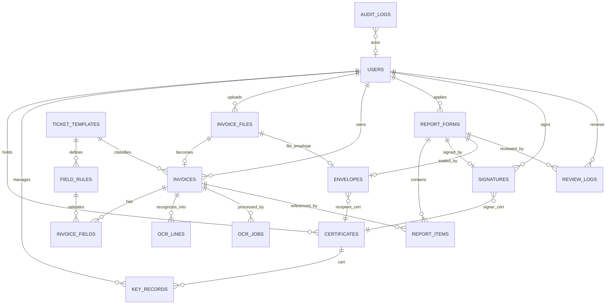

# SCHEMA.md — 数据模型契约

> **来源**：《OCR票据识别与加密系统-毕业设计完整方案.md》第 5 章「数据模型设计」（5.1 ER 关系、5.2 主要表与关键字段、5.3 索引/约束/加密存储策略），并交叉引用 **3.4 关键业务规则**、**6.3 关键要素抽取**（字段清单与校验规则）、**6.5 密码模块**（6.5.1 签名域与规范化、6.5.3 信封结构、6.5.5 私钥保护、6.5.6 证书与信任、6.5.7 审计哈希链）、**6.6 报销业务闭环与状态机**、**6.7 重复报销检测**、**7.5 重新签名与版本管理**。
>
> **本文件是 S2-1 建表与 Alembic 迁移的唯一依据**：字段名、类型、可空性、默认值、约束、索引一律以此为准。**与代码冲突时以本文件为准（AGENTS.md §9）**。需要变更模型时，先改本文件，再写迁移；禁止"先改代码、回头补文档"。
>
> 落地时同时受 `AGENTS.md` 的硬约束约束：§4.2（表结构 / 枚举 / 金额 / 索引命名）、§4.3（UTC 存储与业务日换算）、§5（bbox 格式与坐标保留）、§6（密码与私钥保护）、§10.4（签名域与信封拆封顺序）。契约与这些硬约束冲突时，先报告再定（AGENTS.md §9）。
>
> **整理规则**
> - 表与字段全部来自方案原文：**不增表、不删表、不改名**（16 张表，5 组，见 §0.4）；
> - 方案 5.2 用逗号串写的关键字段已逐条拆成字段表格；方案 6.x 中"必须落库但没进 5.2 表格"的列（如 `signatures.version`、`envelopes.ciphertext_storage_key`、`report_forms.canonical_json` 的存储形态）一并补齐，每个这类字段在说明列注明出处；
> - 方案未明示的类型 / 可空性 / 默认值，按 PostgreSQL 16 惯例与 §0 全局约定推断，统一标 ⚠；**这些 ⚠ 项已在 S0-3 逐项拍板**，结论见文末「定稿清单」，S2-1 建迁移时照此落地（只剩 Alembic 写法需复核）；
> - 本文件只写契约：不写建表 SQL、不写 Python；除 §7 的索引示例外不出现任何 DDL；
> - 图例：**✅** 方案原文明确 ｜ **⚠** 按惯例推断、已在 S0-3 定稿（见文末清单）｜ **TODO** 已清零，不再使用（新发现的问题当场拍板并记 `DECISIONS.md`）。

---

## 0. 全局约定

### 0.1 命名与标识

- 表名、字段名一律 `snake_case`，英文、单数表名（`invoices`、`signatures`），与后端 ORM 模型、API 字段保持一致（**定死**）。
- 主键统一 `id BIGINT GENERATED ALWAYS AS IDENTITY`（✅ 本文件定稿，不用 UUID，避免索引膨胀与手写 id）。
- 外键统一 `BIGINT`，命名 `<表名单数>_id`：`user_id`、`invoice_id`、`form_id`、`cert_id`、`template_id`、`file_id`、`job_id`、`rule_id`。语义为"人"的外键可保留业务名：`uploader_id`、`applicant_id`、`signer_id`、`reviewer_id`、`verifier_id`、`updated_by`、`actor_id`。
- 外键删除行为默认 `NO ACTION`：本课题不做级联删除，票据与签名必须"删不掉、只能作废"（见 §6.1 审计追加写与管理规则）。有明确例外的在外键行内标注。
- 索引与约束命名：唯一 `uq_`、检查 `ck_<表>_<列>`、普通 `ix_`、外键 `fk_<表>_<列>`（AGENTS.md §4.2）。方案 5.3 里的普通索引写作 `idx_`，本文件统一改为 `ix_`，**列与顺序不变**，仅前缀对齐项目规范。

### 0.2 时间与数值

- 时间统一 `TIMESTAMPTZ`（带时区），`created_at` 默认 `now()`；`updated_at` 默认 `now()` 并由应用层 `onupdate` 维护，**不使用数据库触发器**。
- 时间值一律按 **UTC** 写入，接口输出 ISO-8601 带时区；只有"业务日"（报销单按日汇总、发票日期比较）按 `Asia/Shanghai` 换算，且只在 `utils/timeutil.py` 一处换算（AGENTS.md §4.3）。
- 唯一例外：`invoices.invoice_date` 是**业务日期**（票面开票日期），用 `DATE`，不带时间与时区（⚠ 明确例外，不要改成 TIMESTAMPTZ）。
- 金额 / 税额 / 合计：`NUMERIC(12,2)`，**禁止浮点数**（浮点会带来 0.01 级对账误差，且与签名域的"金额两位小数字符串"规则冲突）。
- 置信度 / 分数：`NUMERIC(4,3)`，带 `CHECK BETWEEN 0 AND 1`（方案 3.4 阈值 0.85 / 0.95 需要三位小数）。
- 数量类：`NUMERIC(10,3)`（明细数量可能带小数，如 1.5 公斤）。
- 计数 / 序号：`INTEGER`（`page_no`、`line_no`、`retry_count`、`item_count`、`version`）。
- 布尔：`BOOLEAN`，一律 `NOT NULL DEFAULT false`，不允许三态（"未知"用可空列表达，不用 NULL 塞进布尔）。

### 0.3 半结构化、密文与摘要的存储格式

- 半结构化数据统一 `JSONB`：`bbox_json`、`box_json`、`params_json`、`field_specs_json`、`detail_json`、`canonical_json` 有一个例外，见下条。
- `report_forms.canonical_json` 用 **`TEXT`，不是 `JSONB`** ✅：签名域存的是"签名当时的字节"，JSONB 会重排键序、归一数字格式，导致重算摘要必然不一致（方案 6.5.1 第 7 条）。此列是保命设计，S2-1 不得优化成 JSONB。
- base64 密文 / 签名：`TEXT`，字段名以 `_b64` 结尾（`wrapped_key_b64`、`iv_b64`、`mac_b64`、`ciphertext_b64`、`signature_b64`）。
- 十六进制摘要：`TEXT`，**SM3 / SHA-256 均为 64 个字符**（小写十六进制），配 `CHECK (col ~ '^[0-9a-f]{64}$')`；`prev_hash` 创世行为 64 个 `0`。
- 枚举一律 **`TEXT + CHECK`**，不用 PostgreSQL ENUM 类型：加值只需改 CHECK（`NOT VALID` + 校验后 `VALIDATE`），不锁表、不写 `ALTER TYPE`。取值集中列在 **§9 枚举值**。
- 字符集统一 `UTF8`，数据库 `en_US.UTF-8` / `zh_CN.UTF-8` 均可；排序按 `C` 不强制（本课题无大量文本排序需求）。

### 0.4 表清单（16 张，5 组，顺序固定）

| 组 | 表 | 一句话职责 | 主要写入方 |
|---|---|---|---|
| A 用户与密钥 | `users` | 账号与角色（提交人 / 审核人 / 管理员） | 注册、管理接口 |
| A 用户与密钥 | `certificates` | 自建 CA 签发的证书登记簿（PEM + 指纹 + 有效期） | 证书签发脚本 / 管理接口 |
| A 用户与密钥 | `key_records` | 密钥**登记簿**（只存路径，不含私钥本体） | 密钥初始化脚本 |
| B 票据与识别 | `invoice_files` | 原始票据文件（MinIO 密文对象）的元数据与去重 | 上传接口 |
| B 票据与识别 | `invoices` | 一张票据的业务主体与识别/确认状态 | 识别流水线、确认接口 |
| B 票据与识别 | `invoice_fields` | 字段级抽取结果、置信度、来源与冲突 | 抽取流水线、人工确认 |
| B 票据与识别 | `ocr_lines` | OCR 文本行 + 坐标（字段定位与高亮的数据源） | 识别流水线（ARQ） |
| B 票据与识别 | `ocr_jobs` | 识别各阶段的作业记录与耗时 | 识别流水线（ARQ） |
| C 模板与规则 | `ticket_templates` | 票种模板与字段规格（YAML 落库版本） | 种子脚本 / 管理接口 |
| C 模板与规则 | `field_rules` | 字段校验规则库（正则 + 校验器） | 种子脚本 / 管理接口 |
| D 报销与密码 | `report_forms` | 报销单主体 + 签名域快照 + 状态机 | 报销单接口 |
| D 报销与密码 | `report_items` | 报销单—票据明细（金额、备注） | 报销单接口 |
| D 报销与密码 | `signatures` | 签名记录（算法、摘要、签名值、验签结果、版本） | 签名接口 / 验签任务 |
| D 报销与密码 | `envelopes` | 数字信封（包裹后的会话密钥、IV、MAC、密文） | 封装 / 拆封接口 |
| D 报销与密码 | `review_logs` | 财务审核记录（通过 / 驳回、验签与解密结果） | 审核接口 |
| E 审计 | `audit_logs` | 追加写审计日志 + 哈希链 | 全局审计中间件 |

---

## 1. ER 总览（方案 5.1）



> 读图要点：① `INVOICE_FILES ||--o| INVOICES` 是"一个文件最多变成一张票"，靠 `invoices.file_id` 唯一约束保证；② `REPORT_FORMS ||--o| SIGNATURES` 的"至多一条"指**当前有效**签名，历史签名保留为 `void`（§5.3）；③ `ENVELOPES` 同时挂在 `report_forms` 与 `invoice_files` 两侧，`form_id` 为空的信封即"文件级信封"（方案 5.2 原文）；④ `AUDIT_LOGS` 的 `actor_id` 可为空（系统定时任务、验签失败时的匿名请求）。

---

## 2. 组 A：用户与密钥

### 2.1 users

| 字段 | 类型 | 可空 | 默认值 | 说明 | 索引 |
|---|---|---|---|---|---|
| id | BIGINT | 否 | IDENTITY | 主键 | PK ✅ |
| username | TEXT | 否 | — | 登录名，`CHECK (length(username) BETWEEN 3 AND 64)` ⚠ | UNIQUE ⚠ |
| password_hash | TEXT | 是 | — | 口令哈希，**算法固定 Argon2id**（AGENTS.md §2）；SSO 场景可为空 ⚠ | — |
| real_name | TEXT | 是 | — | 真实姓名（审核页、签名信息展示） ⚠ | — |
| role | TEXT | 否 | `'submitter'` ⚠ | 枚举见 §9.1 | CHECK |
| dept | TEXT | 是 | — | 部门 / 学院（审核分流用） ⚠ | — |
| status | TEXT | 否 | `'active'` ⚠ | 枚举见 §9.2 | CHECK |
| created_at | TIMESTAMPTZ | 否 | `now()` | 创建时间 ✅ | — |
| updated_at | TIMESTAMPTZ | 否 | `now()` | 应用层 onupdate ⚠ | — |

**存什么**：系统账号、角色与口令哈希。**谁写**：注册 / 管理接口。**关键不变式**：`role` 只有三值 `submitter` / `reviewer` / `admin`（✅ 方案 5.2），不加"财务"这类第四角色——财务服务器是 `certificates.owner_type='server'` 的证书主体，不是 `users` 行；`username` 全局唯一且不可改（审计与签名可追溯）。

> 管理规则：**不物理删除用户**（`signatures.signer_id`、`audit_logs.actor_id` 都指向它），离职走 `status='disabled'`。方案 5.2 未列 `updated_at`，按 §0.2 全局约定补齐（⚠）。

### 2.2 certificates

| 字段 | 类型 | 可空 | 默认值 | 说明 | 索引 |
|---|---|---|---|---|---|
| id | BIGINT | 否 | IDENTITY | 主键 | PK ✅ |
| owner_type | TEXT | 否 | — | `user` / `server`（财务服务器证书）✅ | CHECK；idx(owner_type) ⚠ |
| owner_id | BIGINT | 是 | — | `owner_type='user'` 时为 `users.id`；`server` 时为 NULL ⚠。多态引用，**不建外键**（见 §7 备注） | idx ⚠ |
| subject_dn | TEXT | 否 | — | 主体 DN，如 `CN=财务服务器,O=XX大学` ✅ | — |
| serial_no | TEXT | 否 | — | 证书序列号，**十六进制字符串**（X.509 序列号可能达 20 字节，不能用 BIGINT）⚠ | UNIQUE(issuer_dn, serial_no) ⚠ |
| issuer_dn | TEXT | 否 | — | 签发者 DN（自建 CA 的 subject）✅ | — |
| key_algo | TEXT | 否 | `'SM2'` ⚠ | `SM2` / `RSA`，验签前必须知道用哪套算法（方案 6.5.5 三套角色密钥）⚠ | CHECK |
| public_key_pem | TEXT | 否 | — | 公钥 PEM（验签、SM2 加密 CEK 都用它）✅ | — |
| cert_pem | TEXT | 否 | — | 证书 PEM 全文 ✅ | — |
| not_before | TIMESTAMPTZ | 否 | — | 生效时间 ✅ | — |
| not_after | TIMESTAMPTZ | 否 | — | 失效时间 ✅；`CHECK (not_after > not_before)` ⚠ | — |
| fingerprint_sha256 | TEXT | 否 | — | 证书指纹（64 位小写十六进制）；参与信封 MAC 覆盖范围，防"信封被换收方" ✅ | **UNIQUE** ✅ |
| revoked | BOOLEAN | 否 | `false` | 是否已吊销 ✅ | — |
| revoked_at | TIMESTAMPTZ | 是 | — | 吊销时间；`revoked=false` 时必须为空 ⚠（`audit_logs.action='revoke_cert'` 需要它，方案 5.2 未列） | — |
| created_at | TIMESTAMPTZ | 否 | `now()` | 入库时间 ✅ | — |

**存什么**：自建 CA 签发的证书登记簿——PEM、主体/签发者 DN、序列号、有效期、指纹与吊销状态。**谁写**：证书签发脚本与 `revoke_cert` 管理动作。**关键不变式**：`fingerprint_sha256` 唯一（同一张证书不许登记两次，验签时靠它定位收方/签名方身份）；只做"登记 + 指纹比对 + 有效期 + 未吊销"三项校验，**不做证书链验证**（方案 6.5.6 明确的能力边界，论文必须如实写）。

> 不做 CRL / OCSP（方案 6.5.6）：吊销只写本表，验签前查 `revoked=false`，并记录"吊销状态依赖本地登记"这一局限。

### 2.3 key_records

| 字段 | 类型 | 可空 | 默认值 | 说明 | 索引 |
|---|---|---|---|---|---|
| id | BIGINT | 否 | IDENTITY | 主键 | PK ✅ |
| user_id | BIGINT | 是 | — | 密钥持有人；财务服务器密钥（`key_type='envelope'` 的服务端密钥）为 NULL ⚠ | idx ⚠ |
| key_type | TEXT | 否 | — | `sign`（签名）/ `envelope`（解信封）✅，见 §9.4 | CHECK |
| cert_id | BIGINT | 否 | — | 对应证书，FK→`certificates.id` ✅ | idx ⚠ |
| storage_path | TEXT | 否 | — | **只登记路径**：口令加密 PKCS#8 文件的位置，如 `secrets/keys/{user_id}/sign.p8.enc`。**私钥本体不入库** ✅；该列禁止存 PEM/hex 私钥内容（`CHECK (storage_path NOT LIKE '%PRIVATE KEY%')` ⚠） | UNIQUE ⚠ |
| algo | TEXT | 否 | — | `SM2` / `RSA` ✅ | CHECK |
| created_at | TIMESTAMPTZ | 否 | `now()` | 登记时间 ✅ | — |
| revoked_at | TIMESTAMPTZ | 是 | — | 密钥吊销时间，非空即失效 ✅ | — |

**存什么**：**密钥登记簿**——某个主体的某把密钥对应哪个证书、什么算法、密文文件在哪。**谁写**：密钥初始化脚本、密钥轮换/吊销动作。**关键不变式**：本表**只登记路径，私钥本体绝不入库**（方案 6.5.5："私钥绝不入库"）；`key_type` 与 `algo` 必须与对应证书一致，不一致视为配置错误。

> **设计意图（私钥不入库，必写进论文）**：库里只有"这把密钥存在、属于谁、用哪个算法、文件在哪"的登记信息；私钥本体以口令加密的 PKCS#8 文件存放在 `secrets/keys/`，与数据库**物理分离**。于是形成两个相互独立的假设：**数据库泄露 → 攻击者拿不到私钥；私钥仓泄露 → 没有口令也解不开（PBKDF2-HMAC-SHA256，200k 次迭代，AES-256-GCM 包裹）**。两者同时失守才失守，这是本课题密钥体系的全部安全论证前提（方案 5.2 原注 + 6.5.5）。

---

## 3. 组 B：票据与识别

### 3.1 invoice_files

| 字段 | 类型 | 可空 | 默认值 | 说明 | 索引 |
|---|---|---|---|---|---|
| id | BIGINT | 否 | IDENTITY | 主键 | PK ✅ |
| uploader_id | BIGINT | 否 | — | 上传者，FK→`users.id` ✅ | idx ⚠ |
| filename | TEXT | 否 | — | 原始文件名（展示用，**不可用于拼路径**）✅ | — |
| mime | TEXT | 否 | — | `image/jpeg`、`application/pdf` 等 ✅ | — |
| size | BIGINT | 否 | — | 字节数 ✅；`CHECK (size > 0)` ⚠ | — |
| sha256 | TEXT | 否 | — | **明文**的 SHA-256（64 位小写十六进制），用于去重与纳入签名域 ✅ | **UNIQUE** ✅ |
| storage_key | TEXT | 否 | — | MinIO 对象名 `invoices/{yyyy}/{mm}/{uuid}.bin`，内容是 **SM4-CBC 密文** ✅ | UNIQUE ⚠ |
| is_cipher | BOOLEAN | 否 | `true` | 是否已按信封加密落盘；`false` 仅允许出现在本地调试配置下 ✅ | — |
| page_count | INTEGER | 否 | `1` ⚠ | 页数（PDF > 1，图片 = 1）✅ | — |
| created_at | TIMESTAMPTZ | 否 | `now()` | 落库时间 ✅ | — |

**存什么**：上传文件的元数据与去重键——明文哈希、MinIO 对象名（指向 SM4 密文）、是否已加密、页数。**谁写**：上传接口（"先算哈希 → 查重 → 封装 → 写 MinIO → 落库"，方案 6.6）。**关键不变式**：`sha256` 唯一，是**第一道重复报销防线**（方案 6.7 文件级）；`storage_key` 指向的对象是密文，明文只在内存中存在一次。

> 文件行**不可变**（不设 `updated_at`）：内容一变，`sha256` 就变，应生成新行而不是改旧行。
>
> **不设 `envelope_id` 列**（D-012）：文件级信封通过 `envelopes.file_id` 反查，只保留单向外键，避免与 `envelopes` 互相指向造成建表死锁；`envelopes (file_id) WHERE file_id IS NOT NULL` 的部分唯一索引保证“一个文件最多一个信封”。

### 3.2 invoices

| 字段 | 类型 | 可空 | 默认值 | 说明 | 索引 |
|---|---|---|---|---|---|
| id | BIGINT | 否 | IDENTITY | 主键 | PK ✅ |
| uploader_id | BIGINT | 否 | — | 归属人，FK→`users.id`；**所有查询必须带此条件**（方案 3.4 规则 7）✅ | idx(uploader_id, created_at DESC) ✅ |
| template_id | BIGINT | 是 | — | 命中的票种模板，FK→`ticket_templates.id`；未命中为 NULL ✅ | idx ⚠ |
| invoice_type | TEXT | 否 | `'unknown'` ⚠ | 票种代码，取值同 `ticket_templates.type_code`（§9.6）⚠；冗余存一份，避免列表页 JOIN | CHECK |
| invoice_code | TEXT | 是 | — | 发票代码，10 或 12 位数字（部分票种无）✅ | 组成部分唯一索引 ✅ |
| invoice_no | TEXT | 是 | — | 发票号码，8 位数字 ✅ | 组成部分唯一索引 ✅ |
| invoice_date | DATE | 是 | — | 开票日期（**业务日期，用 DATE**，见 §0.2）✅ | — |
| buyer_name | TEXT | 是 | — | 购方名称 ✅ | — |
| buyer_tax_no | TEXT | 是 | — | 购方纳税人识别号（15/18/20 位，18 位走 GB 32100 校验，方案 6.3）✅ | — |
| seller_name | TEXT | 是 | — | 销方名称 ✅ | — |
| seller_tax_no | TEXT | 是 | — | 销方纳税人识别号 ✅ | — |
| amount | NUMERIC(12,2) | 是 | — | 金额（不含税）✅；**禁止浮点** | — |
| tax_amount | NUMERIC(12,2) | 是 | — | 税额 ✅ | — |
| total_amount | NUMERIC(12,2) | 是 | — | 价税合计 ✅；`CHECK (total_amount >= 0)` ✅ | — |
| check_code | TEXT | 是 | — | 校验码（增值税普通发票 20 位，可缺失）✅ | — |
| file_id | BIGINT | 否 | — | 原始文件，FK→`invoice_files.id` ✅ | **UNIQUE** ⚠（1:1 靠它保证） |
| ocr_status | TEXT | 否 | `'pending'` | 枚举见 §9.5 ✅ | idx ⚠ |
| extract_status | TEXT | 否 | `'raw'` | 枚举见 §9.5 ✅ | idx ⚠ |
| overall_confidence | NUMERIC(4,3) | 是 | — | 整单置信度（字段置信度聚合，方案 6.4）✅ | CHECK 0–1 ⚠ |
| quality_flag | TEXT | 是 | — | 影像质量标记 `ok` / `low`（**不设 `fail`**：不可识别由 `ocr_status='failed'` 表达，避免同一事实两处编码），见 §9.5d ✅ | CHECK |
| duplicate_of | BIGINT | 是 | — | 疑似重复的既有票据 id（自引用，**软提示不硬拦**，方案 6.7 语义级）✅ | idx ⚠ |
| status | TEXT | 否 | `'draft'` | 枚举见 §9.5 ✅ | 部分唯一索引的条件列 ✅ |
| version | INTEGER | 否 | `0` | **乐观锁计数器**（应用层 `UPDATE ... WHERE version = ?`，冲突 → `409`；与 `signatures.version` 无关）⚠ 见「定稿清单」第 19 项 | — |
| created_at | TIMESTAMPTZ | 否 | `now()` | 创建时间 ✅ | 组成 idx ✅ |
| updated_at | TIMESTAMPTZ | 否 | `now()` | 应用层 onupdate ⚠ | — |

**存什么**：一张票据的业务主体、票面要素、识别与确认状态、质量标记。**谁写**：识别流水线写状态与置信度，人工确认接口写字段汇总与状态，报销接口写 `status='in_report'`。**关键不变式**：`(invoice_code, invoice_no)` 在非作废票据内唯一（同一张票不能报两次）；`status='void'` 释放该唯一约束，允许重新提交（方案 7.5）；`file_id` 唯一（一个文件最多对应一张票）。

> 票据级状态**只走 5 个值**（`draft/confirmed/in_report/archived/void`）。方案 6.6 状态图里的 `signed/encrypted/submitted/approved/rejected` 是**报销单级**状态，落在 `report_forms.status`，不要混进 `invoices.status`（⚠ 见「定稿清单」第 1 项）。
>
> 红冲 / 负数票：**本期不支持**（D-013）——`total_amount >= 0` 保留，论文“范围限定”写明；若将来支持，需同时放开约束并加 `is_red` 标记。

### 3.3 invoice_fields

| 字段 | 类型 | 可空 | 默认值 | 说明 | 索引 |
|---|---|---|---|---|---|
| id | BIGINT | 否 | IDENTITY | 主键 | PK ✅ |
| invoice_id | BIGINT | 否 | — | FK→`invoices.id` ✅ | 组成唯一索引 ✅ |
| field_name | TEXT | 否 | — | 字段名（`invoice_code` / `total_amount` / `buyer_tax_no` …，与模板 `field_specs_json` 的键一致）✅ | 组成唯一索引 ✅ |
| field_value | TEXT | 是 | — | 票面原文形态的值，如 `¥1,234.56` ✅ | — |
| normalized_value | TEXT | 是 | — | 归一值，金额为两位小数字符串 `1234.56`、日期为 `YYYY-MM-DD`（方案 6.3）✅ | — |
| raw_text | TEXT | 是 | — | 命中的原始文本行（人工核对页展示"机器看到了什么"）✅ | — |
| confidence | NUMERIC(4,3) | 是 | — | 字段置信度 `base × agreement × rule_factor`（方案 6.4）✅ | `CHECK BETWEEN 0 AND 1` ✅ |
| bbox_json | JSONB | 是 | — | 位置框 **`[x1,y1,x2,y2]`（原图坐标系，两点外接框）**——前端画框只认这一种格式（AGENTS.md §5）；由 `ocr_lines.box_json` 的四点坐标取外接矩形得到 ✅ | — |
| source | TEXT | 否 | `'ocr'` ⚠ | 枚举见 §9.8（5 值，含二次识别的 `ocr_retry`）✅ | idx ⚠ |
| source_page_no | INTEGER | 否 | `1` | 命中行所在页码（回查 `ocr_lines` 的唯一键是 `(invoice_id, page_no, line_no)`，缺页码会歧义）⚠ 见「定稿清单」第 3 项 | — |
| source_line_no | INTEGER | 是 | — | 页内行号，回查 `ocr_lines` 用 ✅ | — |
| rule_id | BIGINT | 是 | — | 命中的校验规则，FK→`field_rules.id` ✅ | — |
| need_review | BOOLEAN | 否 | `false` | 是否需要人工确认（`confidence < 0.85` 置 true，方案 3.4 规则 1）✅ | idx ⚠ |
| conflict | BOOLEAN | 否 | `false` | 是否存在交叉校验冲突（价税合计 ≠ 金额 + 税额等）✅ | — |
| conflict_value | TEXT | 是 | — | 冲突时的"校验值 B"（方案 3.4 规则 2 的 A/B 双候选）✅ | — |
| confirmed | BOOLEAN | 否 | `false` | 人工是否已确认 ✅ | — |
| updated_by | BIGINT | 是 | — | 最后修改人，FK→`users.id`（人工修正留痕）✅ | — |
| updated_at | TIMESTAMPTZ | 否 | `now()` | 最后修改时间 ✅ | — |

**存什么**：**字段级**抽取结果——原值、归一值、原文、置信度、坐标、来源、规则命中、冲突与人工确认痕迹。**谁写**：三阶段抽取流水线（`ocr`/`rule`/`semantic`）、二次识别（`ocr_retry`，方案 6.4）、人工核对（`manual`）。**关键不变式**：`(invoice_id, field_name)` 唯一（一个字段一行，重新抽取是 upsert 不是追加）；冲突时"两个值都留"——识别值在 `field_value`，校验值在 `conflict_value`，**不静默改写**（方案 3.4 规则 2、6.3 校验规则库）。

> 人工修正的审计要求：确认时把"改前值 / 改后值 / 操作人"写进 `audit_logs.detail_json`（方案 6.6 "确认"一行），本表只保留最终值。

### 3.4 ocr_lines

| 字段 | 类型 | 可空 | 默认值 | 说明 | 索引 |
|---|---|---|---|---|---|
| id | BIGINT | 否 | IDENTITY | 主键 | PK ✅ |
| invoice_id | BIGINT | 否 | — | FK→`invoices.id` ✅ | 组成唯一索引 ⚠ |
| job_id | BIGINT | 是 | — | 产生该行的作业，FK→`ocr_jobs.id`（重跑后可追溯是哪一次识别）✅ | idx ⚠ |
| page_no | INTEGER | 否 | `1` | 页码，从 1 开始 ✅ | 组成唯一索引 ⚠ |
| line_no | INTEGER | 否 | — | 页内行号，从上到下从 0 开始 ⚠ | 组成唯一索引 ⚠ |
| text | TEXT | 否 | — | 行文本（未归一化）✅ | — |
| score | NUMERIC(4,3) | 是 | — | 识别分数 ✅；`CHECK BETWEEN 0 AND 1` ⚠ | — |
| box_json | JSONB | 是 | — | **四点坐标** `[[x,y],[x,y],[x,y],[x,y]]`（原图坐标系，四点按顺时针）✅；字段层再取外接框聚合成 `[x1,y1,x2,y2]`（AGENTS.md §5） | — |
| block_id | TEXT | 是 | — | 版面块标识（同块行可拼段；PaddleOCR 无稳定 block id，需自行编号）⚠ TODO | idx ⚠ |
| created_at | TIMESTAMPTZ | 否 | `now()` | 写入时间 ✅ | — |

**存什么**：OCR 识别出的**每一行文本**与四点坐标、识别分数、所属块。**谁写**：识别流水线（ARQ 任务，按页写入）。**关键不变式**：`(invoice_id, page_no, line_no)` 唯一（重跑同页是覆盖不是追加，靠它做幂等）；`box_json` 是**四点坐标**（不是 `[x1,y1,x2,y2]` 两点框），因为透视校正后文本框可能是斜的。

### 3.5 ocr_jobs

| 字段 | 类型 | 可空 | 默认值 | 说明 | 索引 |
|---|---|---|---|---|---|
| id | BIGINT | 否 | IDENTITY | 主键 | PK ✅ |
| invoice_id | BIGINT | 否 | — | FK→`invoices.id` ✅ | idx(invoice_id, created_at) ⚠ |
| stage | TEXT | 否 | — | `preprocess` / `detect` / `recognize` / `extract` ✅，见 §9.9 | CHECK |
| status | TEXT | 否 | `'pending'` ⚠ | `pending/running/succeeded/failed` ⚠（与 `invoices.ocr_status` 同值集） | idx ⚠ |
| engine | TEXT | 否 | `'paddleocr'` | 识别引擎 ✅ | — |
| engine_version | TEXT | 是 | — | 引擎版本（论文实验复现必须记）✅ | — |
| params_json | JSONB | 是 | — | 阶段参数（缩放比、阈值、语言等；**不含明文与密钥**）✅ | — |
| elapsed_ms | INTEGER | 是 | — | 耗时毫秒（性能预算对照，方案 7.7）✅ | — |
| retry_count | INTEGER | 否 | `0` | 第几次尝试（上限 3，方案 6.6）✅ | `CHECK (retry_count >= 0)` ⚠ |
| error | TEXT | 是 | — | 失败时写错误码 + 短消息（≤500 字符）✅ | — |
| created_at | TIMESTAMPTZ | 否 | `now()` | 写入时间 ✅ | — |

**存什么**：识别流水线**每个阶段**一条作业记录：阶段、状态、引擎与版本、参数、耗时、重试次数、错误。**谁写**：ARQ 任务（每次阶段开始写 running、结束写终态）。**关键不变式**：同一 `(invoice_id, stage)` 的重试**追加新行**而不是改旧行（`retry_count` 记在行内用于展示"第几次"），因此作业历史天然完整；`error` 只存错误码与短消息，**不得包含明文票据内容**。

> **提交语义的例外**：AGENTS.md §10.5 规定 handler 内不得自行 commit 业务表，但 `ocr_jobs` 是明确豁免项——阶段进度必须在任务进行中可见（前端轮询"识别到第几阶段"），因此每写一次阶段状态就单独提交。这条豁免写进本文件与 `docs/DECISIONS.md`，除此之外任何表都不得中途提交。

---

## 4. 组 C：模板与规则

### 4.1 ticket_templates

| 字段 | 类型 | 可空 | 默认值 | 说明 | 索引 |
|---|---|---|---|---|---|
| id | BIGINT | 否 | IDENTITY | 主键 | PK ✅ |
| type_code | TEXT | 否 | — | `vat_general` / `train_ticket` / `flight_itinerary` / `taxi_ticket` / `unknown` ✅，见 §9.10 | 组成 UNIQUE(type_code, version) ⚠ |
| type_name | TEXT | 否 | — | 中文名，如"增值税电子普通发票" ✅ | — |
| match_keywords | TEXT[] | 是 | — | 票种匹配关键字数组，如 `{增值税,普通发票}` ✅ | GIN ⚠建议 |
| field_specs_json | JSONB | 否 | — | 字段 → {`strategy`, `keywords`, `pattern`, `validator`}；策略取 `inline_right`/`below_center`/`table_column`/`label_neighbor`/`total_zone` ✅ | **GIN** ✅ |
| version | INTEGER | 否 | `1` | 模板版本，只增不改 ⚠ | 组成唯一索引 ⚠ |
| active | BOOLEAN | 否 | `false` | 当前生效版本 ✅ | 部分唯一 `(type_code) WHERE active` ⚠ |
| created_at | TIMESTAMPTZ | 否 | `now()` | 创建时间 ⚠（方案 5.2 未列） | — |
| updated_at | TIMESTAMPTZ | 否 | `now()` | 应用层 onupdate ⚠ | — |

**存什么**：票种模板的落库版本——票种代码、匹配关键字、字段规格（锚定策略 / 正则 / 相对位置）。**谁写**：种子脚本从 `backend/app/ocr/templates/*.yaml` 导入，管理接口做版本升级。**关键不变式**：`(type_code, version)` 唯一，**同一票种允许多版本共存，但只有一版 `active=true`**（部分唯一索引兜底，见 §7）；`field_specs_json` 的结构就是 YAML 里 `fields:` 的子树（`strategy/keywords/pattern/validator`），建 GIN 以支持按字段名检索。

### 4.2 field_rules

| 字段 | 类型 | 可空 | 默认值 | 说明 | 索引 |
|---|---|---|---|---|---|
| id | BIGINT | 否 | IDENTITY | 主键 | PK ✅ |
| field_name | TEXT | 否 | — | 适用字段名（`total_amount` 等）✅ | idx(field_name) ⚠ |
| template_id | BIGINT | 是 | — | 所属模板，FK→`ticket_templates.id`；**NULL = 通用规则** ✅ | idx ⚠ |
| pattern | TEXT | 是 | — | 正则源码（如 `^[¥￥]?-?\d{1,3}(,\d{3})*(\.\d{1,2})?$`）✅ | — |
| validator | TEXT | 是 | — | 校验器：`amount`/`date`/`tax_no`/`code_no`/`uppercase_amount` ✅，见 §9.11 | CHECK |
| error_msg | TEXT | 是 | — | 失败提示（面向用户，中文）✅ | — |
| priority | INTEGER | 否 | `100` ⚠ | 优先级，数值小者先 | idx ⚠ |
| active | BOOLEAN | 否 | `true` | 是否启用 ✅ | — |
| created_at | TIMESTAMPTZ | 否 | `now()` | 创建时间 ⚠（方案 5.2 未列） | — |
| updated_at | TIMESTAMPTZ | 否 | `now()` | 应用层 onupdate ⚠ | — |

**存什么**：字段校验规则库——正则以 `validator` 名称 + `error_msg` 呈现，落库供抽取流水线与前端提示共用。**谁写**：种子脚本（与方案 6.3 "校验规则库"表一一对应）、管理接口。**关键不变式**：`template_id` 为空即"通用规则"（§0 说明"可空＝通用"）；`priority` 决定同字段多规则命中时的顺序（**数值小者先，默认 100，同分按 `id` 升序**，D-014）；`pattern` 是**正则源码字符串**，写入时由服务层 `re.compile` 校验语法、非法直接 422（不落库）。

---

## 5. 组 D：报销与密码

### 5.1 report_forms

| 字段 | 类型 | 可空 | 默认值 | 说明 | 索引 |
|---|---|---|---|---|---|
| id | BIGINT | 否 | IDENTITY | 主键 | PK ✅ |
| report_no | TEXT | 否 | — | **业务单号**（`RPT-YYYYMM-序号`，服务端生成，对外展示与审计引用都用它）；方案 5.2 未列，但 6.5.1 的签名域含"单号"、实施计划 S5-1 要求"既有单号" ⚠ 见「定稿清单」第 20 项 | **UNIQUE** ⚠ |
| applicant_id | BIGINT | 否 | — | 申请人，FK→`users.id` ✅ | idx(applicant_id, created_at DESC) ⚠ |
| title | TEXT | 否 | — | 报销单标题（如"2026-11 差旅报销"）✅ | — |
| reason | TEXT | 是 | — | 事由 ✅ | — |
| total_amount | NUMERIC(12,2) | 否 | `0` | 合计金额（明细汇总，服务端重算，不信客户端）✅ | `CHECK (total_amount >= 0)` ⚠ |
| item_count | INTEGER | 否 | `0` | 明细条数（冗余，列表页免 COUNT）✅ | `CHECK (item_count >= 0)` ⚠ |
| status | TEXT | 否 | `'draft'` | 8 值状态机，见 §9.14 ✅ | idx ⚠ |
| canonical_json | **TEXT** | 是 | — | 签名当时的规范化载荷**原样字符串**（方案 6.5.1 第 7 条：验签时直接取用重算，禁止重新拼装）✅ | — |
| digest_algo | TEXT | 是 | `'SM3'` ⚠ | `SM3` / `SHA256` ✅ | CHECK |
| digest_hex | TEXT | 是 | — | `SM3(canonical_bytes)` 的 64 位小写十六进制；**只用于展示与快速比对，不是验签依据**（方案 6.5.2 原注）✅ | CHECK 格式 ⚠ |
| submitted_at | TIMESTAMPTZ | 是 | — | 首次提交财务的时间 ✅ | — |
| idempotency_key | TEXT | 是 | — | 幂等键（前端生成 UUID，重复点击返回已有单号）✅ | **UNIQUE** ✅ |
| version | INTEGER | 否 | `0` | **乐观锁计数器**（审核决策、驳回重提都带它，防并发覆盖）⚠ 见「定稿清单」第 19 项 | — |
| created_at | TIMESTAMPTZ | 否 | `now()` | 创建时间 ✅ | — |
| updated_at | TIMESTAMPTZ | 否 | `now()` | 应用层 onupdate ⚠ | — |

**存什么**：报销单主体（申请人、事由、合计、明细数）、**签名域快照**（`canonical_json` + 摘要）、幂等键与状态机。**谁写**：报销单接口（草稿）、签名接口（写 `canonical_json`/`digest_hex`/`status='signed'`）、封装接口（`encrypted`）、提交接口（`submitted`）、审核接口（`approved`/`rejected`）、归档任务（`archived`）。**关键不变式**：`idempotency_key` 唯一（重复提交由数据库兜底，不靠前端防抖）；`canonical_json` 一经签名即**不可变**（改内容必须重签、`version+1`、旧签名置 `void`）；`status in ('submitted','approved','archived')` 时必须恰好有一条 `active` 签名且有对应信封（方案 7.5，写成单测）。

> 两个 `version` 不要混：本表 `version` 是**并发控制计数器**（应用层乐观锁）；签名域里的 `nonce` / 载荷版本随 `canonical_json` 一起保存；"第几次签名"的权威记录是 `signatures.version`（方案 6.6 "驳回重提"一行）。

### 5.2 report_items

| 字段 | 类型 | 可空 | 默认值 | 说明 | 索引 |
|---|---|---|---|---|---|
| id | BIGINT | 否 | IDENTITY | 主键 | PK ✅ |
| form_id | BIGINT | 否 | — | FK→`report_forms.id` ✅ | 组成 UNIQUE(form_id, invoice_id) ⚠ |
| invoice_id | BIGINT | 否 | — | FK→`invoices.id` ✅ | idx ⚠ |
| amount | NUMERIC(12,2) | 否 | — | 本单报销金额 ✅；`CHECK (amount >= 0)` ⚠ | — |
| remark | TEXT | 是 | — | 备注 ✅ | — |
| created_at | TIMESTAMPTZ | 否 | `now()` | 加入时间 ⚠（方案 5.2 未列） | — |

**存什么**：报销单与票据的多对多明细：这一单报了哪几张票、各自报多少、备注。**谁写**：报销单接口（增删明细）。**关键不变式**：`(form_id, invoice_id)` 唯一（同一张票在一张单里只能出现一次，否则合计与签名域都可被重复计算）；`amount` 允许小于票面合计（部分报销），但不得为负 ⚠；`invoices.status` 应同步为 `in_report`（跨表不变式，由业务层保证并在单测中覆盖）。

### 5.3 signatures

| 字段 | 类型 | 可空 | 默认值 | 说明 | 索引 |
|---|---|---|---|---|---|
| id | BIGINT | 否 | IDENTITY | 主键 | PK ✅ |
| form_id | BIGINT | 否 | — | FK→`report_forms.id` ✅ | idx(form_id) ✅；**部分 UNIQUE WHERE active** ✅ |
| signer_id | BIGINT | 否 | — | 签名人，FK→`users.id`（职责分离：提交人签提交、审核人签意见）✅ | idx ⚠ |
| algo | TEXT | 否 | — | `SM2` / `RSA-PSS` ✅，见 §9.16 | CHECK |
| digest_algo | TEXT | 否 | — | `SM3` / `SHA256` ✅ | CHECK |
| digest_hex | TEXT | 否 | — | 摘要，64 位小写十六进制；`CHECK (digest_hex ~ '^[0-9a-f]{64}$')` ✅ | CHECK ✅ |
| signature_b64 | TEXT | 否 | — | 签名值（base64，SM2 签名约 70–72 字节）✅ | — |
| cert_id | BIGINT | 否 | — | 签名所用证书，FK→`certificates.id`（验签时校验证书公钥与签名公钥一致）✅ | idx ⚠ |
| version | INTEGER | 否 | `1` | 第几次签名（驳回重提 +1，历史行保留）✅（方案 7.5） | UNIQUE(form_id, version) ⚠ |
| status | TEXT | 否 | `'active'` | `active` / `void` ✅（方案 7.5） | 部分唯一索引的条件列 ✅ |
| verified | BOOLEAN | 否 | `false` | 是否已验签通过 ✅ | — |
| verify_result | TEXT | 是 | — | `ok`/`digest_mismatch`/`bad_signature`/`cert_invalid` ✅，见 §9.16 | CHECK ⚠ |
| verified_at | TIMESTAMPTZ | 是 | — | 验签时间 ✅ | — |
| verifier_id | BIGINT | 是 | — | 验签人 / 验签服务，FK→`users.id`；系统自动验签为 NULL ⚠ | — |
| created_at | TIMESTAMPTZ | 否 | `now()` | 签名时间 ⚠（方案 5.2 未列，但"签名时间"必须有） | — |

**存什么**：签名记录——算法、摘要、签名值、证书、验签结果、**版本与状态**。**谁写**：签名接口（`active`）、验签任务/审核接口（`verified`/`verify_result`/`verified_at`/`verifier_id`）、驳回重提（旧行置 `void`、新行 `version+1`）。**关键不变式**：**每张报销单至多一条 `active` 签名**（部分唯一索引，方案 5.2 / 7.5）；签名行只增不改内容（除验签结果与状态），**不允许删除**；`status='active'` 时 `verified` 可以为 false（"已签未验"是合法中间态），但 `submitted` 之后必须已验证。

> 一条硬规则：`verify_result='ok'` 与 `verified=true` 必须同真同假（`CHECK (verified = (verify_result = 'ok'))` ⚠），避免出现"显示已验签但结果是失败"的脏行。

### 5.4 envelopes

| 字段 | 类型 | 可空 | 默认值 | 说明 | 索引 |
|---|---|---|---|---|---|
| id | BIGINT | 否 | IDENTITY | 主键 | PK ✅ |
| form_id | BIGINT | 是 | — | 报销单级信封，FK→`report_forms.id`；**文件级信封时为 NULL** ✅ | idx ⚠ |
| file_id | BIGINT | 是 | — | 文件级信封对应的票据文件，FK→`invoice_files.id` ✅ | idx ⚠ |
| key_algo | TEXT | 否 | — | `SM2` / `RSA-OAEP` ✅，见 §9.17 | CHECK ✅ |
| cipher_algo | TEXT | 否 | — | `SM4-CBC-HMAC-SM3`（对照 `AES-256-GCM`）✅ | CHECK ✅ |
| wrapped_key_b64 | TEXT | 否 | — | SM2 包裹后的 CEK（base64，约 112 字节：C1 64 + C3 32 + C2 16）✅ | **非空** ✅ |
| iv_b64 | TEXT | 否 | — | 16 字节随机 IV（base64）✅ | — |
| mac_b64 | TEXT | 否 | — | 32 字节 HMAC-SM3（覆盖 header‖IV‖密文‖收方证书指纹）✅ | — |
| ciphertext_b64 | TEXT | 是 | — | **小体积载荷**密文（如报销单 JSON，base64）✅ | CHECK（二选一）✅ |
| ciphertext_storage_key | TEXT | 是 | — | **大体积影像**密文在 MinIO 的对象名（与 `invoice_files.storage_key` 可能指向同一对象）✅ | — |
| payload_sha256 | TEXT | 否 | — | 明文载荷的 SHA-256（64 位小写十六进制），拆封后校验 | CHECK 格式 ⚠ |
| recipient_cert_id | BIGINT | 否 | — | 收方证书（财务服务器），FK→`certificates.id` ✅ | idx ⚠ |
| created_at | TIMESTAMPTZ | 否 | `now()` | 封装时间 ✅ | — |

**存什么**：数字信封——包裹后的会话密钥、IV、MAC、小载荷密文（`ciphertext_b64`）或大体积密文的对象名（`ciphertext_storage_key`）、载荷摘要、收方证书。**谁写**：封装接口（`seal`）与拆封接口（只更新统计，不改密文）；凭证型字段一次写入后不可变。**关键不变式**：`wrapped_key_b64` **非空**（方案 5.3 明确禁止"只加密了数据、没封会话密钥"的半成品记录）；`ciphertext_b64` 与 `ciphertext_storage_key` **至少有一个非空**（小载荷进库、影像留 MinIO）；`recipient_cert_id` 参与 MAC 覆盖范围，防"信封被换收方"（方案 6.5.3）。

> SM2 加密模式固定 `mode=1`（C1C3C2，国标排列），**不是库默认的 C1C2C3**（方案 6.5.2）。该约定属于实现层，但必须写在文档里，否则拆封端会"能解但解出乱码"。

### 5.5 review_logs

| 字段 | 类型 | 可空 | 默认值 | 说明 | 索引 |
|---|---|---|---|---|---|
| id | BIGINT | 否 | IDENTITY | 主键 | PK ✅ |
| form_id | BIGINT | 否 | — | FK→`report_forms.id` ✅ | idx(form_id) ✅ |
| reviewer_id | BIGINT | 否 | — | 审核人，FK→`users.id` ✅ | idx ⚠ |
| decision | TEXT | 否 | — | `approve` / `reject` ✅，见 §9.18 | CHECK |
| comment | TEXT | 是 | — | 审核意见（驳回时必填，业务层校验）✅ | — |
| verify_result | TEXT | 是 | — | 验签结果，取值同 §9.16 ⚠ | CHECK ⚠ |
| decrypt_ok | BOOLEAN | 否 | `false` | 信封拆封是否成功 ✅ | — |
| created_at | TIMESTAMPTZ | 否 | `now()` | 审核时间 ✅ | — |

**存什么**：财务审核动作——通过/驳回、意见、验签结果、解密是否成功。**谁写**：审核接口（`approve`/`reject`）。**关键不变式**：审核结论不可篡改、不可删除（追加写）；`decrypt_ok=false` 或 `verify_result<>'ok'` 时**不允许** `decision='approve'`（业务层强校验，⚠ 建议同步落 `CHECK` 之外的应用层断言）；同一单可多次审核（驳回后重提），因此不加唯一约束。

---

## 6. 组 E：审计

### 6.1 audit_logs

| 字段 | 类型 | 可空 | 默认值 | 说明 | 索引 |
|---|---|---|---|---|---|
| id | BIGINT | 否 | IDENTITY | 主键（**同时是哈希链的物理顺序**，校验按 id 升序全量扫）✅ | PK ✅ |
| trace_id | TEXT | 否 | — | 链路追踪 id（请求级，区分同一次操作的多个动作）✅ | idx ⚠ |
| actor_id | BIGINT | 是 | — | 操作人，FK→`users.id`；系统任务/匿名失败请求为 NULL ✅ | idx ⚠ |
| actor_role | TEXT | 是 | — | 操作时角色快照（`submitter`/`reviewer`/`admin`/`system`）⚠，见 §9.19 | CHECK ⚠ |
| action | TEXT | 否 | — | `upload`/`confirm_field`/`sign`/`seal`/`submit`/`verify`/`decrypt`/`review`/`revoke_cert` ✅，见 §9.19 | idx(action) ⚠ |
| target_type | TEXT | 是 | — | 目标类型（`invoice`/`form`/`certificate`/`key`…）⚠ TODO 值集待定 | — |
| target_id | BIGINT | 是 | — | 目标 id（**多态，不建外键**：目标可能已作废或跨表）✅ | 组合 idx(target_type, target_id) ⚠ |
| detail_json | JSONB | 是 | — | 动作细节（改前/改后值、验签失败原因等）；**必须脱敏**，禁止写入明文金额以外的敏感内容与任何密钥材料 ✅ | — |
| prev_hash | TEXT | 否 | — | 上一条 `entry_hash`，创世行 64 个 `0` ✅ | — |
| entry_hash | TEXT | 否 | — | 本条哈希（64 位小写十六进制）✅ | UNIQUE ⚠ |
| created_at | TIMESTAMPTZ | 否 | `now()` | 发生时间 ✅ | idx(created_at DESC) ✅ |

**存什么**：所有安全相关动作的**追加写**日志：上传、字段确认、签名、封装、提交、验签、解密、审核、吊销证书。**谁写**：全局审计中间件与业务服务（同一事务内写入），另有一条每日锚定任务。**关键不变式**：**只 INSERT，不 UPDATE / 不 DELETE**（方案 3.4 规则 6 "日志写入不可回滚"）；`entry_hash` 由 `HMAC-SM3(audit_key, prev_hash‖ts‖actor_id‖action‖target_id‖payload_sha256)` 计算，`prev_hash` 指向上一条，创世行为 64 个 `0`；任何一行被改/被删，从该行起后续 `entry_hash` 全部对不上。

> **能力边界（论文必须写清）**：哈希链防的是"改了不被发现"，**不防"被读"**；也不防"同时持有审计密钥的人整体重写"。**不是区块链，不要说成区块链**（方案 6.5.7）。
>
> **并发写入定稿（D-015）**：哈希链必须串行追加。实现为在写审计的同一事务里先取事务级咨询锁 `SELECT pg_advisory_xact_lock(<固定常量>)`，再 `SELECT entry_hash FROM audit_logs ORDER BY id DESC LIMIT 1` 取 `prev_hash`，事务结束自动释放锁。选它而不选「锁最后一行」的原因：末尾行可能不存在（首条），`FOR UPDATE` 对空结果不阻塞，仍会分叉。

---

## 7. 索引与约束策略

### 7.1 唯一索引（业务规则下沉到库）

```sql
-- 票据级查重：同一张票只能报一次；作废（void）后释放，允许重新提交
CREATE UNIQUE INDEX uq_invoices_code_no ON invoices (invoice_code, invoice_no) WHERE status <> 'void';

-- 文件级查重：同一份文件重复上传时复用既有识别结果
CREATE UNIQUE INDEX uq_invoice_files_sha256 ON invoice_files (sha256);

-- 重复提交兜底：前端防抖不算数，数据库说了算
CREATE UNIQUE INDEX uq_report_forms_idempotency ON report_forms (idempotency_key);

-- 业务单号唯一：对外展示与审计引用
CREATE UNIQUE INDEX uq_report_forms_report_no ON report_forms (report_no);

-- 证书指纹唯一：同一张证书不许登记两次
CREATE UNIQUE INDEX uq_certificates_fingerprint ON certificates (fingerprint_sha256);

-- 每张报销单只能有一条 active 签名（重新签名须先作废旧签名）
CREATE UNIQUE INDEX uq_signatures_form_active ON signatures (form_id) WHERE status = 'active';

-- 同一票种只能有一版生效模板（改版先停旧再启新，同事务两次 flush）
CREATE UNIQUE INDEX uq_ticket_templates_active_type ON ticket_templates (type_code) WHERE active;

-- 一个字段一行：重新抽取是 upsert
CREATE UNIQUE INDEX uq_invoice_fields_invoice_field ON invoice_fields (invoice_id, field_name);

-- 同一页同一行号只有一条：识别重跑是覆盖不是追加（幂等）
CREATE UNIQUE INDEX uq_ocr_lines_invoice_page_line ON ocr_lines (invoice_id, page_no, line_no);

-- 同一张票在一张报销单里只能出现一次（否则合计与签名域可被重复计算）
CREATE UNIQUE INDEX uq_report_items_form_invoice ON report_items (form_id, invoice_id);

-- 一个文件最多一个信封（文件级）
CREATE UNIQUE INDEX uq_envelopes_file ON envelopes (file_id) WHERE file_id IS NOT NULL;

-- 一张报销单最多一个载荷信封（报销单级）
CREATE UNIQUE INDEX uq_envelopes_form ON envelopes (form_id) WHERE form_id IS NOT NULL;
```

### 7.2 普通索引（查询路径）

```sql
CREATE INDEX ix_invoices_uploader_created ON invoices (uploader_id, created_at DESC);
CREATE INDEX ix_signatures_form ON signatures (form_id);
CREATE INDEX ix_review_logs_form ON review_logs (form_id);
CREATE INDEX ix_audit_created ON audit_logs (created_at DESC);
-- 模板 JSONB 检索：按字段名查"哪个模板定义了该字段的定位策略"
CREATE INDEX ix_templates_specs ON ticket_templates USING GIN (field_specs_json);
-- 待确认队列（原方案 5.3 的 idx_invoices_status 把 extract_status 的值混进了 status，这里拆成两条）
CREATE INDEX ix_invoices_need_confirm ON invoices (uploader_id) WHERE extract_status = 'need_confirm';
CREATE INDEX ix_invoices_draft ON invoices (uploader_id) WHERE status = 'draft';
```

> 上表字段清单里"索引"列的 `idx ⚠` 是占位写法，含义是"该列需要一条普通索引，列与顺序由 S2-1 定"，落库时统一用 `ix_` 前缀；`UNIQUE` / `GIN` / `PK` 之外的标记不构成命名承诺。

### 7.3 检索策略

- **数据隔离下推**：所有票据 / 报销单查询必须带 `uploader_id = current_user.id`（审核人、管理员除外），越权统一返回 **404 而非 403**（不泄露资源是否存在，方案 3.4 规则 7）。本课题以**应用层强制过滤**实现行级隔离；PostgreSQL RLS 作为可选加固，TODO 待评估。
- **审计链校验**：按 `id` **升序**全量扫（哈希链的物理顺序），不做时间范围跳跃；`created_at DESC` 索引只服务于列表展示。
- **模板检索**：`field_specs_json` 的 GIN 索引用于 `field_specs_json ? 'total_amount'` 这类键存在性查询，不用于取值查询。
- **列表页**：票据列表默认 `created_at DESC`，`(uploader_id, created_at DESC)` 复合索引直接支撑；报销单列表同理 `(applicant_id, created_at DESC)` ⚠。
- **去重链路**：文件级 `sha256` → 票据级 `(invoice_code, invoice_no)` → 报销单级 `idempotency_key` → 语义级（金额+日期+销方，仅提示不硬拦，方案 6.7）。

### 7.4 CHECK 约束（合理即可，不过度设计）

| 表 | 约束表达式 | 依据 |
|---|---|---|
| `invoices` | `total_amount >= 0` | 方案 5.3 ✅ |
| `invoices` | `overall_confidence BETWEEN 0 AND 1`（可空时放行） | 方案 5.3 精神 ⚠ |
| `invoice_fields` | `confidence BETWEEN 0 AND 1` | 方案 5.3 ✅ |
| `ocr_lines` | `score BETWEEN 0 AND 1`（可空时放行） | 方案 6.4 ⚠ |
| `signatures` | `digest_hex ~ '^[0-9a-f]{64}$'` | §0.3 ✅ |
| `signatures` | `verified = (verify_result = 'ok')` | 一致性 ⚠ |
| `certificates` | `fingerprint_sha256 ~ '^[0-9a-f]{64}$'`、`not_after > not_before` | §0.3 / 有效期 ⚠ |
| `envelopes` | `wrapped_key_b64 <> ''`；`ciphertext_b64 IS NOT NULL OR ciphertext_storage_key IS NOT NULL` | 方案 5.3 ✅（后半句 ⚠） |
| `report_forms` | `total_amount >= 0`、`item_count >= 0`、`digest_hex ~ '^[0-9a-f]{64}$'` | ⚠ |
| `report_items` | `amount >= 0` | ⚠ |
| `ocr_jobs` | `retry_count >= 0`、`elapsed_ms >= 0` | ⚠ |
| `audit_logs` | `prev_hash ~ '^[0-9a-f]{64}$'`、`entry_hash ~ '^[0-9a-f]{64}$'` | 方案 6.5.7 ⚠ |
| `users` | `length(username) BETWEEN 3 AND 64` | ⚠ |
| `certificates` | `(owner_type = 'server' AND owner_id IS NULL) OR (owner_type = 'user' AND owner_id IS NOT NULL)` | 多态引用（D-012） |
| `key_records` | `user_id IS NOT NULL OR key_type = 'envelope'` | 财务服务器信封密钥无归属人（D-012） |
| `invoices` | `quality_flag IN ('ok','low')` | D-014 |

> 枚举的 CHECK（`role`、`status`、`source` 等）不在此表重复，统一见 §9；建迁移时每张表的枚举列各生成一条 `ck_<table>_<column>`。

---

## 8. 加密与明文边界

> 本节可直接引用进论文"安全性分析"。核心论断：**分层保护**——传输与影像存储走密文，业务字段走数据库权限与行级隔离，私钥与库物理分离；任何"全程加密"的一句话表述都是不成立的。

| 数据类别 | 库内形态 | 明文出现位置 | 保护手段 | 理由（论文口径） | 残余风险 |
|---|---|---|---|---|---|
| 票据影像 / PDF | 仅 `invoice_files.storage_key` + `sha256(明文)`；影像本体是 **MinIO 中的 SM4-CBC 密文** | 仅在服务进程内存中解密一次（识别或预览时） | SM4-CBC + HMAC-SM3（Encrypt-then-MAC），CEK 由 SM2 包裹 | 体积大、不可查询，必须密文存储；库里留 hash 供去重与签名域引用 | 服务端可解密（非端到端）；MinIO 与库同域失守则同失守 |
| 会话密钥 CEK | 只存 **SM2 包裹后的密文**（`envelopes.wrapped_key_b64`） | **只在内存**，用完立即覆盖（`del` + gc） | SM2 公钥加密（`mode=1` C1C3C2），私钥口令保护且不入库 | 密钥不落库、不进日志，是"库泄露也解不开"的关键 | 进程被 dump / 调试器附加时可能读到 |
| 单张票据结构化字段 | **库内明文**（`invoices.*`、`invoice_fields.*`） | 库内 | 数据库账号权限 + 应用层 `uploader_id` 行级隔离 + 越权 404 | 业务数据需要可查询、可校验、可统计；这是**刻意取舍**，不是遗漏 | DBA 直连、备份文件、慢查询日志可读；需靠运维制度约束 |
| 报销单签名域载荷 | `report_forms.canonical_json` 明文 TEXT | 库内 | 同上；签名保证"改动可发现"而非"不可读" | 验签必须取到原始字节重算摘要，加密会让验签多一层依赖 | 同上（明文可读） |
| 摘要与签名 | 明文（`digest_hex`、`signature_b64`） | 库内、导出文件 | —（本就公开可验） | 摘要与签名是**公开可验证**材料，保密的是私钥，不是签名 | 无（伪造需私钥） |
| 信封元数据 | 明文（`iv_b64` 可公开、`mac_b64`、算法标识、收方证书 id） | 库内 | 完整性由 MAC 覆盖 `IV‖密文‖收方指纹` | IV 不需要保密；MAC 泄露无危害 | 无 |
| 证书与公钥 | 明文 PEM + `fingerprint_sha256` | 库内 | 指纹人工核对一次，CA 私钥离线保存 | 公钥本就公开；指纹是"防错配"而非"防泄露" | 不做证书链验证（方案 6.5.6 的明确局限） |
| 私钥 | **不入库**；`key_records` 只登记 `storage_path` | 文件系统 `secrets/keys/`，口令加密的 PKCS#8 | PBKDF2-HMAC-SHA256(200k, salt 16B) → KEK；私钥体 AES-256-GCM 加密；**与库物理分离** | 单点失守不足以拿到私钥，形成"双假设"安全边界 | 演示口令由环境变量注入，生产应改为用户输入或 HSM |
| 审计日志 | 明文 + 哈希链（`prev_hash`/`entry_hash`） | 库内 | HMAC-SM3 链 + 每日锚定记录；`detail_json` 强制脱敏 | 哈希链防篡改**不防泄露**；日志必须可读才可审计 | 持有审计密钥者可整体重写；链不自证"未被读" |
| 用户口令 | 只存 `password_hash` | 登录瞬间在内存 | Argon2id（AGENTS.md §2） | 口令永不可逆 | 弱口令、撞库（与存储无关） |
| OCR 文本行 | 明文（`ocr_lines.text`） | 库内 | 同"结构化字段" | 字段定位与人工核对必须可读；已按字段级脱敏展示（购方税号打码见 6.3 示例） | 票面原文可能含个人/企业信息 |
| 运行日志（应用日志） | 不入库 | 日志文件 | 日志过滤器屏蔽 `BEGIN PRIVATE KEY` 与长 hex 串；异常只输出错误码 | 防止"密码材料随异常栈外泄" | 需在 S7-3 做明文特征扫描验证（方案 7.4） |

> **必须在论文里写清的一条边界**：本系统的机密性保护边界是"**传输与影像存储加密 + 私钥与库分离 + 字段级访问控制**"，**不是**"服务端零知识"。密码运算在服务端完成，服务端（及拥有 DBA 权限者）能读到业务字段明文；改造为浏览器端端到端加密的路径与代价见方案 7.6，属于"不足与展望"。

---

## 9. 枚举值

> 全部以 `TEXT + CHECK` 落库，取值集中在此，代码侧常量与迁移里的 CHECK 文本必须与本表一致。

| # | 字段 | 取值 | 依据 |
|---|---|---|---|
| 9.1 | `users.role` | `submitter` / `reviewer` / `admin` | 方案 5.2 ✅（**只有三值**；财务服务器不是用户，是 `certificates.owner_type='server'`） |
| 9.2 | `users.status` | `active` / `disabled` / `locked` | ⚠ 推断（方案仅写"status"）；`locked` 用于连续登录失败 |
| 9.3 | `certificates.owner_type` | `user` / `server` | 方案 5.2 ✅ |
| 9.3b | `certificates.key_algo` | `SM2` / `RSA` | ⚠ 推断（验签需知算法；方案 5.2 只在 `key_records.algo` 出现） |
| 9.4 | `key_records.key_type`；`key_records.algo` | `sign` / `envelope`；`SM2` / `RSA` | 方案 5.2 ✅ |
| 9.5 | `invoices.ocr_status` | `pending` / `running` / `succeeded` / `failed` | 方案 5.2 ✅ |
| 9.5b | `invoices.extract_status` | `raw` / `need_confirm` / `confirmed` | 方案 5.2 ✅ |
| 9.5c | `invoices.status` | `draft` / `confirmed` / `in_report` / `archived` / `void` | 方案 5.2 ✅（**不含** 6.6 状态图里的 signed/encrypted/submitted/approved/rejected，那些属于报销单） |
| 9.5d | `invoices.quality_flag` | `ok` / `low` ✅ 定稿（D-014） | 方案 6.1 只出现 `low`；`fail` 不设，不可识别用 `ocr_status='failed'` |
| 9.6 | `invoices.invoice_type` | `vat_general` / `train_ticket` / `flight_itinerary` / `taxi_ticket` / `unknown` | 方案 5.2 ✅（与 `ticket_templates.type_code` 同值集） |
| 9.8 | `invoice_fields.source` | `ocr` / `rule` / `semantic` / `manual` / **`ocr_retry`** ✅ 已定 5 值 | 方案 5.2 + 6.4（二次识别必须能与首次区分） |
| 9.9 | `ocr_jobs.stage`；`ocr_jobs.status` | `preprocess`/`detect`/`recognize`/`extract`；`pending`/`running`/`succeeded`/`failed` ⚠ | 方案 5.2 ✅（status 值集 ⚠ 推断） |
| 9.10 | `ticket_templates.type_code` | 同 9.6 | 方案 5.2 ✅ |
| 9.11 | `field_rules.validator` | `amount` / `date` / `tax_no` / `code_no` / `uppercase_amount` | 方案 5.2 ✅（GB 32100 校验归 `tax_no`） |
| 9.14 | `report_forms.status` | `draft` / `pending_sign` / `signed` / `encrypted` / `submitted` / `approved` / `rejected` / `archived` | 方案 5.2 ✅（8 值状态机） |
| 9.14b | `report_forms.digest_algo`；`signatures.digest_algo` | `SM3` / `SHA256` | 方案 5.2 ✅ |
| 9.16 | `signatures.algo` | `SM2` / `RSA-PSS` | 方案 5.2 ✅ |
| 9.16b | `signatures.status` | `active` / `void` | 方案 7.5 ✅ |
| 9.16c | `signatures.verify_result`；`review_logs.verify_result` | `ok` / `digest_mismatch` / `bad_signature` / `cert_invalid` | 方案 5.2 ✅（review_logs 复用同值集 ⚠） |
| 9.17 | `envelopes.key_algo`；`envelopes.cipher_algo` | `SM2` / `RSA-OAEP`；`SM4-CBC-HMAC-SM3` / `AES-256-GCM` | 方案 5.2 + 6.5.3 ✅ |
| 9.18 | `review_logs.decision` | `approve` / `reject` | 方案 5.2 ✅ |
| 9.19 | `audit_logs.actor_role` | `submitter` / `reviewer` / `admin` / `system` | 方案 5.2 三角色 ✅ + `system` ⚠（定时锚定任务） |
| 9.19b | `audit_logs.action` | `upload` / `confirm_field` / `sign` / `seal` / `submit` / `verify` / `decrypt` / `review` / `revoke_cert` | 方案 5.2 ✅ |
| 9.19c | `audit_logs.target_type` | `invoice` / `invoice_field` / `form` / `report_item` / `signature` / `envelope` / `certificate` / `key` / `user` / `template` / `eval_run` ✅ 定稿 | 方案只给"多态引用"语义；值集需覆盖全部受审计对象，否则新动作会写出脏值 |

> **常量落点**：以上枚举在代码侧只允许定义为 `backend/app/models/enums.py` 的 `StrEnum`，CHECK 文本由同一份常量生成，禁止在迁移里手抄字符串（AGENTS.md §4.2）。
>
> **不属于列枚举、但要记录的错误码**：信封拆封失败码 `mac_mismatch` / `bad_padding`（AGENTS.md §10.4）**没有对应列**——它们不写进 `signatures.verify_result`（那是验签码），而是写入 `review_logs` 的关联审计行 `audit_logs.detail_json.error_code` 与接口响应体。不要为了"有地方放"给 `envelopes` 加状态列。

---

## 定稿清单（S0-3 逐项拍板，S2-1 建迁移时照此落地）

> 原「定稿清单」的 20 项已在 S0-3 统一拍板，全部 ☑。结论一并写进了上文字段表、§7 索引与 §9 枚举。
> 这里保留决策轨迹：**为什么这么定** 比“定了什么”更重要 —— 答辩问“这里为什么这么做”要能说出来。
> 与代码冲突时以本文件为准；若将来要推翻某条，先改本文件并在 `DECISIONS.md` 追加一条“被 D-xxx 取代”。

| # | 事项 | 结论 | 依据 / 影响 | 确认 |
|---|---|---|---|---|
| 1 | 票据级状态与方案 6.6 状态图冲突 | **以 5 值为准**（`draft/confirmed/in_report/archived/void`）；`signed/encrypted/submitted/approved/rejected` 是报销单级，落 `report_forms.status` | D-011；论文里把 6.6 拆成“票据状态机”与“报销单状态机”两张图 | ☑ |
| 2 | `invoice_fields.source` 是否加 `ocr_retry` | **5 值**：`ocr` / `rule` / `semantic` / `manual` / `ocr_retry` | 二次识别必须能与首次区分，否则无法评估二次识别收益 | ☑ |
| 3 | 多页票据字段定位缺页码 | **新增 `source_page_no INTEGER NOT NULL DEFAULT 1`** | 与 `ocr_lines` 唯一键 `(invoice_id, page_no, line_no)` 同构，回查才不歧义 | ☑ |
| 4 | `invoice_files.envelope_id` ↔ `envelopes.file_id` 循环 | **删除 `invoice_files.envelope_id`**；只用 `envelopes.file_id` + 部分唯一索引 | D-012；单向外键，建表无顺序问题 | ☑ |
| 5 | `certificates.owner_id` 多态 | **不建外键** + `CHECK`（`server` 必须 NULL、`user` 必须非 NULL） | 多态引用无法用单一外键表达，校验下沉到 CHECK | ☑ |
| 6 | `key_records.user_id` 可空 | **允许 NULL** + `CHECK (user_id IS NOT NULL OR key_type = 'envelope')` | 财务服务器信封密钥没有归属用户 | ☑ |
| 7 | `users.status` 值集 | **`active` / `disabled` / `locked`** | `locked` 用于连续登录失败；不物理删用户（审计与签名要追溯） | ☑ |
| 8 | `invoices.quality_flag` 值集 | **`ok` / `low`**，不设 `fail` | D-014；不可识别由 `ocr_status='failed'` 表达 | ☑ |
| 9 | `ocr_lines.block_id` 类型 | **`TEXT`**，格式 `b{页码}-{块序号}`（如 `b1-3`），由版面分块自行编号 | PaddleOCR 无稳定 block id；仅用于展示与拼段 | ☑ |
| 10 | 是否支持红冲 / 负数票 | **本期不支持**，`total_amount >= 0` 保留 | D-013；写进论文“范围限定” | ☑ |
| 11 | `field_rules.priority` 语义 | **默认 100，数值小者先，同分按 `id` 升序**；`pattern` 写入时 `re.compile` 校验 | 规则命中顺序可预测才可复现 | ☑ |
| 12 | `report_items` 是否加唯一 | **加 `UNIQUE (form_id, invoice_id)`** | D-012；防同一票在一单内重复计金额 | ☑ |
| 13 | 方案 5.3 的 `idx_invoices_status` 条件写错 | **拆成两条带条件索引**（`extract_status='need_confirm'`、`status='draft'`），已写入 §7.2 | 原写法的两个值属于不同列，索引永远不会命中 | ☑ |
| 14 | 审计哈希链并发分叉 | **事务级咨询锁 `pg_advisory_xact_lock`** 串行化追加 | D-015；`FOR UPDATE` 对空表不阻塞，首条仍会分叉 | ☑ |
| 15 | `canonical_json` 用 `TEXT` 不用 `JSONB` | **保持 `TEXT`，不得“优化”成 JSONB** | JSONB 会重排键序与数字格式，验签必失败 | ☑ |
| 16 | `signatures.verified` 与 `verify_result` 脱节 | **加 `CHECK (verified = (verify_result = 'ok'))`**；未验签时 `verify_result` 为 NULL、`verified=false`（CHECK 遇 NULL 不违反） | 防“显示已验签但结果是失败”的脏行 | ☑ |
| 17 | 行级隔离是否上 RLS | **应用层强制过滤**；RLS 作为“展望” | D-016；RLS 与连接池 / `SET LOCAL` 配合易踩坑，毕设工期不划算 | ☑ |
| 18 | 是否走通用软删除 | **不设 `deleted_at`**：票据走 `void`、用户走 `disabled`、签名走 `void` | 语义显式、索引干净、审计可追溯 | ☑ |
| 19 | `invoices.version` / `report_forms.version` | **各加 `INTEGER NOT NULL DEFAULT 0`** 乐观锁计数 | 与 `signatures.version`（签名次数）是两回事，别混 | ☑ |
| 20 | `report_forms.report_no` | **`TEXT NOT NULL UNIQUE`**，格式 `RPT-YYYYMM-序号` | 签名域含“单号”；对外展示与审计引用都用它 | ☑ |

> 迁移前只剩一件事要复核：以上 CHECK / 索引在 **Alembic 里的写法**（部分索引要 `postgresql_where=`，CHECK 要显式命名 `ck_*`）。
> 这属于 S2-1 的实现细节，不再是契约待定项。

> **维护规则（AGENTS.md §9）**：本文件由用户维护，AI 只能读不能擅自改；需求变更**先改本文件**，再生成 Alembic 迁移；已提交的迁移文件禁止修改。任何"代码里已经这么写了"都不是修改本文件的理由——反过来，代码与本文件冲突时以本文件为准。